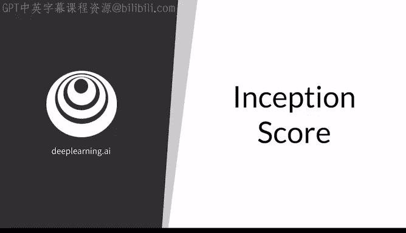
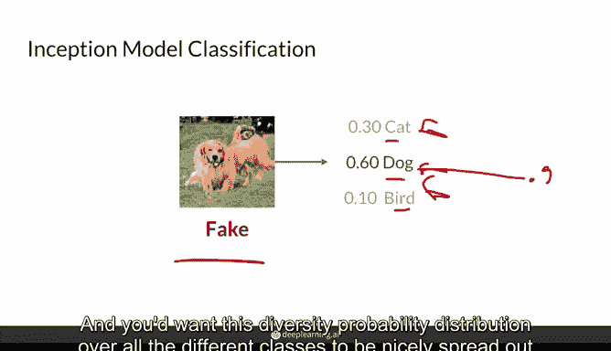
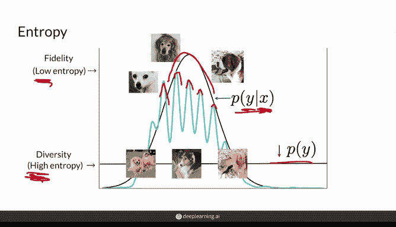
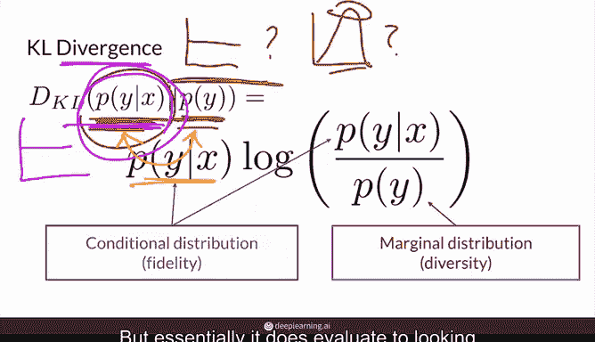
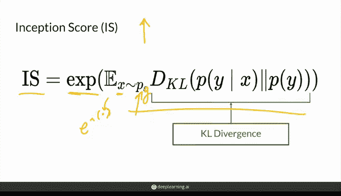
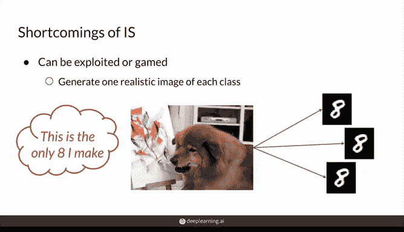
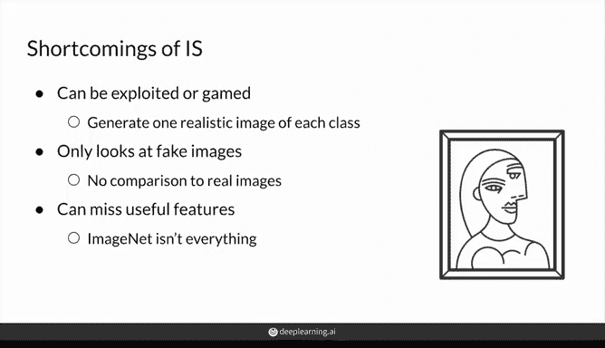
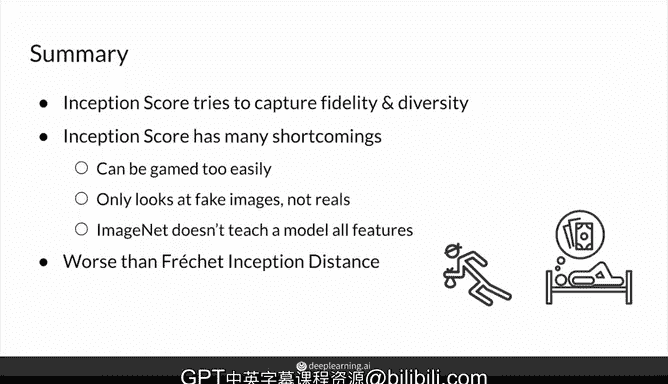

# 吴恩达《生成对抗网络（Generative Adversarial Networks，GAN）》中英字幕 - P42：08_01_10_起始分数.zh_en - GPT中英字幕课程资源 - BV1JC4y1T7vZ

In this video， you'll learn about another way to calculate the distance between reels and fakes using the Inception V3 model。

 This method was developed before FiID and used to be widely used。

 but now has been largely replaced by FiID and is by and large more relevant to conditional generation。

That said， the inception score， which is what it's called， is reported in many papers。

 so it's still good to know what it's measuring and how it differs from FID。

So remember the Inception V3 classifier pretrained on ImageNenet that was used for feature extraction。

 The Inception score also uses this model， however， unlike FID。

 you use the classifier as is not as a feature extractor。

 so you keep the classifier intact and don't use any of those intermediate outputs。So first。

 you input a generated image and see what the inception B3 classifier says is' classified as。

So for example， maybe this image looks like it's 0。6 dog， 0。3 cat and 0。1 bird。

 so intuitively a high value on one class， for example。

 a dog here with low values on the others suggests that this image clearly resembles one class over the others。

 that is it is arguably high fidelity。And you can observe this value for many samples to get a sense of how well overall the scan is able to produce clear objects based of course。

 on the classifier's judgment， and now so if this dog were point9， then this would be even better。

 it would have an even clear dog arguably。So now because you want your G to also produce diverse outputs。

 then looking across many samples， you would expect that many different classes would be generated。

 so you would expect across all your samples that were trained on all of these classes。

 perhaps that dog appears and cat appears and bird also appears and it's not just dog each time。

And so again， this can be observed by using this classifier to then see what this distribution is。

 and you'd want this diversity probability distribution over all the different classes to be nicely spread out and not spiky on a single class。

So more formally， the first measure which looks at the distribution of classes given in image is measuring the distribution P of y given x。

 where given your image X， what is the distribution over those classes given by the classifier？

So with images that have clear high fidelity generated objects。

 that distribution should have high peaks with high probability at a few select classes or even just a single class。

 And here maybe few select classes with overall very low probability on the remaining classes and what does is trying to approximateroxiator signal is that there are clear objects being picked out in the generated images by your classifier and this is known as having low entropy。

 because the probability distribution is clustered at those select points and not scattered all about entropy in a sense is randomness and this fidelity measurement corresponds to low entropy。

 Now on the diversity front， you want lots of classes to be generated across your many samples So the distribution of classes across your samples should be high entropy。

 meaning it's not concentrated on a particular or a couple particular classes。

 which would be if you put your thinking cap on reminiscent of mode collapse because that means you're only generating one type of thing and nothing else。

So this distribution is also known as the marginal label distribution or P of y。

 and this is the distribution over all of your labels。

 so all labels across your entire data are across a large sample。

 so this might be confusing because you have high down here and you have low up here。

 but just keep in mind that these two are supposed to be very different that is what's key here。

So with this notion of fidelity being low entropy and of diversity being high entropy。

 you could combine their measurements into a singleQL score。

 which is convenient because then you can score your model and say I'm getting better or I'm getting worse by getting a distance between that diversity。

 a high value minus the fidelity a low value。And the inception score specifically uses something called the KL divergence from P of y to p of y given x。

So KL Dirgence essentially tries to measure how much information you can get or gain on P of y given x。

 given just P of y so if you only have information on P of Y。

 and so let's say P of Y is really uniform on your different classes。

 it's just this uniform distribution。Then what would you guess for your P of y given x that would be very difficult。

 right， Meanwhile， if you're P of y really spiky， then what would you guess for your P of y given x。

 youd probably guess it was spiky around this area too。

And so if P of y essentially isn't very informative like in this high entropy case。

 because there's a lot of randomness and is all even across the classes。

 then you can't get much information on P of y given x， you have no idea what classes from。 However。

 if P of y is full of peaks or full of one peak right here。

 then you probably have a clue of what P of y given x might be a good guess at least probably that peak there。

 At the same time， if P of y given x is full of peaks。

 it's harder to guess at that exact distribution， than if you're just guessing it's even across all the classes。

 So it's easier to then guess for this guy that it is even across all the classes。

 So now that's some very basic intuition and no worries if you don't completely understand Kl divergence for the purposes of understanding inception score。

 you can think of Kl divergence here as approximately getting how different the conditional label distribution for fidelity is from the marginal label distribution for diversity。

 which is their relative entropy from one another。And there's a reason actually why it's not called KL distance because KL divergence isn't equal in the opposite direction。

 so with these two terms flipped， it's not actually an equal value。

 but it's a very close notion to distance。So as a result。

 you'd expect to see a high kL divergence when your distributions are far apart。

 which is what you want， you want one to be high， you want the other to be low。 In other words。

 basically when fake images each have a distinct label and there's also a diverse range of labels among those fakes。

And feel free to dive more into KL divergence outside of this course。

 it's a generally very useful concept for machine learning and is a core information theoreticalore component behind evaluating models against ground truth。

 but essentially it does evaluate to looking at the conditional distribution here and also marginal distribution here。

So the inception score then sums over all the images and averages over all the classes。

 so you see this P of Epsilon， perhaps better to say P of G is samples from your generator。

And then at the end， there is an exponent， so this is the same as doing E to this huge term up here。

And this exponent isn't really for calculating this value or important for KL divergence in any way。

 it's actually just to give a nice human readable score like 100 for inception score and not 0。

000001， which is not as useful and a very possible output of this inner term。So mathematically。

 the lowest possible value is zero and the highest is infinity， but during implementation。

 in this case， the lowest possible inception score of V1 and the highest or best possible score would be the number of classes present or 1000 in this case because the Inception V3 classifier was trained on IageNe with 1000 classes。

And now higher the score， the better here for inception score。

 and that means the entropy of the conditional probability distribution is low。

 finding relevant objects and features while the marginal probability distribution is high。

 finding a diverse set of features， so typically when this score is low or bad it's because both distributions either have low entropy having high peaks。

 so no diversity or both distributions have high entropy with no clear objects found。

However， as you might have guessed， there are a lot of shortcomings with using the inception score。

 So first， the metric is easy to exploit or game on the diversity front because if your G generates one single real image for each classifier class。

 so 1 thousand00 images for each of the imagenet classes， then it actually gets a perfect score。

 but ideally， your G can do better than generate one image for each class。

 I'd like two golden retrievers please。😊。

So this is definitely a form of mode collapse that can go undetected by Inception score。

Another big issue is that the inception score only looks at the generated samples。

 you might have noticed this that I'd never mentioned the real samples here。

 and it doesn't compare the generated samples to the real images。

 so these proxy statistics might be a bit far off and idealistic。

 and it's also dependent on the classifier's tasks and abilities。Finally。

 since the classifier is trained on ImNe， the values and scores might be very imprecise in a way that's similar to FIDs shortcoming。

 for example， what if the generated images have a lot of objects in it so you'd expect high entropy in the different classes in the classifier output such as a bedroom or office full of different items because it picks up on many different classes in that one image。

Or what if there are a lot of features that aren't detected by the classifier。

 because they are not relevant such as a generator that only generates profiles of faces when the classifier is trained for mostly dog breeds and other objects。

 or even a generator that generates human faces with features in the wrong place。

 but that looks real because components of the face are clearly found by your classifier。

So spatial relationships in particular compose a problem for the Inception score。

 and it only really makes sense when the training dataset is close to ImageNet and this is like FID shortcoming to。

Despite all this， inception score still remains as one of the most widely used metrics for GANs after FID and is relevant mainly to conditional GANs that expect clear classes。

So now you know how fidelity and diversity translate into low or high entropy and how to find the divergence of both to arrive at the inception score。

 this score had been pretty popular but has now largely been replaced by Frche Inception distance。

 but you'll see it in many， many different papers， so it's important that you know how it works。

