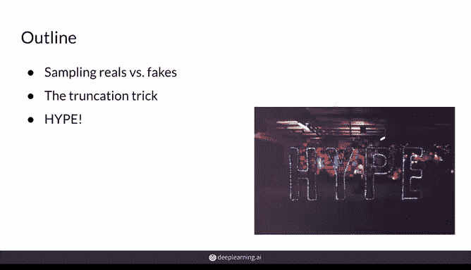
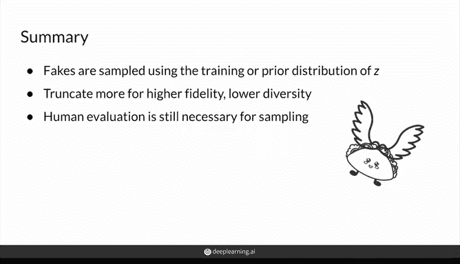

# 吴恩达《生成对抗网络（Generative Adversarial Networks，GAN）》中英字幕 - P43：09_01_12_采样与截断.zh_en - GPT中英字幕课程资源 - BV1JC4y1T7vZ

You now know about the main evaluation methods for GANS in this video。

 you'll learn about a few tricks。

In evaluating GANS， the statistics of both the real versus the fake dataset sets matter in terms of sampling。

 and you'll see how they differ and I'll discuss a trick you can do after training to shift towards either greater fidelity or diversity。

Also， get hyped because I'll be talking about the recently developed standard for human evaluation referred to as hype。

So in addition to sample sizes， how do you select which images the sample when evaluating with FID？

For reels， you can just sample randomly in a uniform way， but for fakes。

 what's typically done is to sample z values based on the training distribution of z values or the prior distribution of your noise vectors。

 P of Z。 Since you'll usually train yourgan with noise vectors using a normal prior。

 meaning a z that's selected from a normal distribution。

 like the one you see here where it's centered around a mu of0 and has a standard deviation of 1。

So vector values that are closer to this zero value will occur more than those further away during training and as a result。

 when you sample using those values close to zero， your resulting image would actually look pretty good。

 but that's only fidelity because this also will occur at a loss of diversity As you can see here these two dogs look pretty good。

 but they're less diverse， and then the ones out here might look a little bit more funky。

So you can adapt fidelity and diversity by choosing where to sample sampling in the middle will get you more normal looking things。

 so for better or worse， your sampling technique becomes actually an important aspect of evaluation and downstream use and because your evaluation metrics like FiID or inception score operate on the samples of your model not your model parameters。

 that means that evaluation on again is very much sample dependent， so this does matter。All right。

 so following the observation on fidelity versus diversity。

 there's a really neat sampling trick that's used called the truncation trick。

 and the truncation trick is exactly that a trick because it's done after the model has been trained and it broadly trades off fidelity and diversity。

What it actually does is truncate this normal distribution that you see in blue。

 which is where you sample your noise vector from during training into this red looking curve by chopping off the tail ends here。

 so this means that you will not sample at these values out here past this certain hyperparameter and this hyperparameter turns how much of your tail you'll keep so you can have one trunet up here。

 you can have one trunet out here so that you keep more of the curve。

And so if you wanted higher fidelity， which is roughly the quality and realism of your images。

 you want to sample around zero and truncate a larger part of your tails。However。

 this will decrease the amount of diversity in your generated images because this is where your funky flying tacos are generated and other weirder stuff that hadn't gotten much discriminator feedback during training。

 So if you want greater diversity， then you want to sample more from the tails of your distribution and have a lower truncation value。

 a truncation hyperparameter value。 however， the fidelity of these images will also be lower because your generator isn't accustomed to getting its weights to make that noise vector into a beautiful realistic image that is it didn't get nearly as much feedback on its realism on those noise vectors sampled from these regions during training。

Finally， you can definitely train your models on a different prior noise distribution from which you sample your noise vector such as the uniform distribution。

 where there is no concentration of possible values like up here。

 but the normal distribution is pretty popular in part because you can then use the truncation trick。

 which is shown here to tune for the exact fidelity and diversity tradeoff you want。

And there really hasn't been a stark difference when people have experimented with different prior noise distributions。

And as expected， a model's FID score will be higher。

 which means it's worse when there's a lack of diversity or fidelity。

 so the samples might not do well on FID when using the truncation trick。

 though using the truncation trick might conform to what you want in an application you're looking to apply your GNs to。

 so something downstream where you need higher fidelity images and you don't want the extra gunk。

So speaking of using those truncated samples because they seem better to the human eye instead of FID。

 using people to evaluate an eyeball samples is still a huge part of evaluation and often an important part of the process of developing a GN。

And what's cool is that there are methods that systematically evaluate the quality based on principled crowdsourcing and perception tasks。

 In fact， one of the recently developed standards for gafidelity is one that I had invented in 2019 with other researchers from Stanford。

 and its name is a bit cheeky called hype for human eye Perceptual evaluation of generative models。

And hyppe displays a series of images one by one to crowdsourcece evaluators on Amazon Meical TRC。

 it asks the evaluators to assess whether each image is real or fake。

 and what's cool is that one version of hype called hype time actually flashes images at you for different amounts of milliseconds to see at what threshold you can figure out an image is real or fake。

And the better your generative model is， the more time a human needs to decide whether that image is fake。

Hype infinity takes away that time threshold and actually is just looking through images。

 but of course， hype is predicated around having great quality control and being able to manage learning effects as an evaluator gets better and better at evaluating fake versus real images over time。

Despite all this， ultimately evaluation will depend on the downstream task you want， for example。

 if your G was to generate x-rays that had pneumonia in them。

 you want to make sure that your doctor would agree that there actually is pneumonia in there and maybe not an Amazon mechanical Tuer who doesn't have a doctor's degree or you probably don't want an image innet pretrain classifier to extract features and to tell you whether or not that's closer or not to a pneumonia X-ray image before you claim that your fake image is producing pneumonia on X-rays。

Alright， so now you know how fakes are sampled by using the prior distribution of Z during training During testing or inference time。

 you also have a new trick up your sleeve， the truncation trick。

 which allows you to truncate the tails of your sampling distribution a little more or a little less。

 depending on whether you're interested in higher fidelity or higher diversity。

As evident in these sampled images， automated evaluation metrics still don't capture exactly what we want。

 but are a good approximation and that's where human perceptual evaluation still sets the benchmark and gold standard。

 and is also a quick way to evaluate images。So thanks for spending this time learning with me and check back for just a little more about one extra and new evaluation method as you get ready to wrap up this week and get to your assignment。

