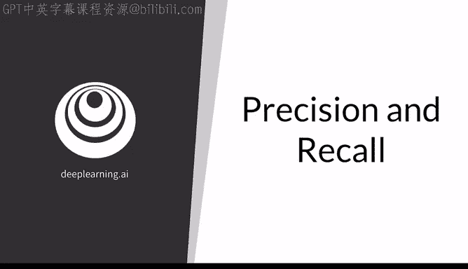
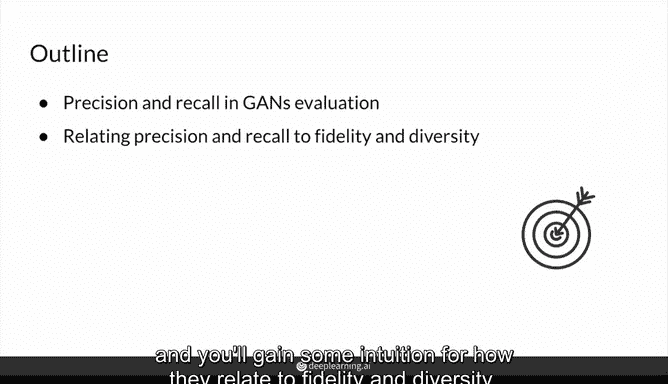
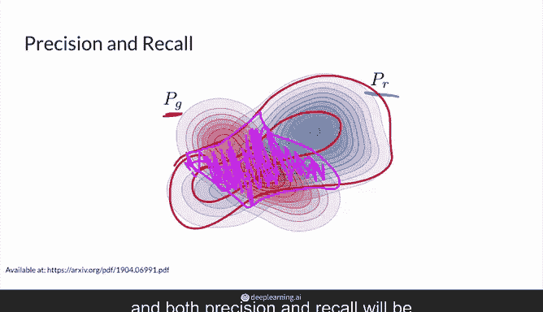
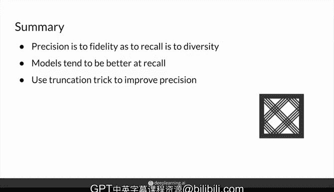

# 吴恩达《生成对抗网络（Generative Adversarial Networks，GAN）》中英字幕 - P44：10_01_14_精确率与召回率.zh_en - GPT中英字幕课程资源 - BV1JC4y1T7vZ

In the final part of this week's material， you'll learn about an evaluation concept you can use for GANS。

Specifically you'll learn about precision and recall in the context of GAN evaluation。

 though this will be applicable to all generative models and you'll gain some intuition for how they relate to fidelity and diversity。

So additional evaluation metrics have recently emerged and few of them use a notion of precision and recall that I find particularly noteworthy and interesting。

 especially to break down fidelity and diversity into more familiar machine learning topics。

 and if you happen to be familiar with the notion of precision recall and classifiers。

 this is a cool extension to generative models such as GANS。So imagine a space of all reels。

 the true distribution PR here， where P stands for the probability distribution R stands for reels。

And over here in red， PG is all of what the generator can generate the fake distribution。

And so the best thing that can happen for yourgan is for PG to completely overlap PR in every single way。

 where there's no Venn diagram business or a concentric circle。

 so you don't even want to be a subset of PR。 you want to be completely PR。

So essentially for your red PG， your generated distribution to be completely like PR。

 your real distribution。And so you might know that there is this important intersection area and both precision and recall will be considering this intersection area。

So first precision， focus on the points within the dotted line and all of these points are generated samples and the ones that are filled in are generated samples that overlap with the real distribution。

 the blue， and the ones that are not filled in are generated samples that don't overlap with the real distribution。

Precsion measures this intersection area， specifically the fake examples that intersect with the reels divided by this whole dotted line area of all the possible things a generator can generate。

So intuitively， this means the overlap where the generated images look pretty real because it's overlapping the real space divided by this entire space。

 which not only includes real stuff， but also includes some samples that look very much fake like this tennis ball dog。

 or I'm not even sure what that is some kind of horse thing， so just pure gunk。

And so you don't want this extra gunk so the more stuff you have out here。

 the worse your precision will be because your precision will be these overlap points divided by all fakes so your precision is essentially the fakes that look real over all of your fakes and you want your denominator to be as close as possible to that overlap so perfect precision means that everything you generate will look real。

 but that doesn't mean you cover this entire real thing you can be a subset in here。

And precision relates to fidelity because there's a notion of this extra fake stuff that's modeled but is unnecessary。

 So the better your precision is， the higher the quality of all your generated samples are。

 and the truncation trick can help with precision reducing your weird stuff。

 but it could also hurt recall too because it could shrink all this generated part into something much smaller。

And so on that topic of recall， recall on the other hand。

 is how much overlap there is divided by all of the real samples。

 so essentially the mirror of precision and that includes the stuff that the generator is missing and isn't able to model。

 so these points out here， which are real samples but perhaps the generator was not able to model them。

 and they look like pretty weird real samples too with this donkey looking in and this car full of waterme。

So it's basically a measure of how well the generator can model all the reels and it ignores all that extra gunk that we were seeing before。

 and that's not used in the measure of recall here So recall relates to diversity because you can see if the generator models all the variation in the reels or not。

And just to compare with precision， here it's overlap of realels， over all reels。

 So recall is trying to get a sense of how well the generator is able to model all possible real images。

And so models I've seen tend to be pretty good at recall。

 meaning somewhere at some value of Z of that noise vector。

 they can actually generate every single image in the real data set and perhaps more。

 and so the whole real distribution of all possible dogs or faces or whatever is trying to model that is in your real dataset at the very least。

But typically these models， especially when they're large。

 produce a lot of extra gunk in the parameters that didn't get a lot of feedback from the discriminator because there are just too many parameters in the model。

 so some parts of it will inevitably produce gunk because it's already been able to model all the reels and doesn't need a cut back so what that'll look like is P of G looking more like this being a superet of the reels。

So the state of the art models can often be bad at precision as opposed to recall and this is why the truncation tray can come in handy for downstream applications to weed out all that extra gunk。

 which is everything outside of the dotted line then。So in summary。

 you now know about precision and recall in the context of generative models。

 and you can now relate precision to fidelity and recall to diversity to some extent in your images。

Models still tend to be better at recall or modeling the distribution of real images because of the sheer number of parameters that are in our models now。

 but you can apply the truncation trick in your downstream applications to improve their precision as well to weed out that gunk。

So you're now at the end of this week's lecture material and ready to go on to the coding assignment。

 good work and go have fun figuring out which one of your GANs or GAN checkpoints is best hope to see you build the next state of the art。

