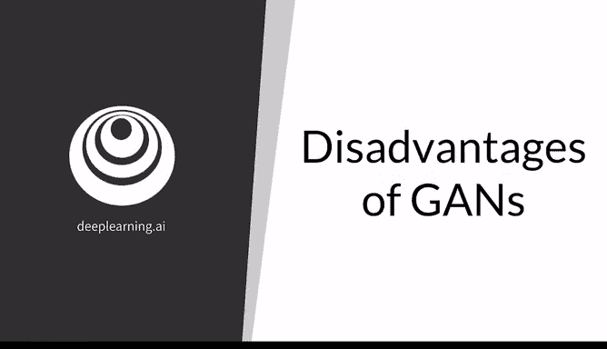
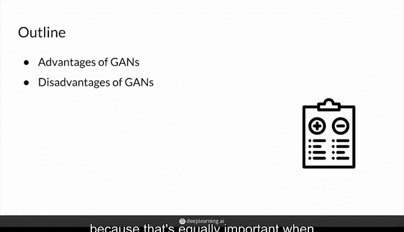
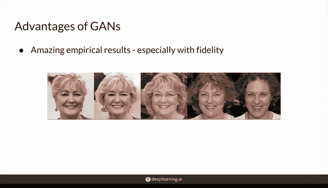
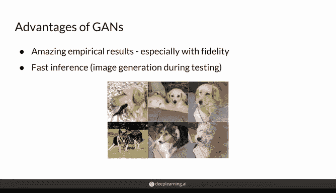
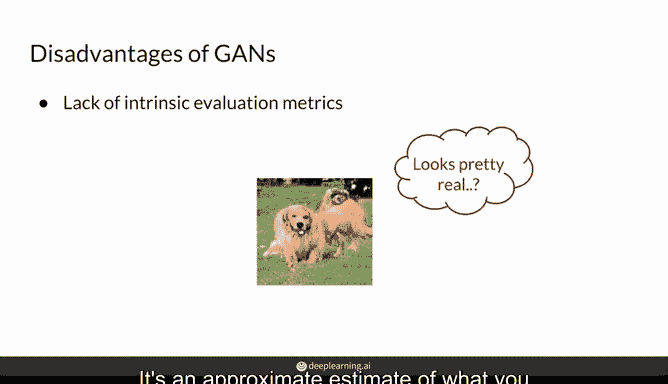
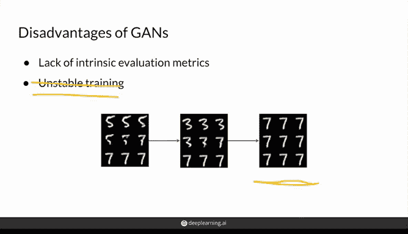
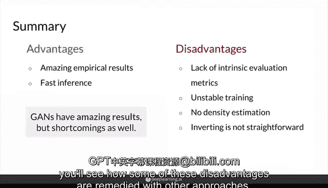

# 吴恩达《生成对抗网络（Generative Adversarial Networks，GAN）》中英字幕 - P46：12_02_02_GAN的缺点.zh_en - GPT中英字幕课程资源 - BV1JC4y1T7vZ

Previously， you learned about how GNs work， mainly focusing on the positives like their amazing empirical results。

Now you'll see some of the shortcomings of GANs as well because that's equally important when you learn about any new technique。

So remember that a significant advantage with GNs is that they can produce high quality realistic results to the human eye like yours and mine。

 you could be fooled into believing these people actually exist， that these are all generated。

Another pro is that once you have a trained model， you can generate objects fairly quickly。

 You might recall seeing this in your assignments。 All you need to do is load the weights of the model and then pass in some noise。

However， GNs also have their disadvantages First they lack concrete theoretically grounded intrinsic evaluation metrics。

 how do you measure their performance， You can't just look at the model weights or outputs and easily say aha。

 this is the best model， this model is better than that one。

In order to evaluate your G， you might remember that you usually need to inspect the features across many generated samples and compare them to those of the real images。

And even that technique isn't that reliable， it's an approximate estimate of what you would ideally want for your evaluation。

Another downside is that during training， the model can be unstable and take a considerable amount of time to train。

 Sometimes it feels like more of an art than a science because gradient descent doesn't always get you a generator you need。

 For example， like mode collapses you hear of producing all sevens when the generator gets stuck。

 And you can't just keep training and expect that your G will converge。

 You need to babysit it and check in a lot to see when to stop training。

 And you need to visually inspect those samples qualitatively。But at the same time。

 you've also seen this problem being remedied with W loss a bit and one lipst continuity。

 So while this is an issue， it's not necessarily a huge one anymore。

 So maybe we can cross it out like that， though it definitely was a disadvantage of Gs in their early days。

 depending on what you want to use your generative model for GNs might not be the right type of model。

 If you want explicitly get the probability density over your modeled features。

 And what that means is the likelihood of， say， a particular image here。

 How likely are these features to present themselves。

And this might be useful if you want to say do anomaly detection by seeing what an unlikely dog would look like versus a likely dog。

 so perhaps this is not likely or it could detect cat dogs that are very， very unlikely out there。

And this is known as density estimation because it's estimating this probability density of all these features。

And density estimation is useful to know how often this golden fur or floppy ears， for example。

 typically make up a dog， and that can then feed into downstream tasks like finding anomalies out where there's low probability for certain features。

But over lots of samples， you could of course， get some kind of approximation for your G。And lastly。

 the generator is not trained to be invertible and what that means is that you can take an image such as this one and be able to figure out what noise vector it maps onto。

 so the opposite task， so instead of the usual task of inputting a noise vector and then outputting an image now you want to feed in an image to figure out what its associative noise vector is。

There have been new methods that have emerged to remedy this problem of invertability。

 typically with another model that does the opposite of the GN。

And there are alsoganNs that are designed to learn both directions at once。

 onegan going in one direction， the other one going in the other。

And you might be wondering why inversion could be useful。

 An inversion can be particularly convenient for image editing because that means you can apply your controllable generation skills to that noise vector that you find for any image。

 And if this could be a real image， it doesn't have to be generated already to find that noise vector。

 And then you tweak that noise vector using those controllable generation skills that you have now so that this image could be。

 for example， a younger， older or have blue hair。 So wouldn't that be nice。Alright， so in summary。

 GANs have incredibly high quality results and relatively fast generation from a train model。

 However， they lack intrinsic evaluation metrics have unstable training。

 though that's been fairly remedied， no formal density estimation that's inherent to the model and it can be challenging to invert an image to its latent space representation。

 especially if the model is very large and it's hard to find where that latent might be。

But it is important， I think， to emphasize the significance of having high fidelity results GANs are arguably the best and arguably the first AI model to achieve such realistic outputs and very consistently too。

 and so GANs are often used elsewhere just to enhance the output's realism。

 so that's really critical to know and that's where GNs can be applied in so many different areas。

In the next video， you'll see how some of these disadvantages are remedied with other approaches。

