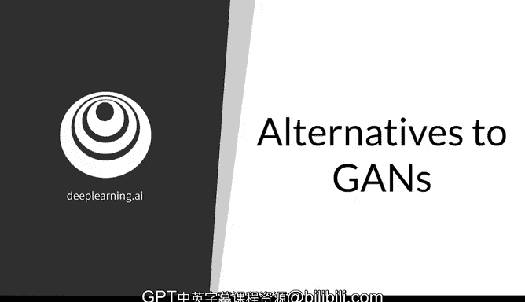
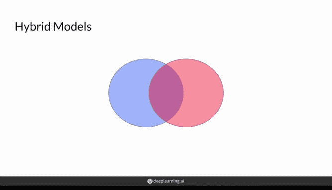
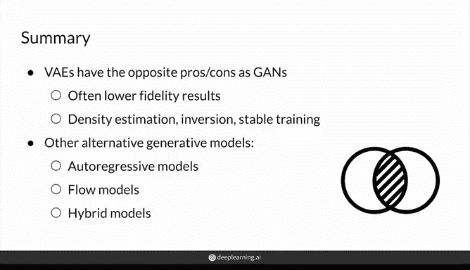

# 吴恩达《生成对抗网络（Generative Adversarial Networks，GAN）》中英字幕 - P47：13_02_03_GAN的替代方案.zh_en - GPT中英字幕课程资源 - BV1JC4y1T7vZ

In this video， you'll learn about some alternatives to GANS。

In the previous video you saw some of the disadvantages to using GNs in this one you'll see how other generative models address these downsides but have different tradeoffs of their ownSpecifically I'll discuss another popular model called VAE that you might already be a little bit familiar with from previous weeks and then other less popular but still very cool alternatives。

A generator model can be any machine learning model that tries to model this P of x， given y。

Or if it's really just modeling that one class， it's probably P of x of that data。

 and often it'll take in some kind of noise for that stochasticity so that you don't generate the same thing each time。

 and that just means variation in its outputs and a class to then output features or objects that represent that class X。

Generative models include much more than just scans。 so let's dive right in。

Variational autoenderrs or VaEes is another large family of generative models。

 And as a reminder from week1 of this specialization。

 VaEes work with two different models in encoder in a decoder。

 and it learns by feeding real images into that encoder。

 finding a good way of representing that image in this latent space， perhaps here。

 and then taking that lane representation or representation close to it and reconstructing the realistic image the encoder saw before with this decoder。

And what I just described is largely the autoender part of VAE。

 and the variational part is a little bit more complex。

 but it enables training the model in a way to maximize the likelihood of generating the real data or images like the real data that go into the encoder here。

And so at a high level， VAes try to minimize the divergence between the generated and the real distributions。

 and this is often regarded as a slightly easier optimization， resulting in stabler training。

 and this is also contented a blurriier results or lower fidelity results。

 And after you train the VAE， you actually lo off the encoder just like you don't need the discriminator and you use the decoder similar to the generator。

 you sample points from your latent space and you're able to generate an output image。

So if you remember the pros and cons of GNs， VAEs are more or less flipped。

 so VAEs typically have been seen as producing lower quality results than GANs。

 or at least werere not the first in producing realistic results。

 they were definitely behind GANs and required a little bit more engineering and changes。

But they have density estimation。 They can invert easily because they have that encoder to try to find that latent space representation。

 And it might not be a perfect inversion， which means it's exactly one to one。

 but it is something that'll get you a decent noise factor。

 And training is also more stable and reliable， though arguably， it's fairly slow。

But the GNs camp will say， well， all that is great。

 but that's no use if you can't generate good samples， which is here done done done。As a result。

 a lot of work has been put in to make their results better。

 and so here's an example of a very recent VAE called VQ VAAE2 on the left。And biggan on the right。

 And you can see the quality of biggan is slightly higher。

 but Vaes are beginning to have better results as well， particularly in diversity here。

 as you see in this generated fish。Also this VAE Eque model， the VQ VAE2。

 borrows many concepts from VAEs， but it actually isn't considered a pure VAE solution。

 in fact it relies on an autoregressive network component too， and what an autoregressive model is。

 it's a model that looks at previous pixels to determine the next pixel。

So maybe it sees a few pixels here and then it's able to determine the rest of the pixels for that image。

 and this is another type of generative model and it goes pixel by pixel based on the previous pixel。

 and so you can think of it as its conditioning on the previous pixels for what's the next pixel。

And it can't see into future pixels， So it can't see into future pixels。

 It can only look at past pixels。 If you're familiar with R andNs or language and speech models。

 it's very similar to that concept as well， where you can't see into the future。

And as you can probably tell， this model is not fully unsupervised because it depends on those previous pixels。

 so it is a supervised technique， meaning it'll require anchor pixels to start generating。

 can't generate from noise。Another type of generated model is a flow model。

 and these are hard and long to train， but it's been a very cool new idea that's based on likelihood to find in invertible mapping between the noise and the generated image。

And so obviously it'll be inverible and at a high level what it's doing is from an initial simple distribution。

 it finds sequences of invertible transformations to create more complex distributions。

So assume that this starts with something very simple。

 it has these invertible mappings that are represented by these arrows。

 it gets more complex distributions and ultimately it's able to model faces。

 and this is an example flow model called G。Finally。

 you can also combine any of these models or ideas to form hybrid architectures to try to reap the benefits of two or more worlds。

 and that's just like the VAE autoregressive model that you saw previously called VQ VAE2。

 and there are also plenty of GAN VAE models that apply concepts from both。

You'll see some advanced ones mentioned in Co  three as well。

So in summary， VAEs have more or less the opposite pro cons list as GANS。

 notably the results are generally blurrier， though that's arguable。

 but it can estimate density invert easily and has stable training。However。

 GANS have improved on these disadvantages in many ways as training has stabilized greatly and approximate version。

 which is what you need for editing an image， has been reduced to an engineering problem of finding your Z vector through another model。

BAEs have also come a long way to getting better results。

 so all in all when it comes to applications， I'd say GANs are still more useful when realistic generation is the main goal。

As you saw in this video， other alternative generative models include the autoaggressive model。

 flow models， and also hybrid models of all of these。

So now that you've learned about other generative models。

 you'll explore some issues present across all the machine learning that GNs and these other models certainly are not immune to。

