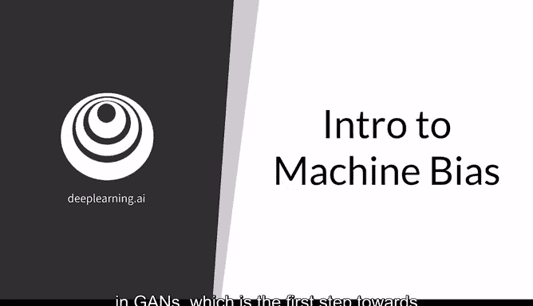
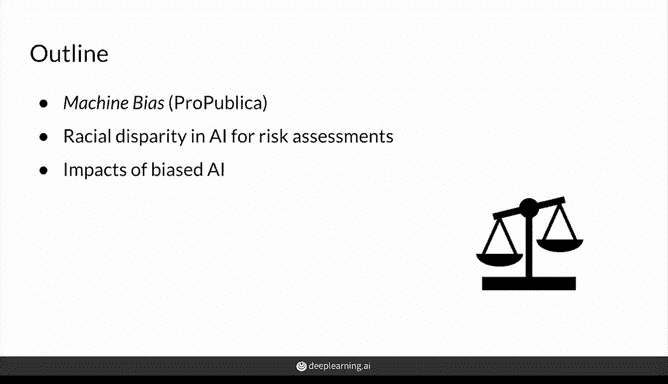
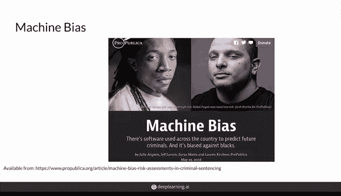
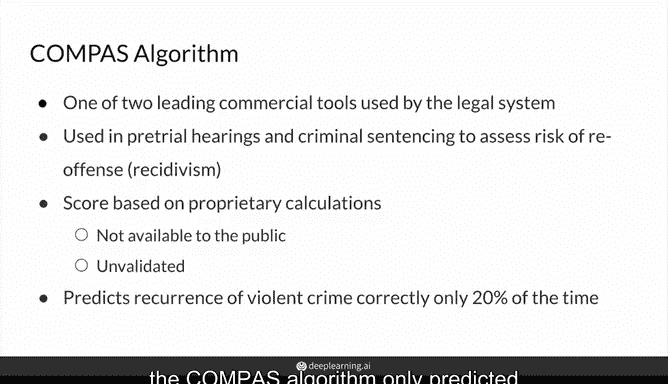
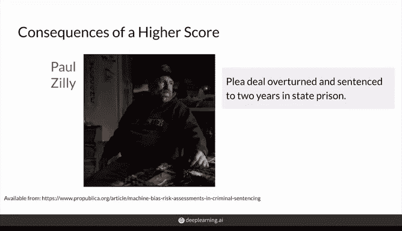
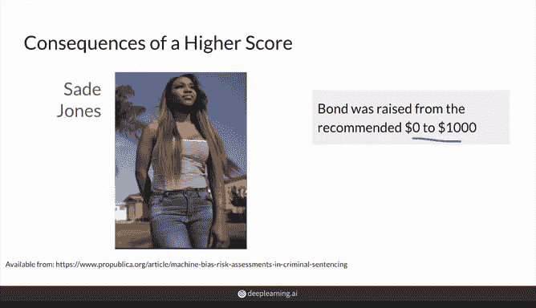
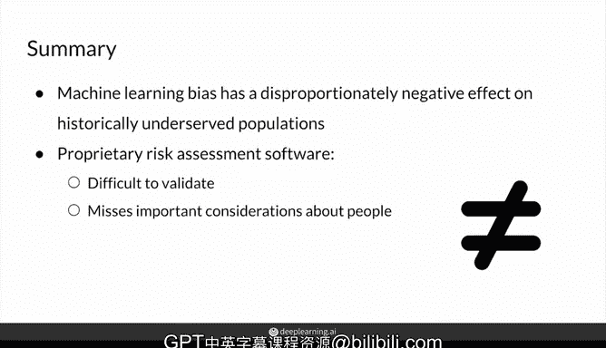

# 吴恩达《生成对抗网络（Generative Adversarial Networks，GAN）》中英字幕 - P48：14_02_06_机器学习偏差简介.zh_en - GPT中英字幕课程资源 - BV1JC4y1T7vZ

In the following video I'll take a step back from GANS and discuss bias。

 an issue that's seen around the world and seeps into many aspects of life to which machine learning and GANs are no exception。

 The purpose of these videos is to bring awareness to bias in machine learning and more specifically in GANs。

 which is the first step towards eliminating bias in your models。

So you get a brief introduction to the Mach bias article in the journal Propublica。

 and a discussion of how racial disparity was found in proprietary software that's used across the country in criminal sentencing and the impact that this has。

So first off， I'll go over the main points from the pro plica news article called Maine biasas。

In the United States criminalmin justice system， courts are increasingly relying on risk assessments or the likelihood youre going to commit a crime in the future。

 and many risk score calculations are now computerized and they're starting to rely on machine learning more and more。

Pro plicica used a public records request to assess one of the two leading commercial models for its machine bias series。

 and this algorithm is called Compass。 And the purpose of compass was to make pretrial sentencing less biased。

 So its purpose was to reduce bias。 But Pro plica's findings suggest that the algorithm itself is actually significantly biased。

 One important thing to note about compass is that the calculations used for the scores are considered proprietary。

 and the company doesn't share exactly what they are。

So the calculations are broadly based on a questionnaire filled out by defendants。

 as well as on their criminal records。There's no question about race there。

 but it asks questions like was one of your parents ever sent to jail and is it wrong for a hungry person to steal。

 so getting a little bit philosophical maybe moral。

And then judges can then increase or decrease that sentence length based on their evaluation of the risk score。

And so yes， these questions do not question race at all。

 but we'll see how some of these proxy questions might be trying to get at that or might be biased due to the type of question asked。

Unfortunately， the compass algorithm only predicted recurrence of violent crime correctly about 20% of the time。

 and pro Publicica found that models predicted black defendants were 77% more likely and more at risk for committing a future violent crime in 45% more likely for any kind of future crime。

 And you can see in the graph， that wild account of white defendants and high risk scores decreased together。

This graph for black defendants shows that the likelihood remains the same。

And this starts to suggest that the scores for white defendants were skewed towards these lower risk categories。

 while the scores for black defendants were not。So as one example， Gregory Lugo， who is a white man。

 versus Mallory Williams， who is a black woman， were both arrested for Dis。

 but had different profiles on their prior offenses。

 So Lugo was actually on his fourth serious offense with three Dis prior to this。

 as well as a battery。 And Williams was actually on her first serious offense with only two misdemeanors beforehand。

 which is less than a Di。So even though Williams's history when it comes to criminal behavior was much less severe than Lugos。

 her risk assessment score was actually much higher， a six as opposed to a one here。

So what kind of effects can these risk assessment scores have on individuals Paul Zillly。

 who's a recovering addict that relapse and stole a lawnmower， had his plea deal overturned。

 which was agreed upon from both parties， the prosecutor and the defendant his sentence increased from a year in county jail to two years in state prison after the judge saw his high risk score。

But after an appeal， his sentence was then reduced from two years to 18 months。

 and the appeals judge had stated that without compass。

 Sil would have been given one year or six months instead。

 Me that this risk score actually made it so that he would go to jail for much longer。

On the other hand， Sage Jones， who was 18 at the time of her arrest， with no previous record。

 had been given a medium risk score after taking an unlocked bicycle。

 and her bond was raised from the recommended $0 to $1000。

And still now she struggles to find a job due to the misdemeanor on her record。

So these are some of the consequences of what a higher risk score does。

 even though the person may not have necessarily done bad things afterwards。

 and it's largely just based on what the model has predicted。

 and if the model has predicted in a skewed way in a biased way， then that might not be very fair。

The researchers also found that the model correctly predicted repeat offenders only 61% of the time across all areas。

 risk of recidivism， risk of violent crime， and risk of failure to appear。

The accuracy was only 20% for violent crime alone， however。

 and the issues such to arise because the errors were different for those who are white versus those who are black。

 So for the false positives， almost 45% of African Americans who were labeled to be at high risk of committing a future offenseence didn't actually commit one。

 And that's compared to 23。5% of white Americans。 And then for the false negatives， I。e。

 those who were labeled low risk but actually did reoffend So the ones we should have caught28% of African Americans and 48% of white Americans。

 So it's noticeable， something is broken with the fairness of this model in the evaluation method once these details were uncovered。

So in summary， models that were created to reduce bias in the criminal justice system by predicting who is and who isn't likely to reoffend actually seem to only reflect our own biases back at us and reinforce the difficulty of reentry for populations that are historically underserved and discriminated against。

Proprietary risk assessment software created by forpro companies only make understanding and improving these systems more difficult because their calculations aren't disclosed and often any investigations into their accuracy are done by the same people who built the software actually。

Something else to consider is that these models don't view people holistically。

 like people's sincere efforts to rehabilitate themselves or the effect a longer sentence could have on their ability to take care of their families。

 so a really important question to ask yourself is who are these models really serving today？

