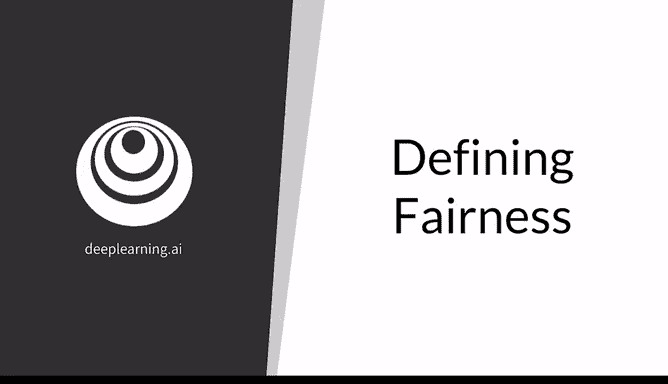
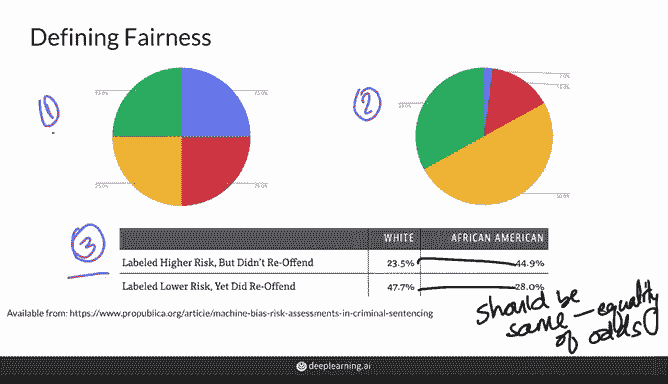
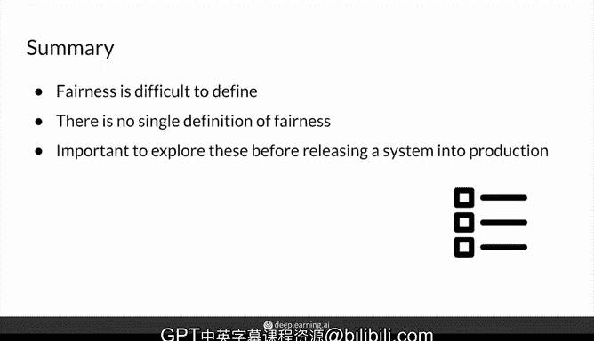

# 吴恩达《生成对抗网络（Generative Adversarial Networks，GAN）》中英字幕 - P49：15_02_09_定义公平性.zh_en - GPT中英字幕课程资源 - BV1JC4y1T7vZ

Continuing the discussion on bias， how do you decide if a model isqu fair。

 It seemed obvious with a compass model， but how do you concretely measure if a model is fair in this video。

 I'll give you some food for thought on what fairness is。 It may seem simple at first glance。

 but there are many definitions of fairness。 In fact。

 different research papers rely on different definitions。

As you saw in this week's readings， fairness is a complex ideal to define。

 and different research papers， as shown here， rely on different definitions of what is fair。

 These are all different definitions of fairness and there are certainly more。

 So what are some ways you can define fair。It could be defined as having equalized odds that the outcome is independent of a sensitive attribute。

 such as ethnicity。 This is also known as demographic parity。 where you see。

 based on some kind of sensitive attribute， the outcome should be exactly equal。

 conditioned on that attribute。 So the overall distribution of these predictions made by a predictors such as your machine learning model will be the same for different values of a predicted class。

You could also define it as having an outcome that is representative of the test set demographics。

 so for example， in the US that means having a GAN generate an Asian American face 6% of the time。

 which corresponds to the approximate proportion of the US population that is Asian American。

Or what about having false positive rates or false negative rates be equal for different attributes。

 an issue that you saw with a risk assessment model in the previous video， all us being equal。

 the probability that you predict correctly or incorrectly is the same for different values of a protected class。

 also known as equality of odds。So as you can see here with one。2。

Three different definitions of fairness， there clearly is no single definition for fairness。

 and this is just three very basic definitions， there are certainly far more。

 but even though there isn't a single definition of fairness。

 youth can still observe the lack of fairness across the board on any of these definitions and across nearly every model。

So in summary， fairness is difficult to define and there's no single definition of it and that's why it's important to explore and understand these definitions before releasing a system into production。

