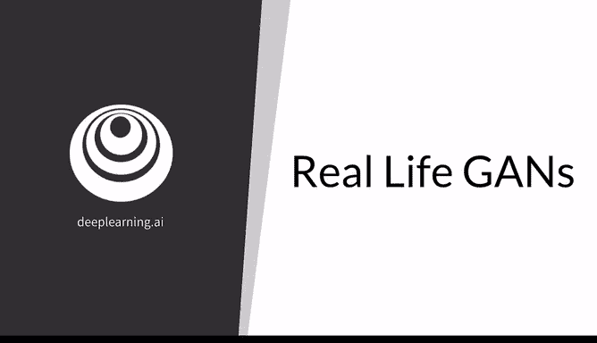
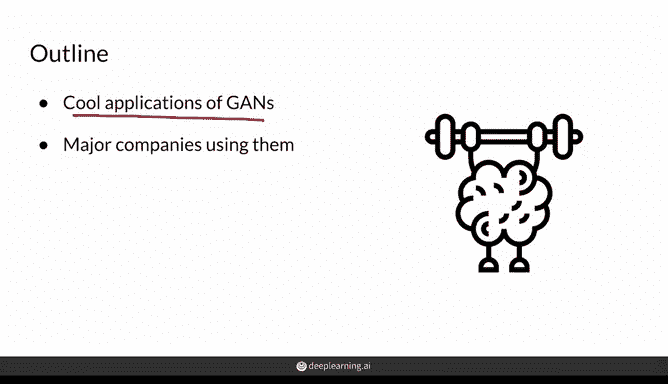
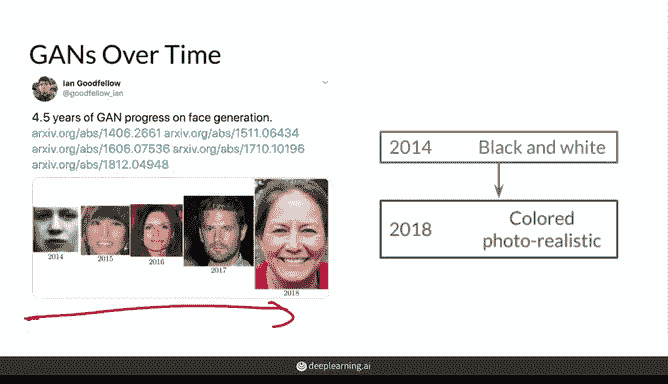
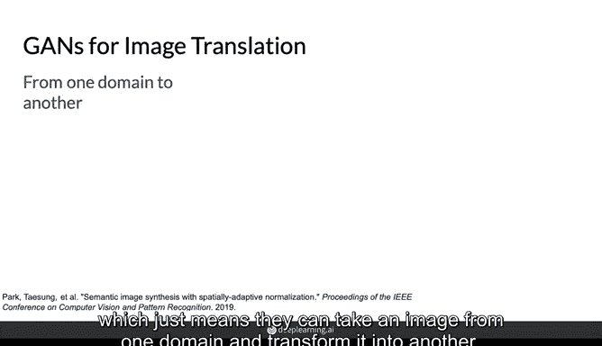
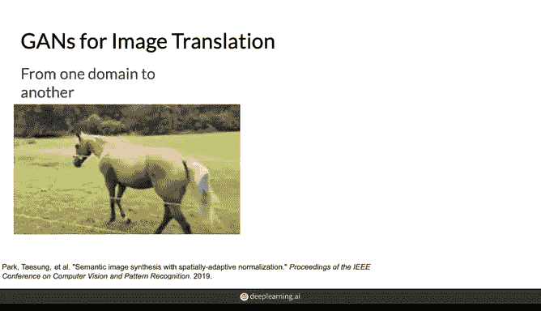
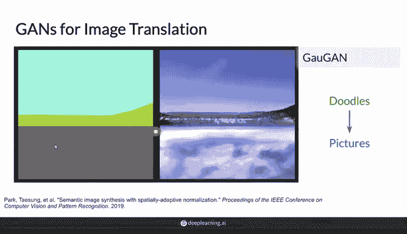
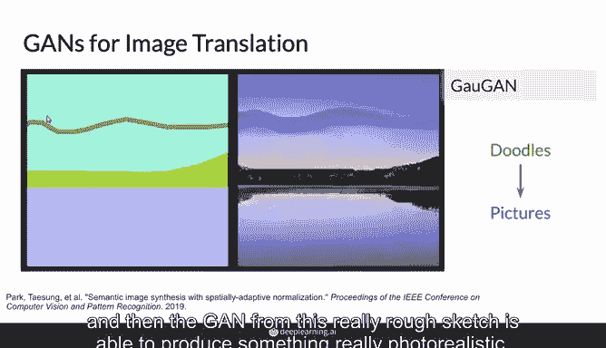
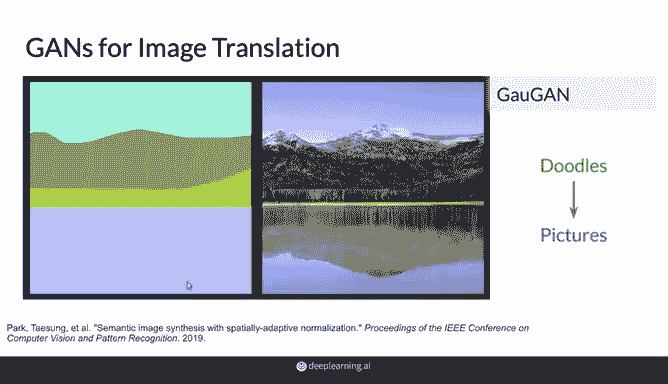
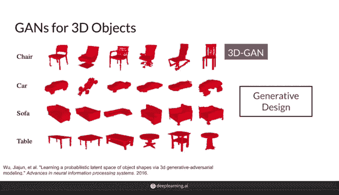
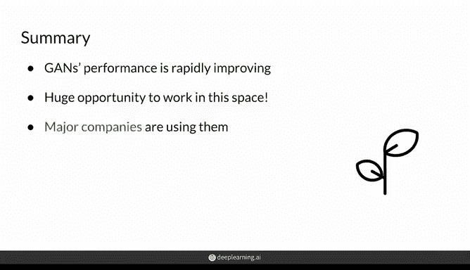

# 吴恩达《生成对抗网络（Generative Adversarial Networks，GAN）》中英字幕 - P4：04_01_06_现实生活中的GANs.zh_en - GPT中英字幕课程资源 - BV1JC4y1T7vZ

Even though they've only been around since 2014， GANS have already achieved super impressive performance across a multitude of tasks。

 and if you haven't seen some of their results， you're in for a treat。

So in this video I'll show you some cool applications of GANs like the generation of realistic human faces and the animation of famous artworks。

 then you'll get to see some of the amazing projects major companies are using them for。

This tweet is from Ian Goodfellow， who is widely regarded as the creator of GANs。

 and it shows a striking visualization of the rate at which GANs have improved over the years。

You can see how GNs have progressed from black and white and rather inhuman looking faces in 2014 to much higher quality colored photorealistic faces in 2018。

 and they've been getting actually even better up until this day。So case in point。

 progress has only increased since then in early 2020。

 NVDdia released Agana could generate images like these。

 which are so high resolution and look like professional photographs。

 and they have a soft background effect in everything。

So it's easy to think that these people are real， but they actually don't exist amazing， isn't it？

Gans can learn from whatever training data they're given。

 so they're not limited to reproducing human faces。 and here's the model， the same one from before。

 but this time producing cats。And so if you look closely。

 you can see some really weird looking images because not every generated example is perfect in this case。

There's some semblance of a cat going on here， but of course I have no idea what that is。

And also something that's pretty cool is that you can actually observe images with text on them and this happens because as mentioned before。

 generative models tried to mimic the distribution of the data you're using to train them on In this case。

 the training data was scraped from the web of all of these cats in this includes a lot of cat memes with meme text on them。

😊，What's funny， of course， is that this meme text on the generated cat memes don't actually make up words because the geneative model is not trying to model words。

 but rather the visual realistic effect。And that being said。

 some of these are actually pretty cute and realistic。

 even though they might not be ready for Reddit just yet。Gans can also perform image translation。

 which just means they can take an image from one domain and transform it into another。 For instance。

 they can transform an image of a horse into a zebra and vice versa。 What's really。

 really interesting is that you don't actually need examples of a zebra and a horse doing the same things and instead just transfer that style over。

In the same way， GNs can help you draw this model can take a rough drawing of a landscape and make it photorealistic so you can have brushstrs here on the left。

 and this is a person putting really rough brushstrs together of different classes such as a cloud or a mountain or a lake and then the G from this really rough sketch is able to produce something really photorealistic。

So in this drift， a person is able to make rough sketches with just a few lines in color。

 and then the G can transform them into realistic pictures。Gam can also take a still life portrait。

 for example， the Mona Lisa and animate it using the motion of any real person's face。

 so they don't even have to look like the Mola Lisaa to play the part。

And if you're reminded of the talking portraits at Harwarts， you're not alone， in a sense。

 Gs are magic。In GN don't stop at 2D images， they can also generate 3D objects like chairs and tables and these can be applied to fields like generative design where you can create cool furniture for your house there are also diverse applications in medicine where you can use your G for generating artificial medical data or even detecting abnormalities and x-rays you'll get to see more on this in course 3 but showing all the cool applications out there could take hours。

Several prominent companies have also started using generative adversarial networks for a variety of applications。

 for instance， Adobe is thinking about the next generation of Photoshop where novice artists can perform at an expert level。

 for example， with those doodles。Google is using them for text generation largely。

 but also with images。 IBM is using GNs for data augmentation。

 so using a GAN to generate synthetic examples to augment the data set for a classifier downstream。

 For example， if you don't have enough data of a certain class or of a certain type of image。

Snapchat and TikTok put them to work in creative new filters， which you've probably seen and used。

 and even Disney is using them for super resolutionol。So at the end of this specialization。

 you'll be able to use GANs as well for whatever application you like。Al right， so in summary。

 you saw the rapid advancements that GANS have achieved in the last few years。

 and while I showed you several really cool applications and mentioned the way that some major companies are using GANs。

 there are many more things to do with GANs and many potential directions you could take for using these models。

