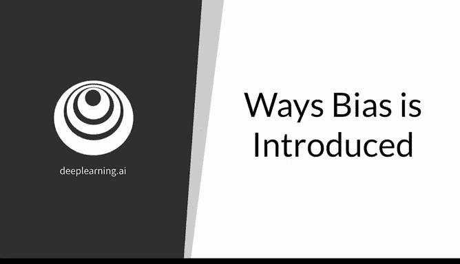
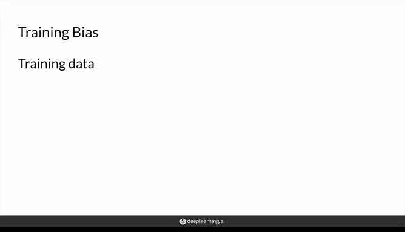
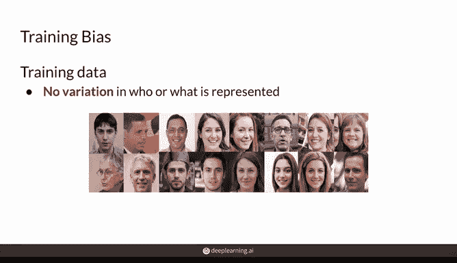
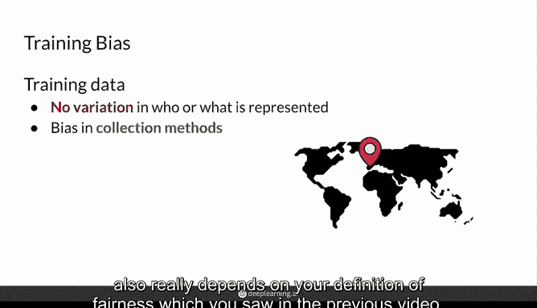
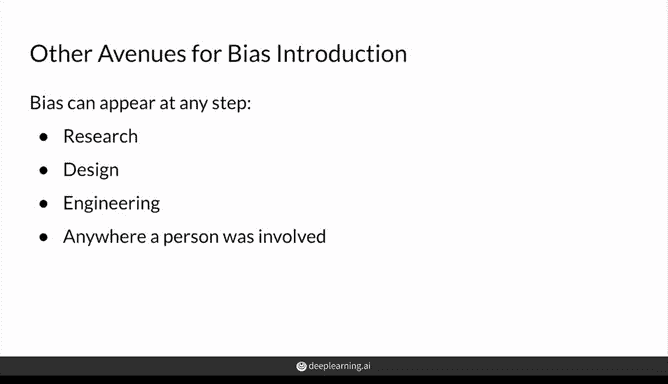
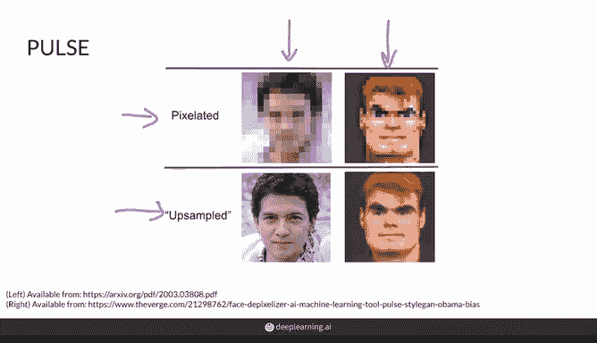
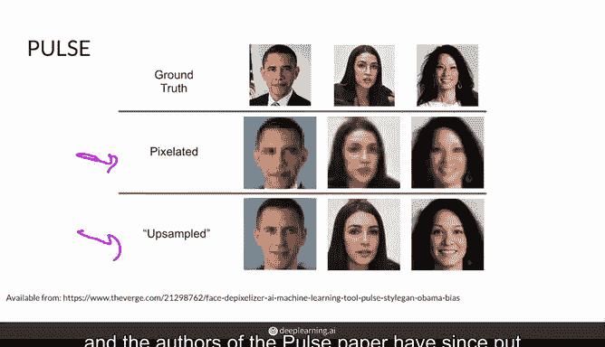
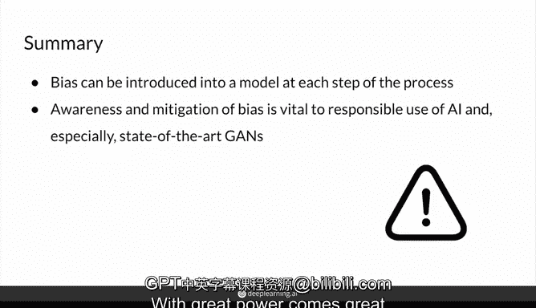

# 吴恩达《生成对抗网络（Generative Adversarial Networks，GAN）》中英字幕 - P50：16_02_11_偏差引入方式.zh_en - GPT中英字幕课程资源 - BV1JC4y1T7vZ

Now that you've been introduced to bias in machine learning。

 you'll learn about some ways bias can enter a model。I'll introduce you to a few of them。

 but it's important to know that there are other avenues as well。

 some that haven't even been realized yet。

So first you'll learn about some of the ways buys can enter your model during any of its stages。

 and then more specifically what that looks like in a system called Pse。

So one way bias can enter your model is during the training phase。

 so first you should pay attention to your training data。

 and this could mean there could be no variation in the data or the data might express biases that come from how they were collected。

Are there disproportionately fewer images of people of color。

 sometimes this can be hardspot if you're just scraping images off the internet， for example。

 scraping images of celebrities。

And you also need to consider how your data was collected Was the data all collected from one location。

 one web scrape， Was it collected by a single person or a single demographic of people。

 remember that whatever is considered a quote unquote diverse data also really depends on your definition of fairness。

 which you saw in the previous video。

If you're using label data， then the diversity of the labelers impact your data as well。

 And this is because different demographics might label things differently。

 and that might cause inherent biases to arise in your data。 For example。

 were labelers mostly men labeling resumes of people as worthy of an interview for a software engineering role or not。

These are just a few considerations you should make when you're preparing your model's training data。

Basees that exist in broader society can also shape all portions of your model Another area it can be introduced is during your evaluation。

 such as who created the evaluation method you're using。

 evaluation methods could be biased towards images that are often regarded as quote unquote good or correct in that society or in one culture。

 but not in another。A simple example is whether cars are driven on the left or right side of the road。

 If they are commonly driven on a certain side， then the evaluation may reflect that and poorly evaluate or score ones that have the wheel on the wrong side。

This would solely be dependent on local driving laws。

Another more concrete example pertains to ImageNet。

 the dataset set used to train the Inception V3 model， which FID uses to evaluate GANS。

 as well as other evaluation metrics。More than half of the images in IageNe come from the US and Great Britain。

Compared to the population densities of the world， this is not really representative of where most people are from。

And that imbalance leads systems to inaccurately classify images into categories that differ by geography。

 would a rice hat be classified as hair or a poncho as a scarf？

The way evaluation calculations are computed can reinforce biases within the model you develop and can make you think a model is great at a certain task when it actually isn't able to perform that task。

For example， researchers actually took items from inside household that had varying income levels。

 then they evaluated the accuracy of the top object recognition models on these products。

 The result was that the images taken from higher income families had higher accuracy on these models。

So what's not great about this is that the people who developed these models might have concluded that they had great models for seeing the world。

 visual perception that is human level and saying that visual perception is solved when really it's only reached a high accuracy level for objects of a particular socioeconomic status。

 and that's not the perception I would envision for a great model。

So now bias can be introduced through the architecture as well。

 What was the diversity of programmers who optimized the code。

 What were their views on what is quote unquote right or quote unquote wrongg and what looks good or bad can impact the images generated After all。

 especially in generative models where the evaluation metrics aren't great。

 it's even more important to lend a critical eye to how various problems are chosen in this field because once you choose important problems。

 people will optimize solutions to those definitions of right of wrong。

 of good of bad and that will angle certain directions of research and how they're chosen as well。

So as an example， the loss function used can skew what a model thinks is correct。

 for G generating faces， this could be the difference between having a more light colored or more dark colored skin。

And these are just some examples， bias can appear anywhere a person might have designed。

 engineered or touched the system since everyone's biases whether they're conscious of it or not。

Here's an example of bias in a G。 a system called P uses a state of the agan called St G to create a high resolution image from a pixelated blurry image。

 a process known as upsembling。So it does a pretty nicely executed upsampling here from these pixelated images as input and then these upsampled images as output。

 and this is probably the best the research community has ever seen here in 2020 so you see a boy being upsampled really nicely here and then you get to see a cool application of a video game character being brought to life here。

However， that's not all， an example of a pixelated Obama photo who is biracial is upsled to a distinctly white man。

In addition， politician Alexandria， Akaazia Cortez and actress Lucy Lou are also transformed into unrecognizable versions of themselves that are arguably more quote unquote。

 wh in ethnicity， more closely resembling the average face from the style game generator in what it was trained on。

Performing better on a video game character who is white than these people of color is a fairly strong indication there is a problem with bias in the model。

But it's hard to say where the system failed， is it stylegan or is it the system that was built on top of style G。

 pulse， or was it the data set that style G was trained on？

There's been research to mitigate bias in GNs such as using an adversarial loss to punish models for being biased。

It's complicated and an important area of work， so I really encourage you to go check that out。

As of now， these types of issues are starting to become more spotlighted in the machine learning community。

 and the authors of the Pulse paper have since put out a statement of caution with applying their model。

So in summary， bias can be introduced into a model from multiple different avenues and it's a very real problem as seen with P and also with compass from a past video。

I hope this will remind you to try to be mindful of bias in your own models and even find ways to combat that in your day to day of learning。

 applying and advancing machine learning The machine learning in GAN worlds need researchers and practitioners to be thinking about this alongside their work。

So now equipped with this important knowledge， I hope you can now responsibly work with say of the Agans。

 which will seep into products and influence people's lives。

With great power comes great responsibility， so wields your power well。

