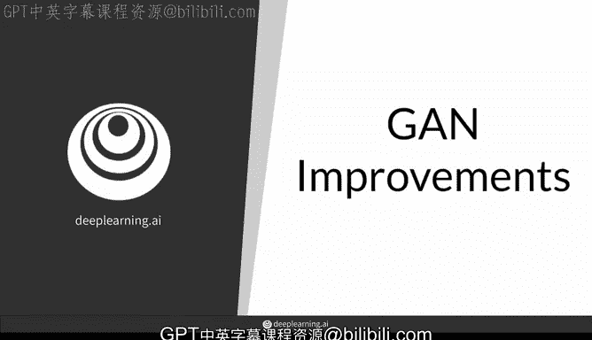
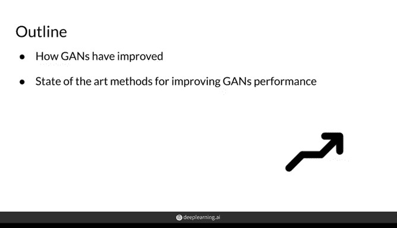
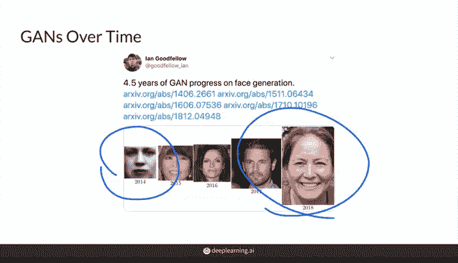
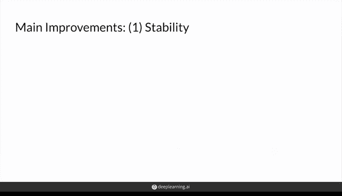
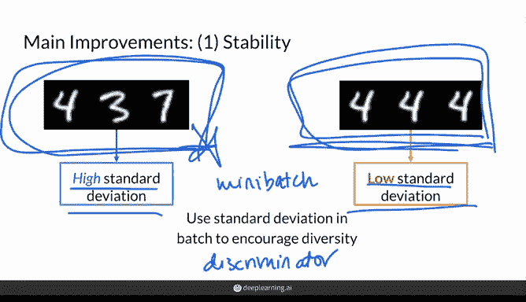
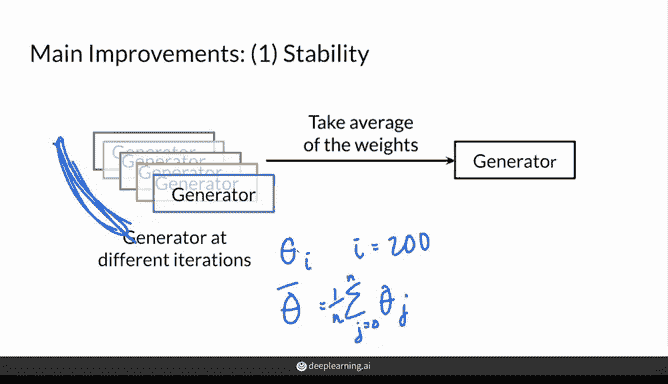
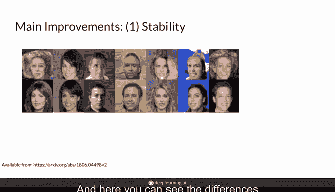
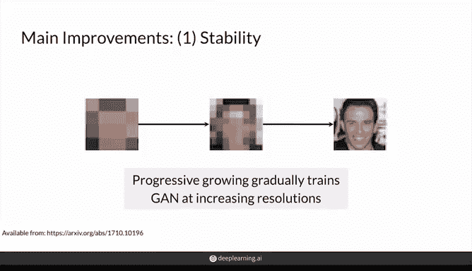
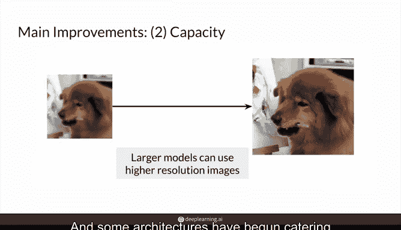
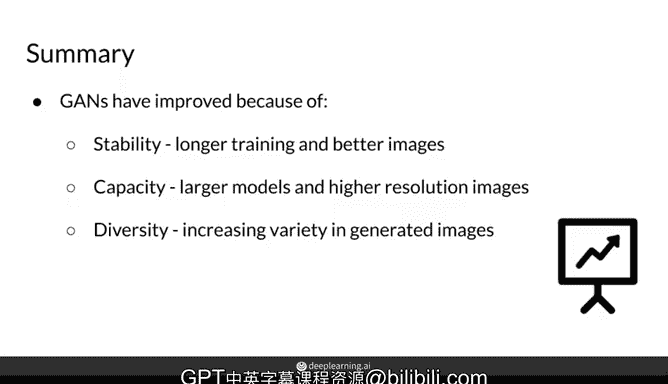

# 吴恩达《生成对抗网络（Generative Adversarial Networks，GAN）》中英字幕 - P52：18_03_02_GAN改进.zh_en - GPT中英字幕课程资源 - BV1JC4y1T7vZ

In this video， you'll learn about GAN improvements。

 you'll see how GANs have advanced over time and what methods have contributed to improving them。

You might remember seeing this at the very beginning of the course。

 it's a tweet from Ian Goodfellella who is regarded as the creator of GNs。

 and it's a visualization of the rate at which GNs have improved over the years。

 so they've basically progressed from black and white images that are barely faces to much higher quality ones that you could believe are real people by 2018 and they've gotten better sense。

The first major improvement was to G training stability and so you might recall from the video on mode collapse an unstable GAN typically means that training it longer won't help it and in this case the generator here is stuck in some kind of local minimum and is only generating one thing and here is only generating fours when it really should be generating a diversity of things。

So you've seen many ways to prevent mood collapse， but one interesting thing is to take a look at these two samples where you want this thing on the left with a lot of variation and there's high standard deviation across the samples。

But again， that has mode collapse， when you look at a mini batch of say， three samples。

 compared to the one that you want here on the left。

 you see that there is very low standard deviation。

 meaning that there is very little variation across these three samples。

And so each of these three samples from your mini batch could be pretty indicative of how much variation there is inherent to your GN。

And as a result， the standard deviation of these images can show when your generator is approaching mode collapse because the Sam deviation will be low and to mitigate this。

 perhaps you can pass this information to the discriminator and it can then punish the generator or rather give feedback back to the generator to try and keep it from collapsing because now if this is given to the discriminator instead of the discriminator just seeing one sample at a time。

 itll now see all of these and realize you know there might be a little bit of mode collapse here going on and of course it doesn't see all those samples it sees them quote unquote through perceiving the standard deviation。

 the statistic on the mini batch。

Another way researchers have improved stability in GNs is by enforcing one lipsit's continuity when using Waserson Loss or W Los。

 and this prevents a model from both learning too fast and also keeping a valid W distance。

 which you've seen in week three of this specialization。

Where you want to make sure the gradient of your function remains in these green triangles at every single point of this function。

 so this is observing this point and observing a point out here would yield a different set of triangles and you want to make sure your function stays within those。

And that means it's not growing more than linearly。And so you've seen this with WGN GP。

 which is using Waserson loss， which can be abbreviated by this W and maintains one lip shift continuity by using the gradient penalty or GP here。

And another method is called spectral normalization。

 which in some senses is very similar to batch normalization in the sense that it normalizes the weights and is often instantiated as some kind of layer。

 so spectral norm layer and so this is another type of weight normalization like batch norm and it stabilizes training by keeping values within a certain range and I won't go into the details because it gets pretty mathematical on what a spectral norm is。

 but it does maintain this onelipis continuity， so don't worry too much about it and there are open source implementation of this method。

A final way researchers have tried to stabilize GANs is by using two techniques that you'll learn more about in the following videos in style GAN the first is using a moving average that takes the average weights over several checkpoints。

So instead of describing the weights of one generator。

 which would be typically theta I where I equals， let's say step 200。

 wherever you find the best generator checkpoint， instead you want the average theta which I'll put a bar here。

 which will equal the sum of j to n。Theta J， so instead you want the average of all of these parameters。

And this gives you much smoother results and is done during training。

 but also can be applied when saving a model and then sampling from it。

And here you can see the differences between averaging and not averaging， so without averaging。

 you can see that maybe that generator checkpoint was in some kind of local minimum。

 or it just wasn't very smooth versus using some kind of averaging here the exponential average can yield much smoother result and the differences are quite apparent here。

The second technique is called Progress Groing， and it gradually trains your generator on increasing image resolutions so it can generate high quality images and you'll learn more about this in the coming videos on St again。

So now that you've learned some ways researchers have increased GA training stability so they can train for longer and improve。

 you'll see some other areas where GANs have advanced as well So another major improvement to GANs was their capacity generators and discriminators have gotten a lot wider and deeper such as deep convolutional GANs。

 DC GANs that you learned about earlier in week two and these models can be larger because of improved hardware like better GPUs and higher resolution data sets like the FFHQ data。

 which is a set of face images from Flickr that are really high resolution to trained style GAN。

 the state of the AGAN and some architectures have begun catering to these higher resolution datasets as well。

The final major improvement to GNS has also been their diversity in their output。

 so they have had increasing variation in their generated images and that's fantastic because we want to model all the possible human faces here not just generate one face so remember that this is also a key criterion that you now evaluate yourgans on。

And one of the ways diversity has been improved is by having larger data sets with more coverage because having more variety in the images being trained on lead to the same in the output as well Fs you see here are actually generated by stylegan and Sganin has a few architectural changes to increase diversity。

And I do want to know that the method you saw before using mini batch standard deviation to perhaps help with the stability in training can also help with increasing and improving diversity by avoiding modeclaps and trending towards how much variation real images have。

So in summary GANs have advanced largely from improved training stability， capacity and diversity。

 a stable GA with less chance of mode collapse lets you train your model for longer and larger models in higher resolution images will improve the quality of your outputs and a few changes will increase the diversity in your generated images and you'll see some of these in the following videos on stylegan。

 one of the best GANs today。

