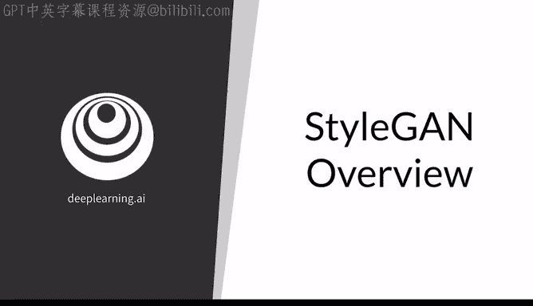
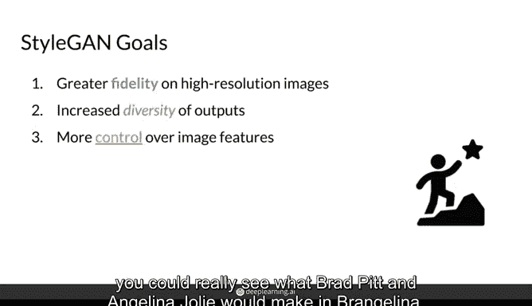
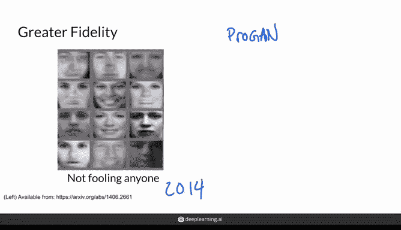
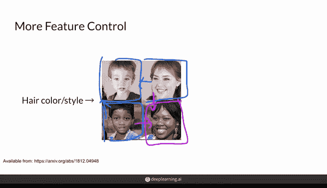
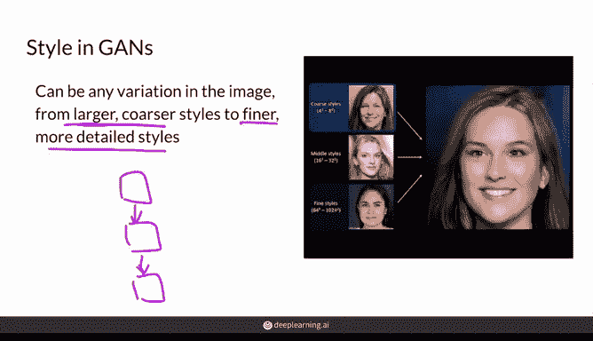
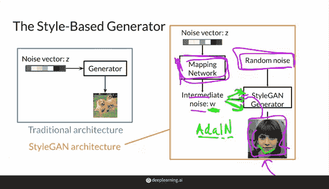
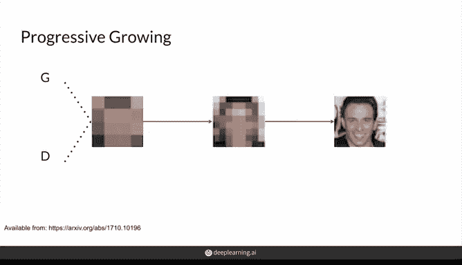
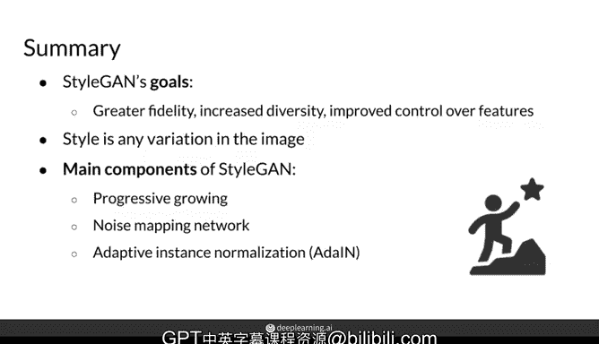

# 吴恩达《生成对抗网络（Generative Adversarial Networks，GAN）》中英字幕 - P53：19_03_03_StyleGAN概述.zh_en - GPT中英字幕课程资源 - BV1JC4y1T7vZ

In the previous video you heard about how GANs have improved over the past few years In this video。

 you'll learn about Style GN， a relatively new architecture that's considered to not only be the state of the Agan right now。

 but an inflection point in GAN improvement， particularly in its ability to generate extremely realistic human faces。

I'll start by going over Stylegan's primary goals and show you how it's become the embodiment of the improvements in GNs you just heard about。

 then I'll talk about what the style in stylegan means and finally you'll get an introduction to its architecture and individual components。

So one of the first goals of St again is to produce high quality high resolution images that are capable of fooling a casual onlooker。

 so you and me perhaps。The second is a greater diversity of images in the output。

 so if you're still thinking about the cute little dog poppper examples in the earlier videos。

 the output would probably range from a golden retriever to a golden doodle to a French poodle instead of just giving you a range of slightly different golden retrievers with the same background。

One of the really cool things about Stgan is also the increased control over image features and this can be adding features like hats or sunglasses or mixing styles from two different generated images together So in a sense you could really see what Brad Pitt and Angelina Jolie would make in Braina。

Getting high resolution fidelity that fools the untrained eye is a huge feat that up until recently was much more difficult to achieve。

 and this was mainly due to smaller model capacity， lower resolution data sets。

 and also the challenge of High resolution just really wasn't tackled until Progan。

 which is Stgan's predecessor that was launched in 2018。

So here you see these generated faces from 2014， look for the most part， like bad sketches。

 they're grainy and unlikely to convince anyone of their authenticity。

Now， look at this more recent high resolution face generated by style G if you saw this image without any context。

 would you be able to guess that she wasn't a real person？

It would seem pretty apparent that Sgan has achieved its goal of greater fidelity。

 but on an interesting side note， Salgan has tried both WGAN GP loss from week3 that you learned about and the original GA loss in week one that you learned about and found that each work better on a different dataset and both dataset sets were high resolution faces so the jury is still out but really both probably work and so the takeaway is that it's all about experimenting。

Finally， Stgan also wants to increase the control you have over your image features and this can be mixing the style of one image into another。

 like you can see here， where this face here is a mix from the below and to the right。

 where you can see hair color and styles coming from the picture from the right and various facial features coming from the face on the bottom。

And then you see here on the bottom right hand corner。

 this woman is a mixing of styles from the woman above， as well as styles from the boy on the left。

Control could also mean adding accessories such as glasses and Sgin accomplishes this by disentangling the latent space。

 which you'll be learning about in more detail here shortly。So as you can see。

 all these dudes got some sunglasses。The word style in the context of image generation is pretty much any variation in the image。

 and you can think of these variations as generally representing the look and feel of different levels in the image。

And these differentin levels could mean larger coarser styles。

 such as general face shape or facial structure to finer more detailed styles。

 which are like colorly hair or placement of certain wisps of hair。The style again generator。

 interestingly enough， is made up of blocks where earlier blocks roughly align with coarser features like facial structure or pose。

So the earlier layer is here and near to the output。

 finer detailed styles such as hair color or eyebrow shape are controlled So you can imagine this woman here could be compositeed or changed in some ways based on co styles from the woman on top。

 medium styles from the woman in the middle and finer grain styles from the woman on the bottom here。

Now that you're more familiar with the concept of styles。

 let's take a gander at how stylegan generator differs from a traditional GA generator that you might be more familiar with So in a traditional GAN generator。

 you take in this noise vector into the generator and the generator then outputs an image。

Now in style again， the noise vector is handled a little bit differently。

 So instead of feeding in the noise vector directly into the generator。

 it goes through a mapping network to get an intermediate noise vector W say that then gets injected into the stylegan generator actually multiple times to produce this image。

 And also there's this extra random noise that's passed in to add various stochastic variation onto this image and that could just be moving this wisp of hair in different ways。

 So smaller variation that this random noise could then help produce。 And for this random noise。

 there's no learning aspect of it it's largely just uncorrelated random Gaussian noise where you pertuurrb the values coming out of convolutions。

 various layers a little bit。However， this mapping network。

 which you'll see shortly is very important and consists of learnable parameters as well。

 so BackProrop will go all the way from the discriminator back up here through the generator and through this mapping network。

And something that's important to note is that W is not just inputted easily into the stylegan generator instead styles are extracted from the W value。

 this intermediate noise value and then added to various points in the stylegan generator and in earlier points in the stylegan generator。

 W will inform coarser styles that you saw previously such as general face shape and injecting W into layer layers will control styles of finer grain things such as hair color and this injection of this intermediate noise into all of these layers of stylegan is done through an operation called add in or adaptive instance normalization and this is a type of normalization similar to batch normalization。

 except that after it normalizes in some way， it tries to apply some kind of style which is just statistics of an image based on this W coming in。

The third and final important component of stylegan is Pro growing。

 which slowly grows the image resolution being generated by the generator and evaluated by the discriminator over the process of training。

And progressive G originated with program organ with Pro G。And it's not unique to style again。

 but it is its predecessor， and the authors did note that it did help with training on higher resolution images。

So during the training process， both the generator and discriminator start with a small low resolution image。

 and the goal of first train the generator to be able to generate something easier than a high resolution face。

 as in the small blurry image that's in the right ballpark， you know。

 there's still some face pixels going on。And when the models are stable they can then be expanded to double the height and width。

 so slightly harder task now， slightly less blurry needs to look a little more facelike。

 but still easier than a super high res face and this continues until the desired image resolution is reached and this doubling occurs at scheduled times during the training process。

But what's tricky is that the doubling can't be too abrupt。

 but must be more gradual in order to ease the generator into generating those larger images So if you're feeling confused。

 don't worry at all This too will be covered in more detail a bit later in the course The main takeaway is that you've got to go slow if you want to grow。

So now you're acquainted with Stgan and some of its amazing achievements。

 which include greater fidelity on higher resolution images， increased diversity in their outputs。

 and more control over image features like hair color accessories。

You saw a bit about what style means in the context of image generation。

 which is to say the general texture or look and feel of different levels of the image。

And these vary depending on their location in the generator from large core styles。

 like the shape of a face to finer styles， like hair color。Finally。

 you were introduced to the style G architecture， and you've seen how its main components。

 that noise mapping network， adaptive instance normalization。

 set it apart from a more traditional GAN。Progressive growing isn't limited to use in St game。

 but it does help with more stable training of higher resolution images。

this was just a high level introduction you're about to get a deeper dive into each of these components and how they work up next。

