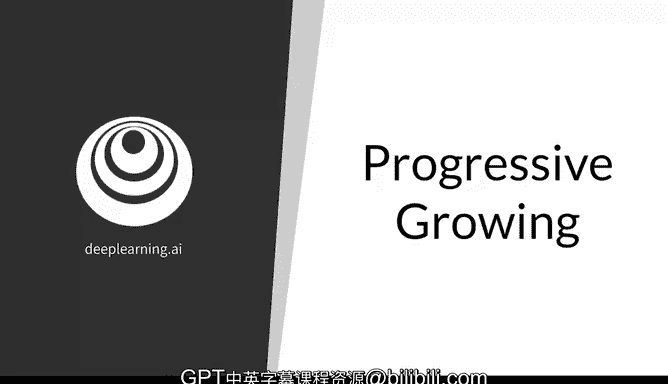
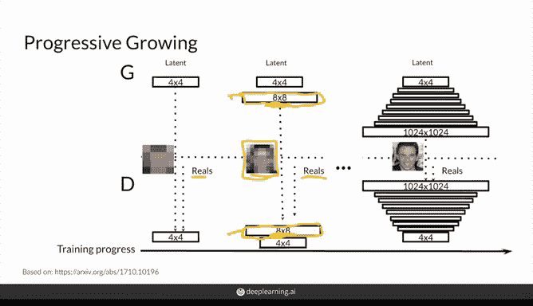
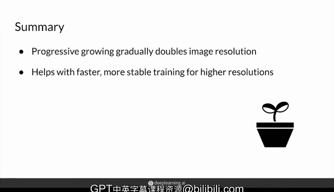

# 吴恩达《生成对抗网络（Generative Adversarial Networks，GAN）》中英字幕 - P54：20_03_04_渐进式增长.zh_en - GPT中英字幕课程资源 - BV1JC4y1T7vZ

In this video， you'll learn about progressive growing， which is one of the components of stylegan。

And I'll go over both the intuition behind progressive growing as well as the motivation。

 and then I'll dive a little bit deeper into how to implement it。So first off。

 progressive growing in style again is trying to make it so it's easier for the generator to generate higher resolution images by gradually training it from lower resolution images to those higher resolution images。

 so starting with an easier task of say a very blurry image for it to generate a 4x4 image with only 16 pixels to then a much higher resolution image over time。

So for example， this is what it would start out as where the generator just needs to generate this 4 by4 image and the discriminator needs to evaluate whether it's real or fake。

 of course， to make it not so obvious what's real or fake。

 the reels will also be downsampled to a 4 by4 image。

And now in the next step of progressive growing everything is doubled so the image now generated is an a by a image。

 so a much higher resolution image than before， but still an easier task than a super high resolution image and of course the reels are also downsampled to an8 by a image to make it not so obvious which ones are real and which ones are fake and the discriminator will now take in this8 by a image and have this extra convolutional layer to take that in and the generator conversely will also have this a by a extra convolutional layer that will then be able to generate this higher resolution image。

And by8 by8 here for the convolutional layer， I don't mean the filter size。

 I actually mean the expected output here on generator and input here for the discriminator of height and width we're not looking at channels here。

And then finally， over time， over perhaps lots of different growing periods。

 and these are scheduled intervals during training。

 the generator will be able to generate super high resolution images and the discriminator will look at that high resolution image against real images that will also be at this high resolution。

 so no longer downsampled and be able to detect whether it's real or fake。

And so this is progressive growing in action from really pixelated4x four。

 perhaps pixels to super high resolution images， and style again trained on an anime phase data set。

Now， this progressive growing isn't as straightforward as just doubling in size immediately at these scheduled intervals。

 It's actually a little bit more gradual than that。

 So what happens initially when you first want to generate a double size image is that instead of a 4 by4 image here where I'm saying co4 by4 is a height width。

 you actually want to upsample that image in ups that could be using nearest neighbors filtering。

 these are not learned parameters， it's just very basic upsling And all you do is you upsle it to this image here。

 So all you're doing is upsling。 And then at the next step。

 maybe you do 99% ups and you do 1% of taking this upsled image into a convolutional layer that produces an 8 by 8 resolution image so that you have some learned parameters。

 but you only weight this direction by 1%。 So you do all this learning and then you still weigh this image as 99% from the ups purely and 1% from these learned parameters。

 And then over time， you start to decrease。😊，This 99% and you want to increase this 1% so you rely more and more on these learned parameters so let's say you have 50% 5050 and you're relying more on learned parameters and you see this image starting to look perhaps more like a face and less like just ups from nearest neighbors ups and then over time even more until you completely do not rely on this ups by itself and you just rely on these learned parameters so at some point this will be 100% and this will just be part of the network that you see like this guy this will just be part of the network and this section will just not be there anymore。

All right， and more generally you can think of this as an alpha parameter that grows over time where alpha starts out as0。

 and this is just completely one， so completely this way， and then alpha grows like 0。10。2。

3 all the way up to 1 and when an alpha is1， then this will equal 0。

 this whole thing over here so you don't care about this， and this will equal 1。Allright。

 so that was for the generator for the discriminator， there's something fairly similar。

 but in the opposite direction。 So now you have this higher resolution8 by8 image。

 and before maybe you had a 4 by4 image and what happens is slowly over time you go through this downsampling layer to then handle this 4 by4 image down here。

 So what first happens is you downsample and your alpha is 0 So you're only going this direction。

 and then over time is your alpha increases and this is the same alpha parameter as you saw in the generator you'll go through these learned parameters with a con 8 by8 taken as input and then downsampled here and then into your4 by4。

 So essentially what's happening in the discriminator is the reverse and with the same alpha that gradually uses these learned parameters as well。

 and of course， the discriminator takes in the image instead of generates the image at the very end gives you just one output of real or fake and essentially a probability of between 0 and1。

So progressive growing in the context of stylegan essentially is a series of all of these blocks that progressively grow into higher and higher resolution outputs。

 and the cellgan generator essentially will look like this and each of these blocks will be composed of an upsampling layer as well as a convolutional layer and actually they will have each two convolutional layers to be able to learn even more。

So in summary， progressive growing gradually will double that image resolution so that it's easier for your style again to learn higher resolution images over time。

Essentially， this helps with faster and more stable training。

