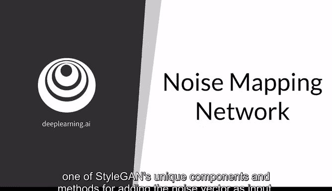
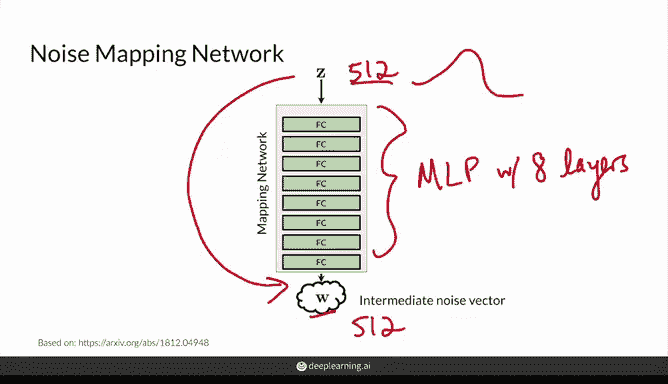
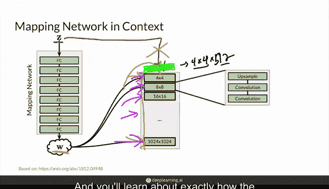
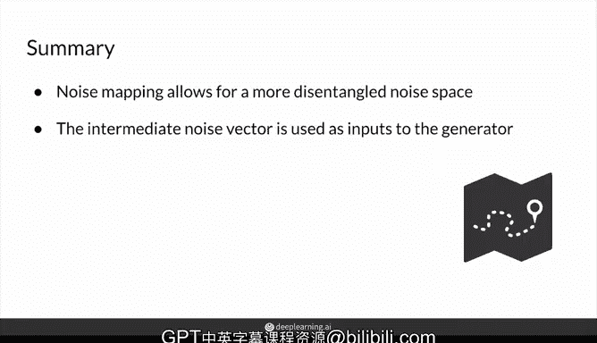

# 吴恩达《生成对抗网络（Generative Adversarial Networks，GAN）》中英字幕 - P55：21_03_05_噪声映射网络.zh_en - GPT中英字幕课程资源 - BV1JC4y1T7vZ

Now you'll learn about the noise mappingapp network。

 one of Style GN's unique components and methods for adding the noise vector as input。

 which will help control styles later on。

So first you'll take a look at the structure of the noise mapping network。

 then the reasons why it exists， and finally where its output the intermediate vector actually goes。

So first off， the noise mapping network actually takes your noise vector Z and maps it into an intermediate noise vector W。

And this noise mapping network is composed of eight fully connected layers with activations in between。

 also known as a multilayer perceptron or MLP。So it's a pretty simple neural network that takes your Z noise vector。

 which is 512 in size and maps it onto your W intermediate noise vector， which is still 512 in size。

 so it just changes the values so you still do the same thing with Z where you sample Z from a normal distribution for all 512 values and then you put it now through this network to get this intermediate W noise vector。

And the motivation behind this is that mapping your noise vector will actually get you a more disentangled representation so as a quick reminder。

 entanglement in your Z space is when your noise vector doesn't really map on output features in a one to one way where when you change one of these Z vector values。

 you can actually change a lot of different features in your output。

 and this is bad because this doesn't allow for a lot of fine grain control or feature level control that you would like in your resulting image because it wouldn't be great if you're trying to change the eyes of someone and you suddenly change their beard or whether they have a beard at all in that image。

 and the reason why Z space where the noise vector is from is often entangled is because the real data that you know has a certain probability density。

 meaning that there is a probability of the sample of a certain image having glasses on or not having glasses on having a beard having a certain color of hair eyes or certain age associated with。

There's this probability density around the actual features。

But because Z has this normal prior where you draw all your values from this normal distribution。

 it can be hard for it to map this normal distribution to the correct density distribution of all your output features and because you're expecting random noise vectors to basically be able to model this entire space of having glasses having a beard。

 what color hair eyes， like all different types of images。

 all different types of features associated with those images， if you're expecting the noise vector。

 the Z space to do that， that's actually quite challenging for it and it'll try to find some way to twist itself to try to map onto these desired features。

 and itll often twist itself in a way that probably doesn't quite make sense to us。

And so this is kind of unrealistic for it to just be completely disentangled。

 so be completely one to one mapping here， it's kind of an unrealistic thing for it to achieve。

 so it will probably and very necessarily learn a complex entangled set of mappings to achieve that to be able to map onto all those output features we would like it to map onto and generate。

However， having this intermediate mapping for the noise vector can give it a little bit of room so it can allow for that space and now this is called W space to match the real data's density and this makes it easier to learn a one to one mapping that's disentangled So essentially the noise vector doesn't need to be as fixed to the statistics of the training data but can instead learn these factors of variationation that are now linear and easier to generate from and this will reduce the chance of your styles being too closely correlated and this ultimately helps to control and map features and I wouldn't say W space is actually this perfect as shown in this image here。

 this is just a graphic it's just less entangled than Z space is what it's been found and as a quick note these vectors you see here are just size 7 they' are actually 512 here So where does this noise mapping network fold into the context of this style again architecture So you had learn about progressive growing where the output doubles in size every now and then。

And this is what the generator architecture kind of looks like and the noise mapping network actually comes in here as input into all of these blocks and so you'd probably note that where Z normally would fit in here this is no longer the case and instead it's going through this mapping network and W actually is inputted at multiple different places along the network and you'll see in the next video how exactly it's added into all these places and how W's influence differs at different points that it's inputted its influence differs where it's inputted earlier versus later and know that W doesn't actually go in the beginning of the network unlike what Z did in the original GAN setup。

And this is because the authors with style G actually found no noticeable difference from adding it there。

 so putting W there or not was basically the same thing。

So instead of inputting W at the very beginning， what the model starts with is actually just a constant value so what the network actually starts with is just a constant value。

 so basically just a fixed value that doesn't change for any image you generate and it's actually not just one fixed value this is of size 4 by 4 by 512 as it goes in and then grows where it's 4 by4 to start height width and then a 512 channels。

And again， this is the same value for every image being generated。

 so any changes to any image being generated will occur where the noise vector is being introduced。

Which is everywhere， which is all of these blocks， actually in every intermediate block here。

And then it actually goes in multiple times into each of these blocks， which is pretty cool。

 and youll learn about exactly how the noise vector is added into these blocks in the next video。

So you've just heard all about the noise mapping network。

 which is a multilayer perceptron or feed for neural network with fully connected layers and activations in between that maps your Z noise vector to an intermediate noise vector W。

 and this W is used as input into many places into your generator and allows for style control over the generated images。

