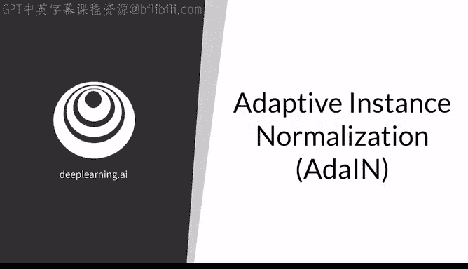
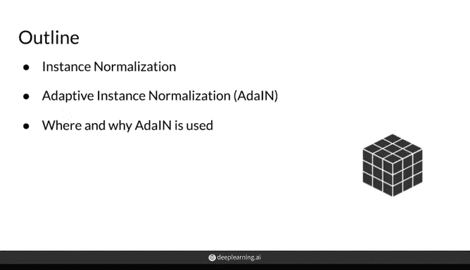
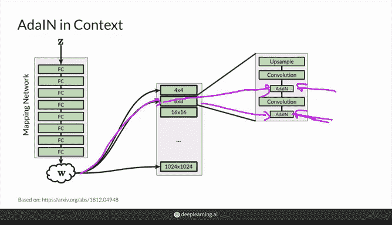
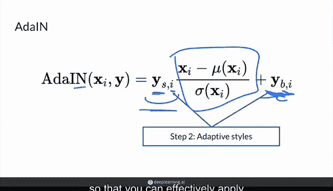
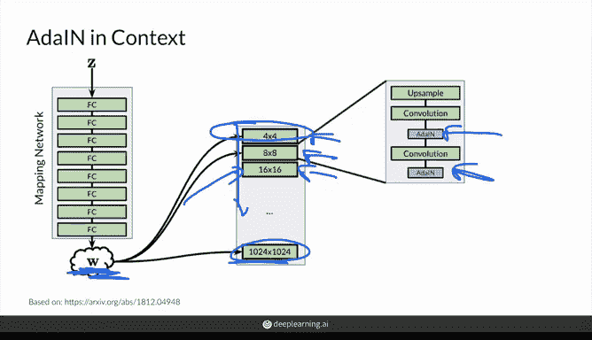
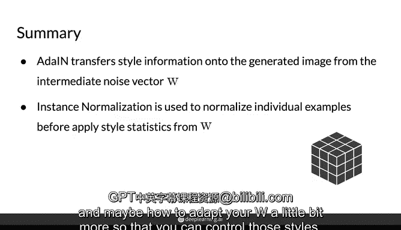

# 吴恩达《生成对抗网络（Generative Adversarial Networks，GAN）》中英字幕 - P56：22_03_06_自适应实例归一化(AdaIN).zh_en - GPT中英字幕课程资源 - BV1JC4y1T7vZ

Al right， so now it's time to take a bit closer at how your intermediate noise vector is actually integrated into the network。

 and that is looking at adaptive instance normalization or at an end for short。

So first I'll talk about instance normalization and I'll compare it to batch normalization which you're more familiar with。

 then I'll talk about what the adaptive and adaptive instance normalization means and also where and why at a n or adaptive instance normalization is used So first add an in in the context of style ga So you already learned about progressive growing in this intermediate block and you also learn about the noise mapping network over here where it injects W into these different blocks that progressively grow。

Well， within each of these blocks， you see that there's an upsling layer。

 a convolution and another convolution to help learn additional features and also to double the image and size with the upsampling layer。

 but this is actually not all adaptive instance Orization at an end actually comes in after each convolutional layer。

And you'll see how it comes in and how the W that's coming into each of these blocks actually goes into here as well。

So first let's focus on just as one block here and the first step of adaptive instance normalization will be the in part or instance normalization part and what happens here is well if you remember with normalization is it takes the outputs from your convolutional layers x and it puts it at a mean of zero in a standard deviation of1。

And it does this by getting the mean of those values and also the standard deviation to then center it around zero with a standard deviation of one。

But that's not it because it's actually not based on the batch necessarily which you might be more familiar with batch norm。

 where batch norm you look across the height and width of the image。

 which is along this axis that you see highlighted in blue here。

 you look at one channel so among ourGB you only look at R for example。

 and you look at all end examples in the mini batch and then you get the mean and standard deviation based on all of these highlighted blue cells for one channel in one batch and then you also do it for the next batch and also the next channel。

But instant normalization is a little bit different In normalization comparing it using the same graph here actually only looks at one example or one instance。

 so an example is also known as an instance， so it doesn't look across statistics of the entire batch it only looks at one example and again only one channel of that example So if you had an image with channel's RGB that would just be looking at let's say the B here which is just this blue channel and getting the mean and standard deviation only from that blue channel。

 nothing else， not additional images at all just getting the statistics from just that one channel one instance and normalizing those values in there based on its mean and its standard deviation。

So to represent that in this equation， we actually call an instance I here。

 so it'll be X I for that instance and the mean or mu here over that instance as well as standard deviation。

And again， here just means every value in that instance will be normalized to a mean of zero and a stair deviation of one。

So that's the first step of adaptive instantorization so that's the instantor realizationization part and where the adaptive part comes in is to apply adaptive styles to this now normalized set of values and the instant normalization here probably makes a little bit more sense than batch normalization because it really is about every single sample you are generating as opposed to necessarily the batch or normalizing across a batch for example。

Okay， so the adaptive styles are coming from your intermediate noise factor， W。

 which you heard about being inputed into multiple areas of the network。

 and so adaptive instance normalization is where W will come in。

So you have your original Z vector which was sampled from a normal distribution for each of its values。

 it was sent through this mapping network， noise mapping network that you learned about earlier。

 which is a multilayer perceptron to get your intermediate noise vector W。

So W informed styles which are then inputted into add in but actually how that happens where it informs those styles is actually not directly inputting W there instead it goes through learned parameters such as two fully connected layers and produces two parameters for us one is YS that stands for scale and the other is YB which stands for bias and you might be able to guess what these terms are for so scaling parameter for this in the bias parameter or the shift parameter is the other one and these statistics are then inputted into the add in layers so that is put in there and then another set of these values will be put into the other one。

And so exactly how they're put in YS and YB is that after you do this instance normalization step。

 which is this middle part， then you want to multiply your values which are now normalized around zero and standard deviation1。

 this is similar to batch norm， by the way， then you want to reshift and rescale your values based on these statistics that are extracted from the W intermediate noise vector so the second step is getting these adaptive styles and they're adaptive because your w can change or these values extracted will change。

And so looking at this style really comes down to just rescaling and reshifting values to a certain range mean and standard deviation so you can think of it as an image that has some kind of content and with different Y values YS and YB values it will be like Picasso Did or like Monet drew that image。

 but itll have the same content right it'll still be a face or still be a poppy field but it would be a different style so shifting your values to different ranges mean standard deviations will actually get you those different styles and so that's pretty cool。

And note that there is， again， I here for the instance because this is instance normal still。

 so you have this YS and Y B value just for that instance。

And note that before you're applying these styles， essentially this middle instance normalization part is trying to undo any style related information that was originally there。

 so just getting some kind of content so that you can effectively apply these styles next in the second step。

All right， so zooming out a bit， where does add in fit in again。

 well the generator is made up of lots of blocks where earlier blocks actually roughly align with coarser features and litter blocks with finer details and this is pretty consistent across all neural networks and so here what's interesting is that add in is used at every single block here in the generator to essentially get the style information from W into those feature maps。

So W is added into all of these blocks and when it's added in into these earlier blocks。

 it'll be those coarser details that are changed or affected by this W style。

 whereas in these later blocks it'll be finer details that are informed by W。

And because the normalization step in addta n adaptive instance normalization renormalizes the statistics back to a mean of zero in a standard of deviation1。

 because this occurs at every single one of these blocks。

 this means that every block will control styles at that block and at the next block it'll be overridden by the next addda n that normalizes those previous outputs and that even happens within the block you see here。

And this allows for control over the model in terms of what's generated and in terms of what's kind of style is being generated。

 imagine injecting different styles at different blocks to allow for either coarse or finer grain controls and that'll be in the upcoming video so W might not just be W here。

So in summary， adaptive ins and normal realizationization are what transfers style information from the intermediate noise vector W onto your generated image。

Insant normalization essentially normalizes each sample each instance。

 while the adaptive part in adaptive instance normalization is able to apply the different styles from the intermediate noise vector W onto that image or onto that intermediate feature map。

In the following video， you'll see exactly how the style part comes in and maybe how to adapt your W a little bit more so that you can control those styles。

