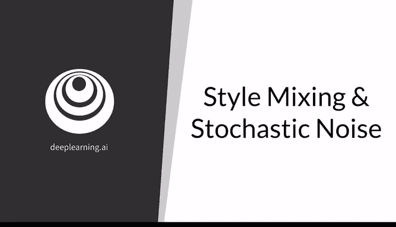
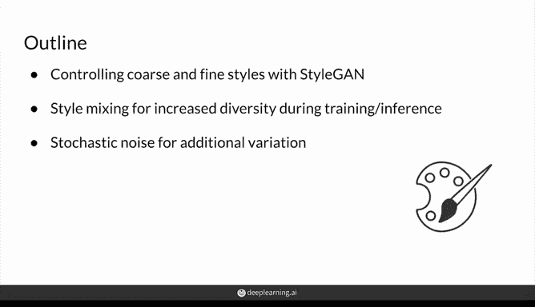
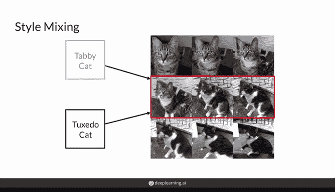
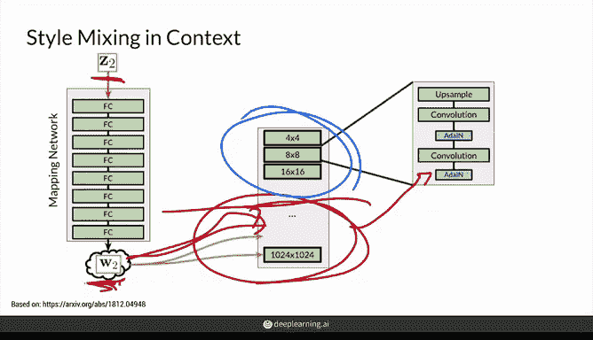
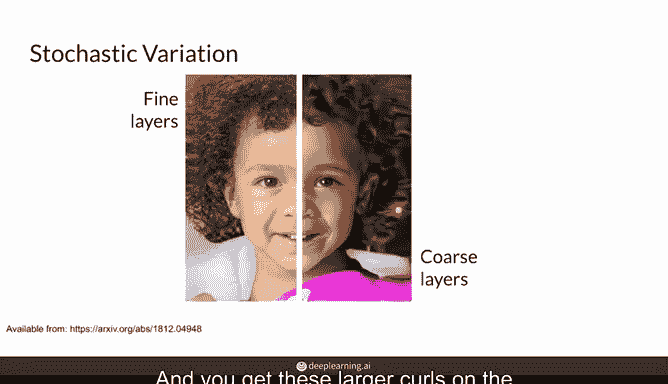
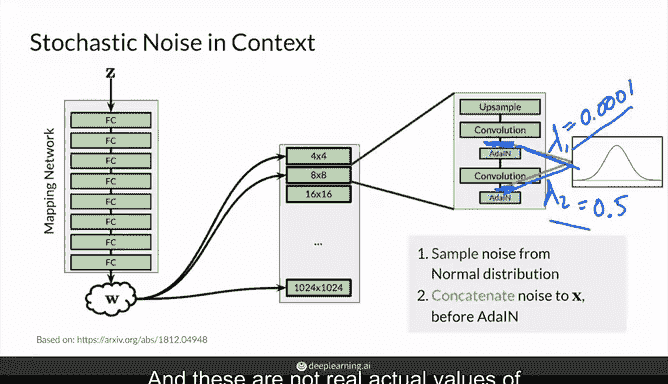
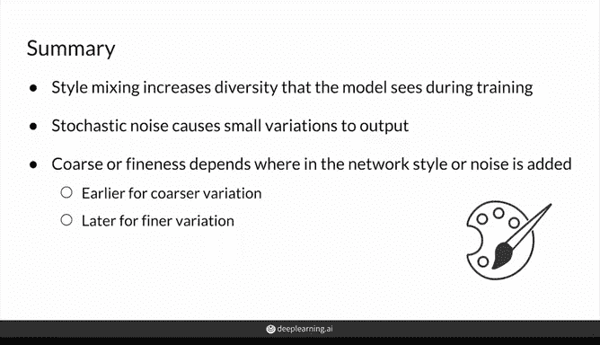

# 吴恩达《生成对抗网络（Generative Adversarial Networks，GAN）》中英字幕 - P57：23_03_07_风格与随机变化.zh_en - GPT中英字幕课程资源 - BV1JC4y1T7vZ

In this video you learn about style mixing， which mixes the different intermediate noise vectors as well as stochastic noise。

 which adds a little bit more extra noise into your model and your images。

So in this video you'll learn about controlling course in fine styles with stylegan using two different methods the first is style mixing for increased diversity during training and inference and this is mixing two different noise vectors that get inputted into the model and the second is adding stochastic noise for additional variation in your images so adding small finer details such as where a wisp of hair goes So first some intuition on style mixing so you see a tabby cat in this first row and these are generated tabbycas as well as a tuxedo cat generated along these three images in the bottom row and in the middle row here what you see is actually a mix of the two of a tabby cat in a tuxedo cat and this is kind of what style mixing is trying to get at if you can generate images from the first row and you can generate images from the third row then maybe you can generate images from that second row by mixing them in some way。

Alright， so you had gotten a little bit of a sneak peek on how this might work in a previous video。

 so although W is injected in multiple places in the network。

 it doesn't actually have to be the same W each time so you can actually say you know I don't want to inject W into this last block here or I don't want to put it in any of these here only want to put it there or only want to put in the first half of the network and only in the second half for example So what you can actually do is you can actually have multiple Ws so you can actually sample a Z let's say Z1 so you're sampling that Z that goes through the mapping network you get a W it's associated W1 and you inject that into let's say the first half of the network and remember that goes in through at of in。

All right， and then you sample another Z Z2 now， and that gets you W2。

 and then you put that into the second half of the network。

 so you inject that into all the different blocks in the second half of the network and again that goes through added in layers that are part of those blocks。

And the switch off between W1 and W2 can actually beat at any point really。

 it doesn't have to be exactly the middle for half and half the network。

 and this can help you control what kind of variation you'd like so the later the switch。

 the finer the features that you'll get from W2。And so W2 here is largely informing these finer control features and your W1 was originally controlling these top more coarse features and as you might expect this improves your diversity as well since your model is trained like this so that is constantly mixing different styles and it can get more diverse outputs Allright。

 so let's take a look at what that might look like here's an example using generated human faces from stylegan So here in this first column our image is generated by W1 and you can imagine this being W1。

A， this is W1 B， and this is W1 C。 These are definitely not the same Ws generating these three images。

 but let's call them all W1 for now。 and W2 will be on this first row here where these are all W2， A。

BC D， E。 So these are all W2 here。And what's interesting is that this first row here。

 if you only look at this is actually getting course styles from W2 so from the top row here it's getting those course styles so you can see rough face shape maybe some type of gender related thing and then it's getting finer styles and maybe middle styles quote unquote from this W1 image right here just as one image right here that's being applied and so this is a mixture each of these are a mix of these two different intermediate noise vectors that generated those associated images from the top here and this one image here。

And then if you look at this last row， so skipping the second row for now。

 if you look at this last row with this woman here。

 you're actually getting only fine styles from W2 so you're only getting fine styles from the top here and what you can see is that those finer styles are just informing much smaller and slightr variation to this person and this person takes on all the coarse and even middle styles of this original vector that generated this face。

 so these all look pretty similar。And in the middle here， it's kind of a mix of both。

 So you see the vector that generated this image is actually being formed with middle styles from the ones up top up here。

 So you see definitely much more variation than the bottom over here。

 but you see less variation as informed by these top images compared to the first row and you see it being much more similar to this original image but of course not so addressed against this bottom here。

 And so this is what the style mixing is all about you can input different W1 W2 vectors and you can get these mixes and you can control the degree to which how much you want of one image versus another and which type of styles pose middle are fine that you want from each of these intermediate vectors。

 and it's definitely much more than just coarse middle and fine these are just three broad ways of thinking about it because you're injecting your W intermediate noise vector many。

 many different times much more than three times into your stylegan generator。Okay。

 so that was really cool， but what about slider variations that don't require you to mix two different images that don't require you to necessarily say I want the style from that person versus this person。

 I want to just perturb or see differences with this one thing I generated and Salgan has this two which is adding additional noise to the model by adding this additional noise to the model which will add stochastic variation to your image。

And so that's shown here， what's really cool is that this first half is injecting random noise into the finer layers。

 the later layers of your model， and that gets the person to have these much smaller curls in the hair and these eyebrows that are more wispy versus injecting that noise in earlier layers of the network where there is more coarse variation that's expected from the noise and you get these larger curls on the image and a smoother eyebrow it seems here。

And so in order to do that is actually a separate process of injecting noise。

 so it has nothing to do with Z or W here。And what that noise is is that it'll actually be added in before your adaptive instance normalization。

 But first you want to sample noise from a normal distribution so you just sample potentially random values from this and then those noise values are then concatenated to your x which is your convolutional feature map output before it goes into adaptive instance normalization at in and so that's just adding some kind of stochasticity some kind of randomness into your image into those values and the degree to which this noise actually affects these convolutional outputs is controlled by a factor。

 let's call it lambda 1 here in lambda 2 and these are learned values So lambda 1 could be let's say 0。

00001 so it doesn't affect it that much and let's say lambda 2 is 0。

5 and so it does matter a lot it is added a lot onto that convolutional output and these are not real actual values of how much it necessarily does scale it it is a learned value in terms of how much this does help and this variation。

can even change super， super subtle things that I think is so cool and that's changing this wisp of hair so this is a zoom in into this person's hair over here that's generated and it's just so slight in terms of the arrangement of this person's hair as well as this person's hair。

 which represent you know Stgan's ability to model all of that。Though I will say。

 and I do pick up on this a lot is that this baby the bottom here doesn't look very real。

 so you know， not all outputs look super real。Okay。

 so to recap style mixing with your intermediate noise vectors can increase the diversity that the model sees during training and allow you to control kind of coar or finer styles。

Sttochastic noise is another way to inject variation into your output and also the coarse or fineness depends on where in the network your style mixing or noise is added and earlier for coarser variation and later for finer variation。

 which is pretty consistent across neural networks， including classifiers。

