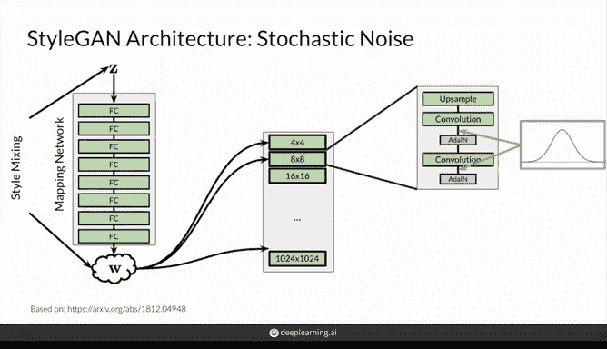
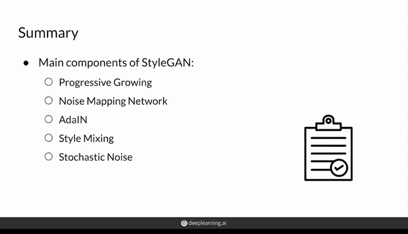

# 吴恩达《生成对抗网络（Generative Adversarial Networks，GAN）》中英字幕 - P58：24_03_08_整体整合.zh_en - GPT中英字幕课程资源 - BV1JC4y1T7vZ

Al right， congrats on getting it this far， so let's put everything you just learned about St G together。

I'll go over all the major components you just looked at and put it all together and all these components are fairly important。

 the styleganin authors did ablation studies to several of them to understand essentially how useful they are by taking them out and seeing how the model does without them and they found that every component is more or less necessary up until this point of course there are other ways of replacing some of these components to still get the same thing。

 which you've definitely seen across all of these weeks of learning about GNs。

 but let's put styleganN together and then get to implement all of these components。

So first you learn about progressive growing， which essentially grows the generated output over time from smaller outputs to larger outputs。

 and so that composes the basic blocks of the generator and then you have the noise mapping network which takes your Z that's sampled from normal distribution as usual for every single one of its values。

 but puts it also through this multilayer perception these eight fully connected layers separated by sigmoids or some kind of activation and to get this intermediate W noise vector that is then input it into every single block of your generator except for at the beginning which is typically how it's done。

 but it's injected in multiple places。And then you learn about add in or adaptive In normalization。

 which is used to take your W and apply styles at various points at various points in your network in each of those blocks。

 and earlier blocks will control those finer styles or inform those finer styles using the statistics from W versus later blocks will take those statistics。

 so scaling and shifting statistics from W to inform finer details。

You also learned about style mixing， which samples different Zs to get different Ws。

 which then puts different Ws at different points in your network so you can have a W1 B in the first half of your network into a W2 in your second half。

 and then your generated output will be a mix of the two images that were generated by just W1 or just W2。

And finally you learn about stochastic noise， which inform small detailed variations to the output。

 so a wisp of hair or the placement of that wisp of hair， how curly your hair is。

 and what types of curls those are， and that gets injected into the network at various points to also inform coarser or finer style depending on which block you injected it。

 and that also has a learned scaling parameter of how much this noise matters at each point。

And that's a wrap， congrats on getting all the way here， these are the major components of stylegan。

 progressive growing， the noise mapping network， adaptive instant normalization， style mixing。

 and stochastic noise。

