# 吴恩达《生成对抗网络（Generative Adversarial Networks，GAN）》中英字幕 - P5：05_01_08_GANs背后的直觉.zh_en - GPT中英字幕课程资源 - BV1JC4y1T7vZ

Gans are powerful models that learn to produce realistic objects that are difficult to distinguish from existing real ones。

 for instance， human faces。Again learns by making a generator and a discriminator compete against each other in this video。

 I'm going to talk about the goals of the generator and the discriminator and you'll see how the game between them begins and how that really plays out as they one up each other until we get a generator that is really。

 really good and can produce realistic images that you want。

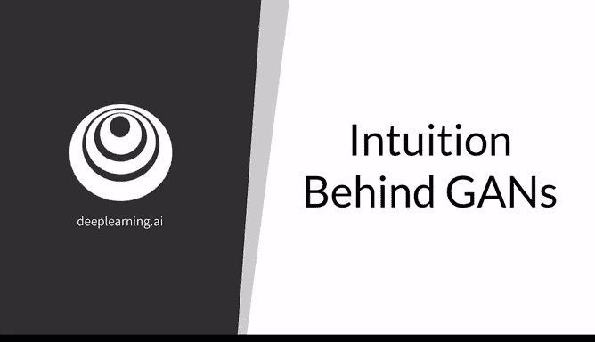

So recall that GNs have two components， ones called the generator。

 and the other is called the discriminator， and these are typically two different neural networks。

The generator learns to generate fakes that look real to fool the discriminator。

 and the discriminator learns to distinguish between what's real and what's fake。

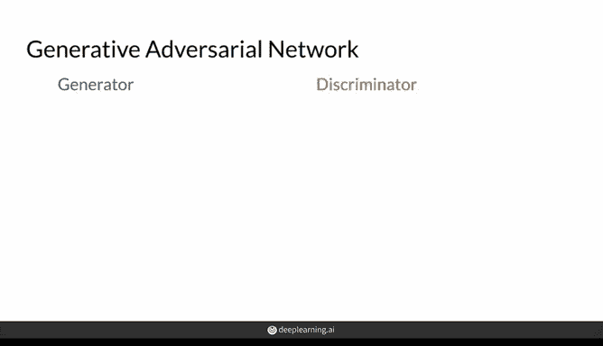

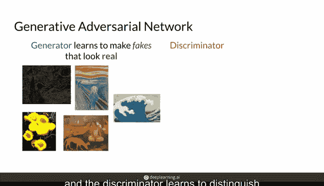

So you can think of the generator as a painting forger and the discriminator as an art inspector。

So the generator forges fake images to try to look as realistic as possible。

 and it does this in the hopes of fooling the discriminator so you can see here starry night and scream。

They look pretty good。Meanwhile， the discriminator here looks at a pile of real famous paintings in the fake ones created by the generator and tries to tell which ones are real and which ones are fake。

 So here， the ones bordered with that pink purplish color are fake and the ones that are bordered with green are real。

😊。

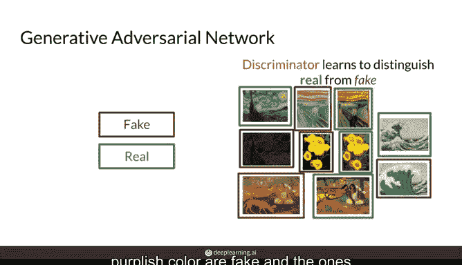

And as you can see a bit from this setup in order to fool the discriminator。

 the generator will try to forge paintings that look more like the real ones。

 and in order to catch the generator， the discriminator will try to learn how to not it fold。

 even by the closest replicas。So to start this game。

All you need is a collection of these real images， like some famous paintings。

 If you want the generator to paint famous paintings。

And so at the beginning of this game the generator actually isn't very sophisticated。

 it doesn't know how to produce real looking artwork。

 so I'm going to represent the generator as this meme of a dog trying to paint。

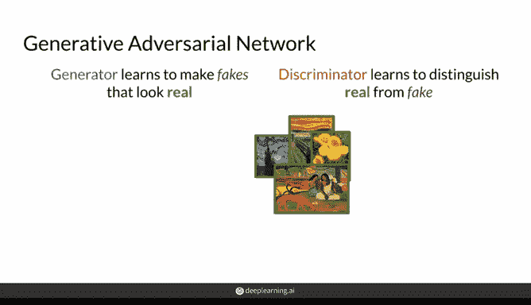

Additionally， the generator isn't allowed to see the real images。

 it doesn't know how this painting should even look。So this is really really tough for the generator。

 especially in the beginning， so at the very beginning。

 the elementary generator initially just paints a masterpiece of scribbles and don't judge her。

 nobody ever told her what to do and what to generate here。

And so your other beginning component is actually an elementary discriminator that doesn't know for sure what's real and what's fake。

And represented here as a dog with a braret on trying to be an art critic here。But in this case。

 he's allowed to look at the real artwork， it's just jumbled up with the fake ones as well。

 and he doesn't know which one is which that's for him to figure out and learn how to decide。

So to start the competition， you train the discriminator using the real artwork so it's able to know which images are actually real。

 so after it decides hm， maybe this looks real， you actually tell it yes。

 that's real or no that's fake。This way you can get a discriminator that's able to differentiate a poorly drawn image like this from the ones that are slightly better。

 and eventually also the real ones。Of course， the discriminator gets these all jumbled up。

 so it doesn't know upfront which ones are real， which ones are fake。

 but you do tell it as it learns， which ones are real， and which ones are fake。

 whether it's right or wrong in determining those two classes。

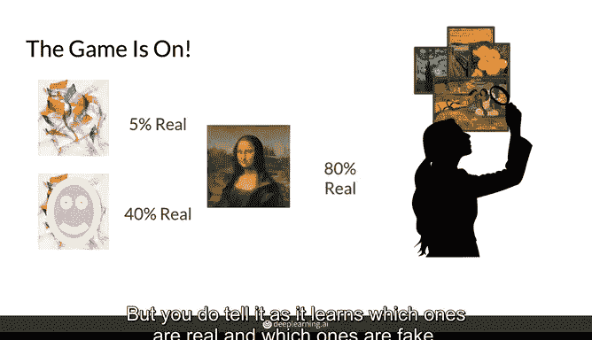

And when the generator produces a batch of paintings。

 the generator will know in what direction to go on and improve by looking at the scores assigned to her work by the discriminator。

So this one looks a little bit more real， so maybe the generator here will start painting a little bit more realistically towards a face of maybe the Mon Lisa。

 not quite there yet， but almost。

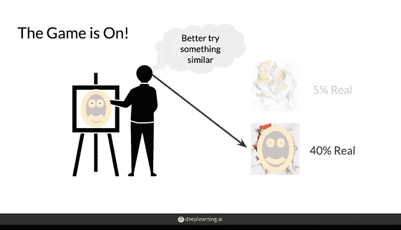

And the discriminator also improves over time because it receives more and more realistic images at each round from the generator。

 and it always remember receives both real and fake images all jumbled up in a pile。But essentially。

 it tries to develop a keener and keener eye as these images get better。

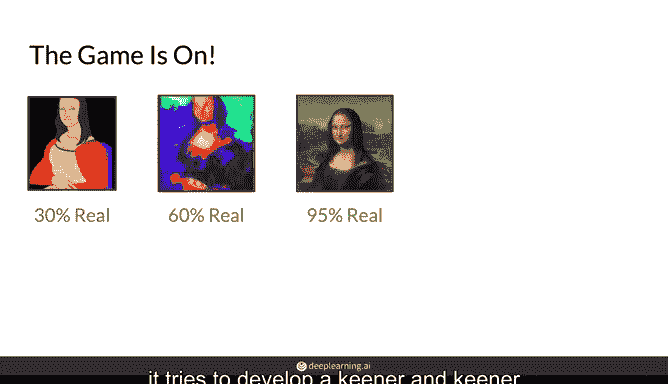

And so when it says that this image here created by the generator is 60% real。

 you actually tell it after it says it's 60% real， that it's wrong， that it's not necessarily real。

 that it's actually fake。

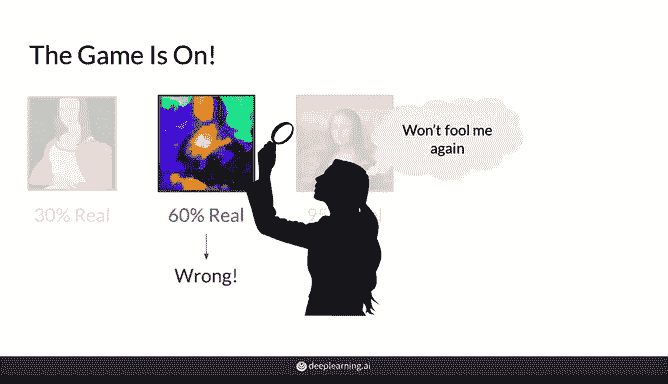

And then after many rounds， the generator will start producing paintings that are harder and harder to distinguish。

 if not impossible， for the discriminator to distinguish from the real ones。 And then at this point。

 when you， the person who wants a good generator to generate awesome， fake images。

 when you are happy with the result of this generator， the game will end。😊。

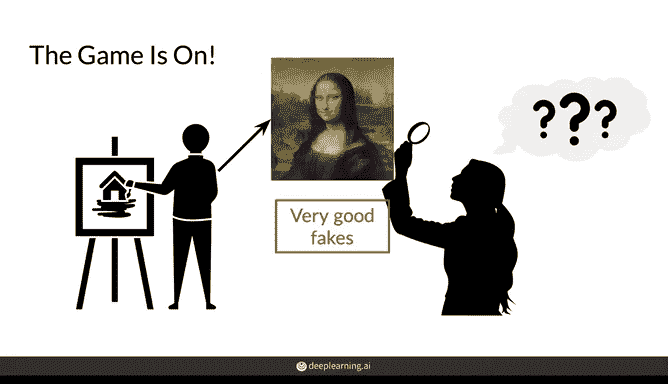

So in summary from this lesson， it's important to take away that the goal of the generator is to produce fakes that look real to the discriminator。

 while the discriminator's goal is to tell the generators fakes apart from real examples that you give it。

And so both models learn from their competition with each other until the examples produced by the generator are good enough to fool the discriminator。

In the next videos， you're going to take this intuition and dig deeper into how this competition works。

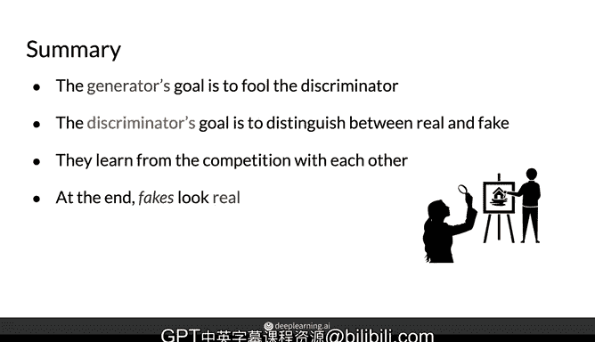