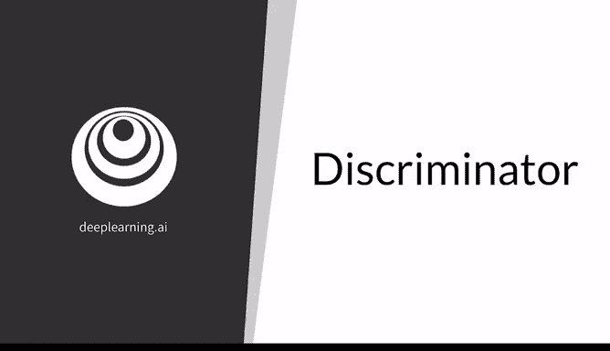
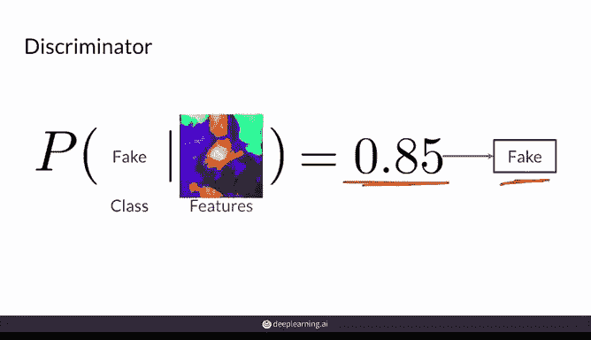
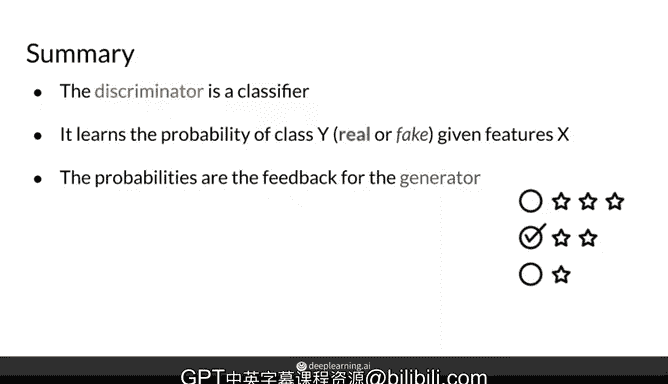

# 吴恩达《生成对抗网络（Generative Adversarial Networks，GAN）》中英字幕 - P6：06_01_09_判别器.zh_en - GPT中英字幕课程资源 - BV1JC4y1T7vZ

SoGNs are composed of two models， the discriminator and the generator in this video I'll show you first how the discriminator works。

The discriminator is a type of classifier。 so'll start with a refresher on what that is。

 Then you'll see in probabilistic terms what classifiers learn to model。

 And at the end of this video， I'll show you how it all translates to thegans discriminator。

 So as a quick recap， the goal of a classifier is to distinguish between different classes。

 So given this image of a cat， the classifier should be able to tell that it's a cat and not a dog。

 for example， In fact， it can learn to differentiate cats from multiple different classes。

 And this depends on which classes you want it to differentiate。

Probably the simplest case is probably just cat and not cat。

Classifiers aren't limited to determining image classes。

 so you could have this piece of text right here it meows and plays with yarn to classify into a cat。

 you could have a video of a cat purring， all sorts of different things here。

So one type of model for a classifier is using a neural network and this neural network can take in some features x。

 for example， here there's x0， x1， x2 all the way up to xN， so n different features。

It computes a series of non nonlinearities， which I'll get into later and outputs the probabilities for a set of categories。

 and it thinks that it's 45% likelihood of this image being a cat。

 45% likelihood of this image being a dog， and 10% likelihood of this image being a bird。

And in the beginning， the model probably won't know how to classify correctly。

 so that's why cat and dog are probably on par with each other here。

 and it learns over time trying to improve its predictions according to the true labels from the data。

 so you'll tell it at the end， no， this is 100% cat， 0% dog，0% bird。

So this learning process can be summarized as follows。

 you have some impeffetures X such as that it purs。

 and it likes to play with yarn and a set of labels Y associated with each of your classes。

 for example， a cat， a dog and a bird。And you use your neural network。

 which takes in those features and learns these set of parameters， which I'll call theta。

And these are each of those nodes you see in that neural network。

These weights change over time as it learns what a cat looks like and what a dog looks like and what a bird looks like。

In these parameters， the are trying to map these features X to those labels Y in those predictions you'll call Y hat because they're not exactly the exact Y labels。

 they're trying to be the Y labels。And so the goal is to reach a point where the difference between the true values y and the predictions why hat is minimized。

And this is where a cost function comes in and it's computed by comparing how closely Y hat is to Y。

 and that's a goal of this cost function， which tells this discriminative model， this neural network。

 how close it is to classifying cat correctly and do correctly and bird correctly。

So from this cost function， you can update those parameters， those nodes in that neural network。

 according to the gradient of this cost function， and that just means generally which direction those parameters should go to try to get to the right answer。

 to try to get to a Y hat that's as close as possible to why。

And then you repeat this process until your classifier is in good shape。

 So let's take a little ride into Ma land， where the goal of the discriminator is to model the probability of each class。

 for example， not just cat here， but turtle bird， dog and fish as well。Given a set of input features。

 for example， here is an image of a cat， so given this image of a cat， which class is this？

In other words， this is modeling the probability of class Y， given input features X。And again。

 these features could be features extracted from this image such as that it purs and that it likes to play with yarn。

 but also the pixels themselves。And this is a conditional probability distribution because it's predicting the probability of class Y conditioned on a certain set of features。

 which is what this vertical bar is for。So the model only makes a prediction of a class once it's seen the input features。

 and in this case it's an image。And now， bringing it back to the GAN context。

 the discriminator is a classifier that inspects the examples， their fake examples。

 their real examples， and determines whether they belong to the real or fake class。

So taking in this fake moda Lisa here， and instead of determining whether there is a cat dog or bird in this image。

Determining how fake this image is， and here it thinks it's 85% fake。In probabilistic terms。

 the discriminator models the probability of an example being fake given a set of inputs X。

 For instance， it'll look at this picture of a fake mod Lisa and determine that with 85% probability。

 it isn't the real one。And as a simplification， it will be classified as fake。

And you can also think of this as 0。15 real and rewrite this as the probability over real given that image。

The discriminator models the probability of an example being fake given that set of inputs X。

For instance， it'll look at a picture of a Mona Lisa or a fake Mona Lisa and determine that with 85% probability。

 this isn't the real one， 0。85 fake。So in this case。

 it'll be classified as fake in that information and not just this fake information， but this 0。

85 will be given to the generator to improve its efforts。

In summary， the discriminator is a type of classifier that learns to model the probability of an example being real or fake。

 given that set of input features like RGB pixel values for images。

The output probabilities from the discriminator are the ones that help the generator learn to produce better looking examples over time。

