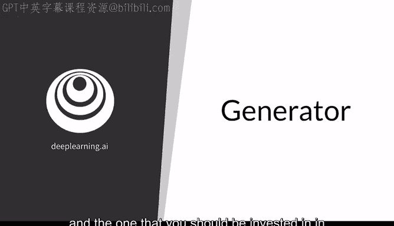
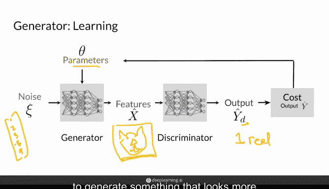
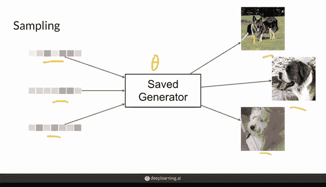
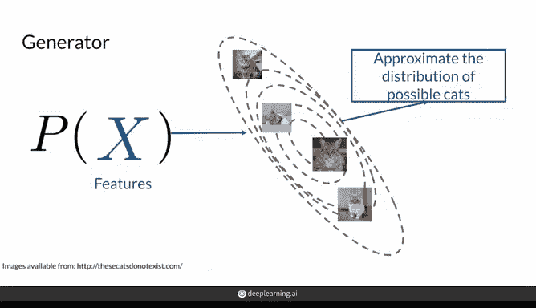
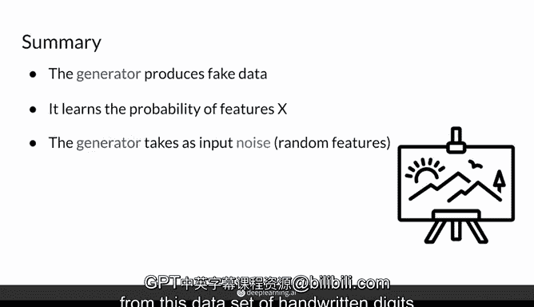

# 吴恩达《生成对抗网络（Generative Adversarial Networks，GAN）》中英字幕 - P7：07_01_10_生成器.zh_en - GPT中英字幕课程资源 - BV1JC4y1T7vZ

The generator in agan is like its heart。It's the model that's used to generate examples and the one that you should be invested in in helping achieve a really high performance at the end of the training process。

In this video I'll revisit the role of the generator and you'll see how it's able to improve its performance。

 then I'll show you what it models in terms of probability。

So the generator's final goal is to be able to produce examples from a certain class。

 so if you trained it from the class of a cat， then the generator will do some computations and output a representation of a cat that looks real。

So ideally， the generator won't output the same cat at every run。

 and so to ensure it's able to produce different examples every single time。

 you actually will input different sets of random values also known as a noise vector。

And so here this noise vector is actually just a set of values where these differently shaded cells are just different values。

 So you can think of this as 1，2，5，1。555。And then this noise vector is fed in as input。

 sometimes with that class Y for cat into the generator's neural network。

So this means that these features x0， x1， x2， all the way up to XN。

 include the class as well as the numbers in this noise vector。

 and so then the generator in this neural network will compute a series of nonlinearities from those inputs and return some variables that look like a Q brown and white cat in a run。

So here instead of different classes， its output will actually be an image and so you can imagine maybe this image has 3 million pixels。

 so you can imagine those being 3 million nodes at the end there that do not necessarily represent classes but each pixel's value。

And in another run， it can generate this sphinx cat。 and maybe in a final run， this savannah cat。

And these are all with a different noise vectors。 So let's first consider conceptually how the generator improves over time。

 First， you have a noise vector or those random input values you saw。

 which I'm going to represent with this Greek symbol here ofsi。

 and you pass this into a generator represented by a neural network to produce a set of features that compose an image of a cat or an attempt at cat。

 For example， your generator might generate this。In this image Xha is fed into the discriminator。

 which determines how real and how fake it thinks it is based on its inspection of it。And after that。

 from what the discriminator thinks of it， which is this Y hat with a D here representing that it's the discriminator's predictions。

 you can compute a cost function that basically looks at how far the examples produced by the generator are being considered real by the discriminator because the generator wants this to seem as real as possible。

And so basically， the generator wants Y hat to be as close to one meaning real。As possible。

Whereas the discriminator is trying to get this to be zero fake。

And it uses the difference between these two to then update the parameters of the generator。

 and that gets it to improve over time and know which direction to move its parameters to generate something that looks more real and will fool the discriminator。

So once you get a generator that looks pretty good。

 you can save the parameters theta of the generator。

 and that typically means freezing those theta values and saving it somewhere and then you can load it back up and then sample from this saved generator and what sampling basically means is you have these random noise vectors and when you input that into the saved generator。

 it can generate all sorts of different examples and so this saved generator was not trained on cats I hope because it's generating dogs。

Note that you can continue generating new noise vectors， putting it through this save generator。

 and then sampling more dog images in this case。

So in the land of probability， the generator models the probability of an example such as a cat in the previous example it actually was a dog and of course you can do one of a turtle bird or fish as well。

 please go crazy with that。And more generally， the generator is trying to model the probability of these features of a cat。

 such as licking its paw or having cute whiskers or having different types of fur。

 given this class Y of a cat。 So this is the conditional probability of features X。

 given the class Y。 However， since we only have one class at the moment for。

 let's say just generating cats， then y will always be the same。

 And so you don't actually need this here。 so that you have P of X that you're modeling。Of course。

 if you want your generator to learn across all different types of classes and you care about the class。

 then you do need to put that class in and you'll see more on this shortly throughout coursese1。

So now you have P of x across all the different types of cats in the world。

 and the generator will model the probability of features X without any additional conditions。

 and this is because the class Y will always be cat so sit for all probabilities X。And in this case。

 it'll try to approximate the real distribution of cats。

 So the most common cat breeds will actually have more chances of being generated because they're more common in the data set and certain features such as having pointy ears will be extra common because most cats have that。

 but then more rare breeds will have a less likely chance of being sampled。 And so these lines here。

 just represent a 3D probability distribution of how the class of cats are distributed。

 And so the most common types of features that cats carry on will be shown and sampled in this middle here。

 which if you think about this as a 3D representation it's coming out at you。

 And then a rare breeds or rarer looking cats will be at the edges。

And so this means that the most common cap breeds will have more chances to be generated while the less common ones like the sphinx will be produced much more rarely。

And you'll see in future videos how to control the sampling process and get what you would like。

 but right now the generator's job is just to model how cats are in the natural world。

So to wrap up， the generator produces fake data that tries to look real。

 it learns to mimic that distribution of features X from the class of your data。

 and in order to produce different outputs each time， it takes random features as input。

In this week's assignment， you'll build a G that generates images of numerical digits。

And it has the same setup， you just give it random noise。

 and it can produce all these different digits that are handwritten。

 and this is cool because handwriting doesn't look perfect。 It doesn't look the same each time。

 and it would be able to model and generate the range of different fives and8s in all sorts of different digits from this data set of handwritten digits that you'll see in the assignment。

😊。

