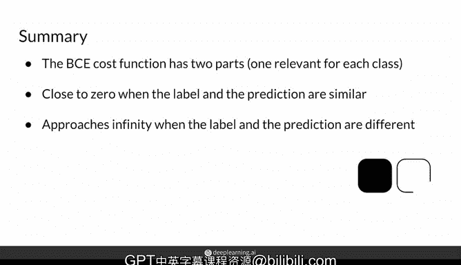

# 吴恩达《生成对抗网络（Generative Adversarial Networks，GAN）》中英字幕 - P8：08_01_11_BCE成本函数.zh_en - GPT中英字幕课程资源 - BV1JC4y1T7vZ

The binary cross Entropy function or BCE for short， is used for training GNs。

And it's useful for these models because it's especially designed for classification tasks where there are two categories like real and fake。

In this video， I'll show you the equation used to get the BCE loss and what every part of the equation means At the end。

 I'll wrap up the lessonss by showing you how the BCE cost function looks for different labels。

Alright， so here is the full BC cost function， it might look a little bit intimidating。

 but I'll break down each of these components and also give you examples to provide some intuition on how it works。

So first at the beginning here you see a summation sign from 1 to M as well as dividing by that M。

 and so this basically just means summing over the variable M。

 which is actually the number of examples in the entire batch and taking the average of those examples。

 taking the average cost across this mini batch and I'll go over what this negative sign means later on。

So throughout this video H denotes the predictions made by the model， so you see that here。

 why is the labels for the different examples， so these are the true labels of whether something is real or fake。

 for example， real could be a label of one and fake could be a label of0。

X are the features that are passed in through the prediction， so this could be an image。

And theta are the parameters of whatever is computing that prediction。

 so in this case it's probably going to be the discriminator。

 so it's the parameters of the discriminator looking at those features and that's doing this H of x comma theta。

Often you'll see this also written as H of x semicolon theta。

 and that just means parameterized by theta， and that's slightly more accurate。

 but you don't have to worry about that now。In these brackets you can break these down into two different terms。

 and so let's look at each of them， so the term on the left is the product of the true label Y times the log of the prediction。

 which is H of x， the features parameterized by theta for the model。

So to understand what this value is trying to get at， let's look at some examples。

 So the case where the label is 0。 So let's say this means it's fake and you have any prediction here。

Then this value actually results in zero。And if you have a prediction of one， that's real。

And you have a really high prediction that is close to one of 。99。

 then you also get a value that's close to zero。And in the case where it actually is real。

 but your prediction is terrible and it's zero， so far from one。 So you think it's fake。

 but it's actually real。 Then this value is extremely large。

 And this is largely caused by the log there。And so what this is trying to say is that in the case when the true prediction is zero。

 this term doesn't matter， it just goes to zero， so this term is mainly for when the prediction is actually just one and it makes it zero if your prediction is good and it makes it negative infinity if your prediction is bad。

So now looking at the second term， it looks very， very similar。

 save some of these minus signs in here， and so in this case， if your label is1。

 then1 minus y is equal to0。And actually， if your prediction is anything， this will evaluate to zero。

If it's fake and if your prediction is saying， hey， that's pretty fake， it's close to zero。

 then this value is close to zero。 If it's fake， but your prediction is really far off and thinks it's real。

 then this term evaluates to negative infinity。So basically。

 each of these terms evaluates to negative infinity， if for their relevant label。

 the prediction is really bad。And so that brings us to this negative sign a little bit。

 so if either of these values evaluates to something really， really big in the negative direction。

 this negative sign is crucial to making sure that that is a positive number and positive infinity because for a cost function what you typically want is a high value being bad and your neural network is trying to reduce this value as much as possible so getting predictions that are closer evaluating to zero makes sense here because you want to minimize your cost function as you learn。

So in summary， one term in the cost function is relevant when the label0。

 the other one is relevant when it's1， and in either case the logarithm of a value between 1 and0 is calculated。

 which returns that negative result， and that's why you want this negative term at the beginning to make sure that this is high or greater than or equal to zero。

All right， now I'll show you what the loss function looks like for each of the labels over all possible predictions。

So in this plot， you can have your prediction value on the x axis。

 where H is your model and gives a prediction based on x parameterized by theta。

And the loss associated with that training example is on the Y axis。So in this case。

 the law simplifies to the negative log of the prediction。

So when the prediction is close to one here at the tail。

 the loss is close to zero because your prediction is close to the label so good job here。

 this is good and when the prediction is close to zero out here，Unfortunately。

 your loss approaches infinity so really high value because the prediction and the label are very different。

And the opposite is true when the label is zero and the loss function reduces to the negative log of1 minus that prediction。

 so when the prediction is close to zero， the loss is also close to zero。

 so that means you're doing great， but when your prediction is closer to one。

 but the ground truth is zero， it'll approach infinity again。So in summary。

 the BC cost function has two main terms that are relevant for each of the classes。

 and with a prediction and the label are similar the BC loss is close to zero。

 and when they are different， when they're very different， the BC loss approaches infinity。

And the BCE loss is performed across a mini batch of several examples， let's say n examples。

 maybe five examples where n equals 5。And it takes the average of all those five examples。

 and each of those examples can be different， one of them can be， you know one。

 the other four could be zero for their different classes。

