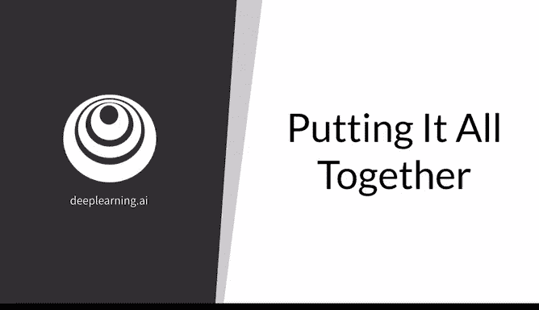
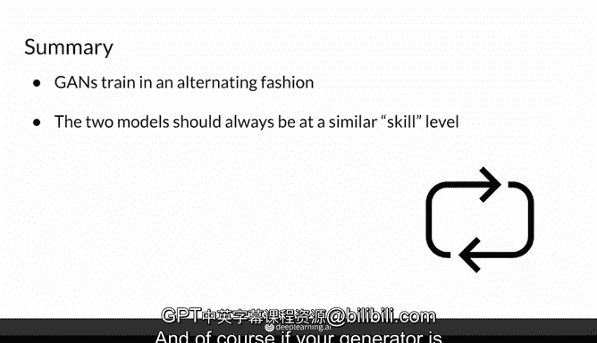

# 吴恩达《生成对抗网络（Generative Adversarial Networks，GAN）》中英字幕 - P9：09_01_12_整体整合.zh_en - GPT中英字幕课程资源 - BV1JC4y1T7vZ

So you've seen all the basics and the intuition behind GNs and their components in this video you'll review some previous concepts that I covered as well as putting it all together so you can get started with training your GAN。

So first I'll share a representation of what a GN architecture might look like。

 and then I'll show you how to train a againN by alternating the training of the discriminator with the training of the generator。

So recall that in a basic G， the generator takes a random noise as input with this psi Greek letter。

 and this generator then produces fake examples called X hat。 and these are fake images， for example。

And I don't need to pass a Class a generator， but I can if I'm generating lots of different classes。

 for now I'm not going to pass a class to the generator I'll show you how this works later。

And then the generated examples， along with some real examples， are passed to the discriminator。

In this probability， this output from the discriminator is called Y hat。

And so the goal of the discriminator is to distinguish between the generated examples and the real examples。

Well the goal of the generator is to fool the discriminator by producing fake examples that look as real as possible。

So to train a base again， you alternate the training of the generator in the discriminator。

 so let's first start with how the discriminator works。So first， of course。

 you get some fake examples X hat produced by the generator from that input noise。

And then those examples， the fake ones， X hat and real ones。

 X are both passed into the discriminator without telling the discriminator just yet which ones are real and which ones are fake。

 and then the discriminator makes predictions why hat of which ones are real and which ones are fake。

 or more specifically a probability a score of how fake and how real each of these images are。

After that， the predictions are compared using that BCE loss with the desired labels for fake and real。

 and that helps update its parameters or theta D where D represents parameters for the discriminator。

And so this only updates the parameters of the discriminator， only this one neural network。

 and not the generator。Alright， so for the generator， it first generates a few fake examples again。

 X hat， and this is from the input noise， and then these are again passed into the discriminator。

 But in this case， the generator only sees its own fake examples。

 It doesn't see the real examples at all。 so it only knows that these are being passed to some discriminator。

And then the discriminator makes predictions why hat of how real or fake these are。And after that。

 the predictions are compared using the BC loss with all the labels equal to real。

 because the generator is trying to get these fake images to be equal to real or a label of one as closely as possible。

And so this is where it's a little bit tricky and a little bit different between the generator and discriminator Discriminator wants the fake examples to seem as fake as possible。

 but the generator wants fake examples to seem as real as possible。

 that is it wants to fool the discriminator。And so after computing the cost。

 the gradient is unproagated backwards and the parameters of the generator or theta subG are updated。

And note again， now it's only the generator， this one neural network that is getting updated in this process。

 not the discriminator。So as you alternate their training。

 only one model is trained at a time while the other one is held constant。

So when training beginss in this alternating fashion。

 it's important to keep in mind that both models should improve together and should be kept at similar skill levels from the beginning of training。

And so the reasoning behind this is if you had a discriminator that is superior than the generator。

 like super， super good， you look at predictions from it telling you that all the fake examples are 100% fake。

Well， that's not useful for the generator。 The generator doesn't know how to improve。

 Everything that just looks super fake。 There isn't anything telling it to know which direction to go in。

 maybe to know add something a little bit more realistic and how to learn over time。 Meanwhile。

 if you had a superior generator that completely outskills the discriminator。

 you'll get predictions telling you that all the generated images are 10 percent real。

 So when traininggans in this alternating fashion， It's important to keep in mind that both models should improve together and should be kept at similar skill levels from the beginning of training。

 And the reasoning behind this is largely because of the discriminator。

 The discriminator has a much easier task。 It's just trying to figure out which ones are real。

 which ones are fake， as opposed to model the entire space of what a class could look like what all cats could look like。

And so the discriminator's job is much easier than the generators。

One common issue is having a superior discriminator， having this discriminator learn too quickly。

 And when it learns too quickly， it suddenly looks at a fake image and says， you know。

 this is 100% fake。 I know this is fake。 but this 100 percent is not useful for the generator at all。

 because it doesn't know which way to grow and learn。 And so having output from the discriminator。

 be much more informative， like 。87 fake or 0。2 fake as opposed to just 100% fake1 probability one fake is much more informative to the generator in terms of updating its weights and having it learn to generate realistic images over time。

And so the most important takeaway here for you is that GAN training works in this alternating fashion typically。

 and in order to improve that training over time， you have to keep the scale of both the generator and discriminator close to each other to maintain a good training process。

And of course， if your generators are to really good， then you're done。

