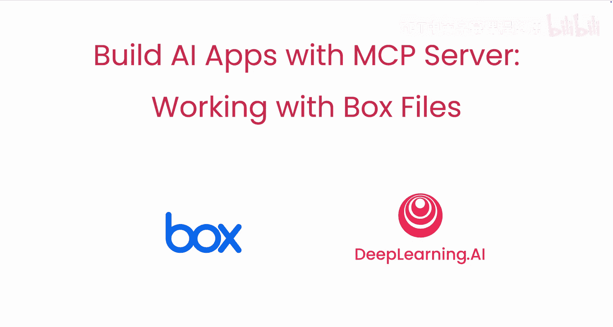
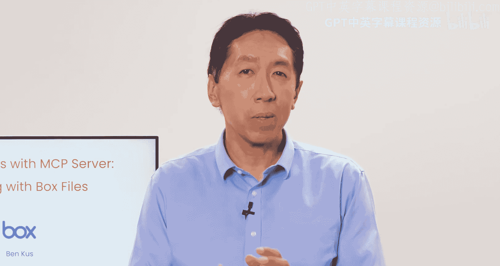
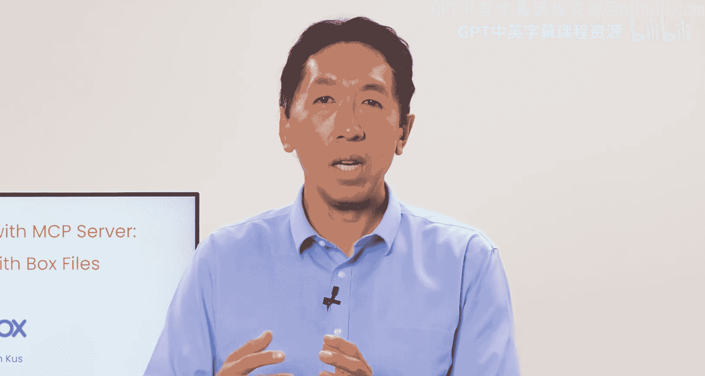
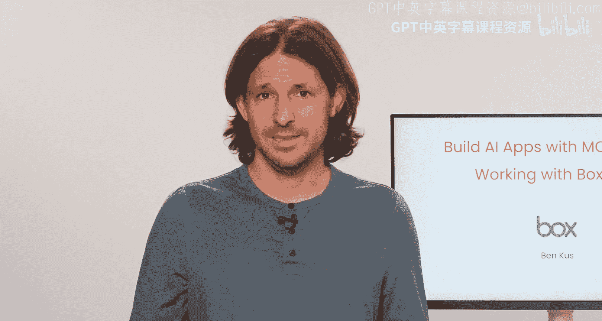
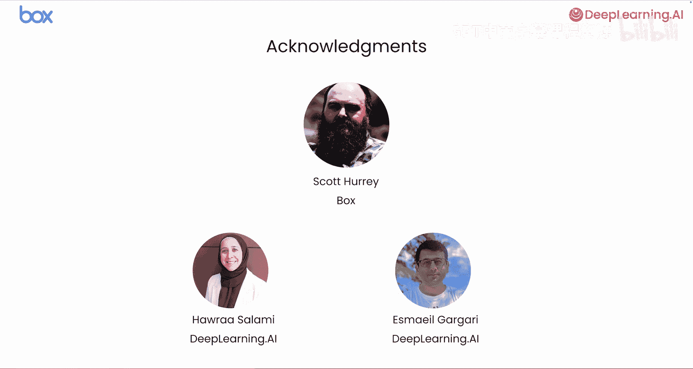

# 吴恩达《用 MCP 服务器构建 AI 应用：操作 Box 文件｜Build AI Apps with MCP Servers》中英字幕 - P1：1.introduction.zh_en - GPT中英字幕课程资源 - BV1sApvzmEYz

Welcome to build AI App with MCP service， working with boxox files。

 built in partnership with box and is close to learn best practices for using MCP service illustraterated by an example of processing unstructured PDF invoices to store extractive views such as decline name。

 invoice amount and product names into database。😊。

The invoices will be stored in a box folder and you learn how to use the box MCP server to interact with files。

 I'm delighted to the instructor for this course is bankers， who is CTtoO。 A box。 Thanks， Andrew。

 I'm excited to work with your honor course。 MCP or model context protocol standardizes the way you provide context to an OM based application。

😊，Instead of writing custom integrations inside your AI applications to interact with external systems or data sources。

 you can connect your applications to MCP servers and thereby automatically extend the set of tools available to your AllN for example。

 boxes MCP server provides a set of tools interact with files and folders such as file search。

 text extraction AI based querying and data extraction for your data stored in box In this course。

 then we'll walk you through how to integrate the MCP server with any multi-ageent AI application as well in order to process your files。

You use box MCP as an example MCP server in the course。

 but the concepts are extendable to any other MCP server you'll start by building a custom solution where you manually read each locally stored invoice and extract text you'll then pass text to your applications to LLM to extract the client' name total invoice amount and product name from each invoice Next you'll streamline the process by using the box MCP server This server provides the tools you'll need to interact with and process invoices as you add more features to your application the logic may become more complex So the next step would be to transform your application into a multiagent system that consists of multiple specialized agents and where each agent can use the MCP server to search for or process files For example。

 one agent can return the list of files inside the folder and another agent can extract data from a given document and maybe a third agent can generate a final reports with the contents of the invoices In this course you will assume that these agents running。

Deently maybe even developed by other teams， so you'll make them communicate with each other using the agent to agent or AdaA protocol developed by Google Many people have worked to create this course I'd like to thank from B Scott hurryrry。

And from Deeplenda AI， Har Salami and Eshma Gagari also could it to this course All right。

 let's go to the next lesson where you'll implement your AI application without the use of the inbox MCP server。

 which requires that you write custom code for each file type。

