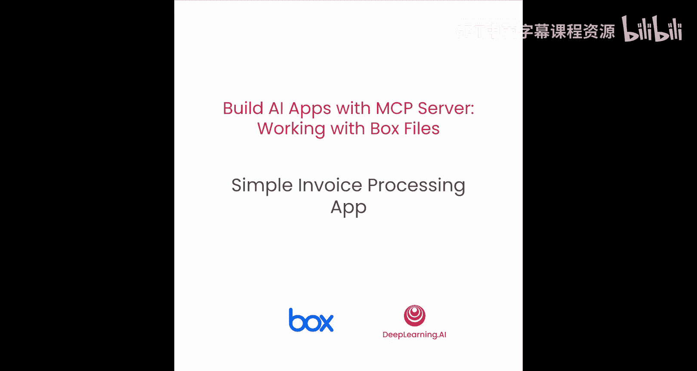
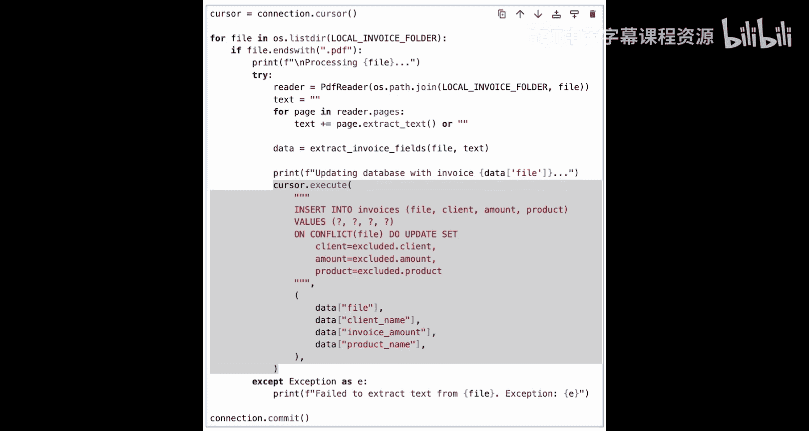
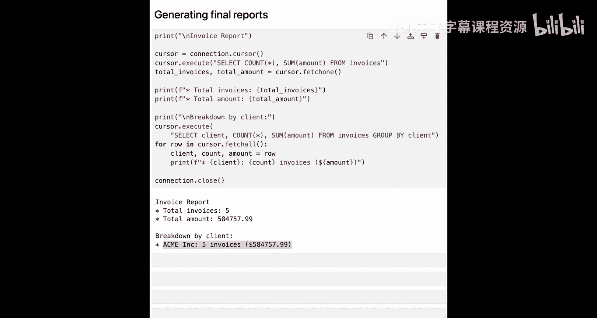

# 吴恩达《用 MCP 服务器构建 AI 应用：操作 Box 文件｜Build AI Apps with MCP Servers》中英字幕 - P2：2.simple-invoice-processing-app.zh_en - GPT中英字幕课程资源 - BV1sApvzmEYz

In this lesson， you'll manually process local PDF files to extract their content as text。

You'll then use Gemini to extract key fields from the extracted text。Let's dive in。

Let's start by importing all the libraries needed in this notebook。

 You'll use SQL L 3 to store the process information in the local SQL light database。

 You'll use Gemini as your L M in this example， And for that， I imported Jeni。 I here from Google。

 And finally， you'll use Pdf reader to extract text from the invoices。

 One thing to note here is that I load the environment variables from a dot V file into the session so I can access them later。

 Next， let's define some variables。😊，First， I'm using Ge 2。5 flash。

This is a fast and affordable model that is perfect for our example。

 I also define the name of the local folder that contains the invoices you'll be processing to process an invoice you must have the content on your local machine。

I also loaded the Gemini API key from the dot EV file so that you can use the Gemini model。 First。

 let's define a small utility function called parse JO。

 Sometimes Gemini returns responses as a marked on formatmentted Json。 Other times it sends raw Json。

 This help our function ensures that you extract clean Json from the response regardless of the format Gemini returns。

Alternatively， you can use pedantic to define the expected output structure and instruct Gemini to format these responses accordingly。

 You can check your notebook for an implementation example。

 Since the coding example in the next lesson also requires handling tool usage from the models output。

 we use the same parrsse Json function in both examples to maintain consistency across notebooks。

 Here's the core function that communicates with Gemini。 I call this function。 Ex invoice fields。

It takes the text from an invoice。 sends it to Gemini and asks for the relevant key fields。 First。

 you set up the Gemini client using the API key。 Then you define the prompt。

 The prompt is straightforward。 I ask Gemini to extract client name。

 invoice amount and product name from the invoice text in returnist information as a Json object。

 If you can't find the value， I ask it to return all。 Once the prompt is ready。

 You can call the model using the generate content function。

 You parse the responses as Json using the function defined earlier。😊。

And then you add one more field， the name of the file from which the data came from this way you know which invoice the data belongs to。

All right， let's now get ready to store this data。I'll start by creating a local database for simplicity。

 I'm using SQL light。 It's light and fast and doesn't require any setup。

 These lines create the database file and a table to store the invoice data。

 if it doesn't exist already from here， you loop through every invoice in the folder。

 you verify that the file ends in dot PDF as that's the only format that the script currently supports。

 then you open the PDF file using the P reader library and convert each page of the document to text then you call the extract invoice fields function to send the text to Gemini and get back the structured data that you want Once you have the data you insert it in the database if the invoice is already processed the script updates the existing entry。

 Otherwise it creates a new one you'll do this for every invoice in the folder。

Here is the result of running the process in all our invoices。And once all the data is stored。

 you generate two reports。 The first report gives a total number of invoices in the total amounts across all of them。

 The second report categorize the invoices by client and indicates the revenue generated from each one So we have the total of five invoices but a total amount of 58475799 sets the breakdown by client also reflects that same information。

 That's it。 In this lesson， you built a simple way to process invoices In the next lesson。

 you'll learn how you can solve the same type of use case by using the box' MCP server instead of directly using Gemini and requiring your files beyond your local file system。

 All right， See there。

