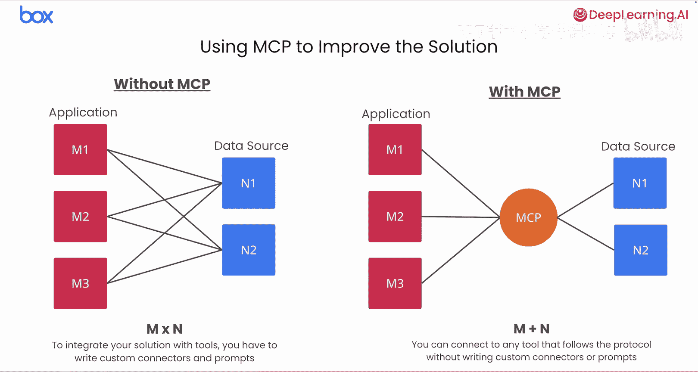
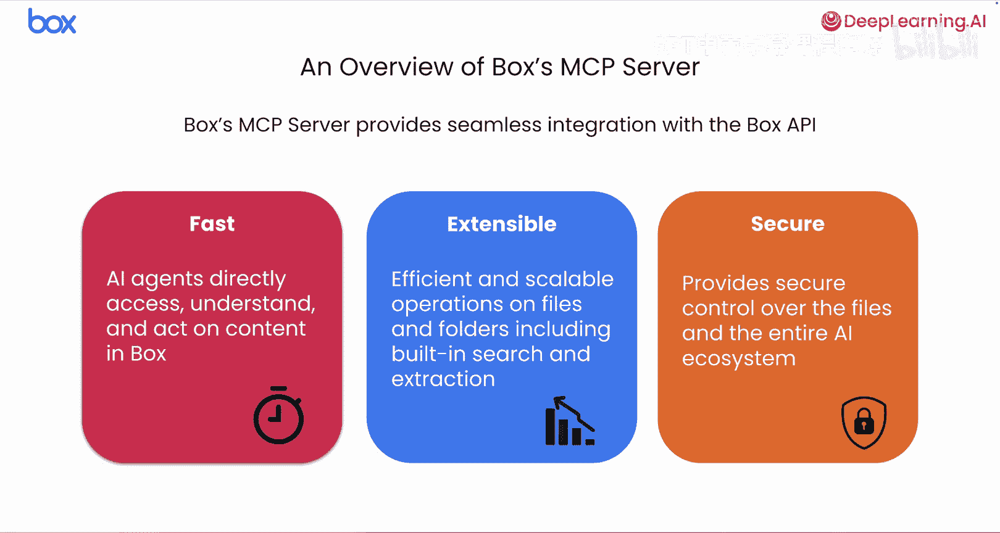
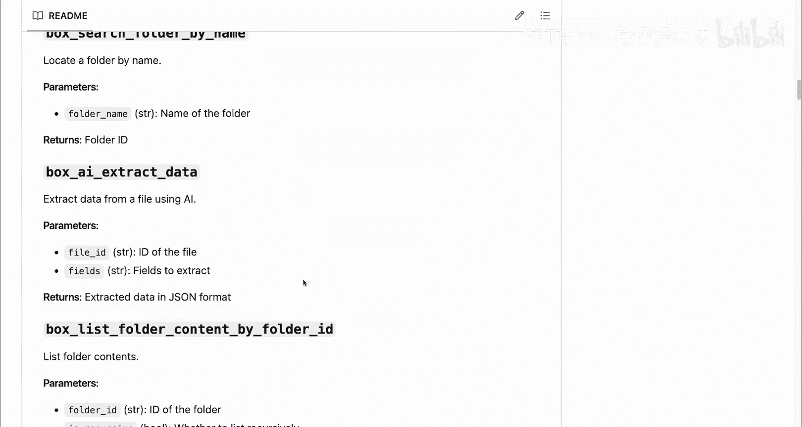

# 吴恩达《用 MCP 服务器构建 AI 应用：操作 Box 文件｜Build AI Apps with MCP Servers》中英字幕 - P3：3.introduction-to-box-mcp-server.zh_en - GPT中英字幕课程资源 - BV1sApvzmEYz

In this lesson， you'll learn how to make your solution more flexible and scalable using the box empty P server。

 All right， let's go。 The solution you implemented worksbe as a proof of concept。

 But if you try to use in a real business environment， you would run into some problems。

 The court issue is a custom bill solution doesn't scale。 First， in the last lesson。

 the files were previously downloaded to local。 But having to download every invoice for box before processing them is extremely slow and would not scale to processing thousands of files。

😊，Second， you built this script to handle specific invoice format in reality。

 Invoices come in various types such as word documents， Pdfs， Jpeex。

 PGs and more your current code would require significant updates to handle that diversity Also。

 as soon as the business needs to extract additional fields。

 you'll need to revisit and update the code。 This makes a solution in And finally。

 processing files like this would need to be reviewed for best practices and data security due to storing files Often with sensitive data that would complicate this type of solution。

 This makes it a solution and practical beyond a simple proof of concept。

 you'll need to give your current solution a boost in order to handle various file types seamlessly across the entire enterprise。

 This is where the model contact protocol or MCP comes in MCP will help you simplify the complexity of your application making it more flexible and scalable at its core。

 MCP is a standard that defines how context in terms of external tools and data resources is provided to AI applications Right now。

 your solution was built custom with Gemini。 you had to write custom oneoff application to process the invoices if。

To extend the functionality and access other tools or data sources。

 you need to write more custom code This is known as the M times n problem for M applications and in external data sources or systems you'll need to write n times n integrations which quickly becomes unmanageable by adding support for MCP your application can access any external tool that also follows MCP standard Here's how it's done the definition and execution of tools are offloaded to an MCP server This means that inside your AI application you no longer have to write custom code to connect your models to external systems instead use an MCP client within your application which connects to the MCP server and sends tool im requests the same server can be used with any other AI application This simplifies everything into a much easier m plus in setup by using MCP you can address many of the scaling and flexibility issues we identified before。

Back to our use case。 Let's look at a specific practical implementation that will help us improve the solution using MCP servers such as B MCP server。

 We can outsource the integration work needed to almost any AI agent framework。

 we will use box MCP server for these examples， although this approach can be used with almost any MCP server and with other similar use cases。

 This is the fundamental power of MCP。 we will be using a local mP server that box provides for this purpose。

 essentially it is a readym solution that handles all the complex interactions with the box platform including data extraction API which is one of the most popular parts of box AI API  different vendors will offer different MCP servers。

 some of which you either access locally or unly Some of the things box MCP server provides First it allows AI applications to directly access。

 understand and act on the content inbox。 This major application no longer needs to download and handle files。

 it can just ask the server to perform the actions on the content。

 The server is designed to handle large volume of documents from the start。

 it can execute operations on files and folders very efficiently This addresses the speed and scaling issues in the。

server also includes built in tools It comes with capabilities for searching。

 querying data using AI and extracting fields from documents You don't need to worry about OCR code or prompting the model for specific fields since these are now prebuilt functions you can call and finally。

 because it all happens within the box platform you have secure control over the files and the entire AI ecosystem So heres through epo where you can find the files you can use to locally rom the box emptyP server。

You can see here the list of all tools provided by the B MC server。

 which integrates the B API to perform various operations such as file search， text extraction。

 Abase querying， and data extraction。So let's go to the next lesson to rewrite the solution using boxesoxMP serverver instead of the custom AAP code。

