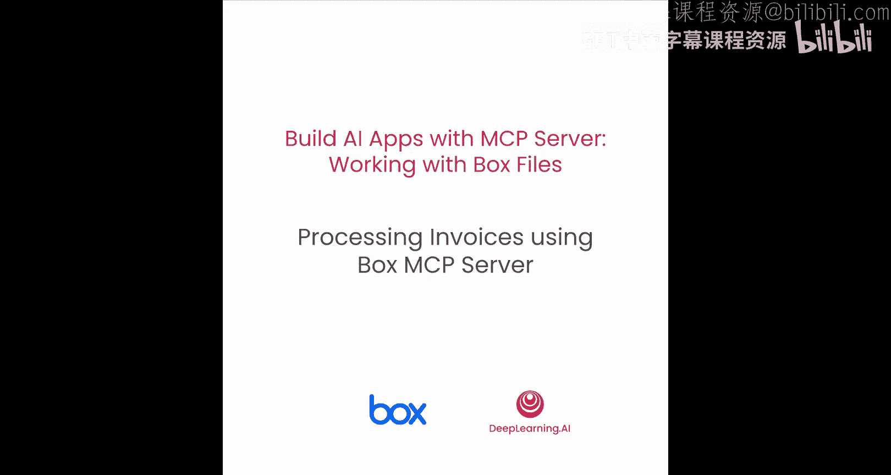
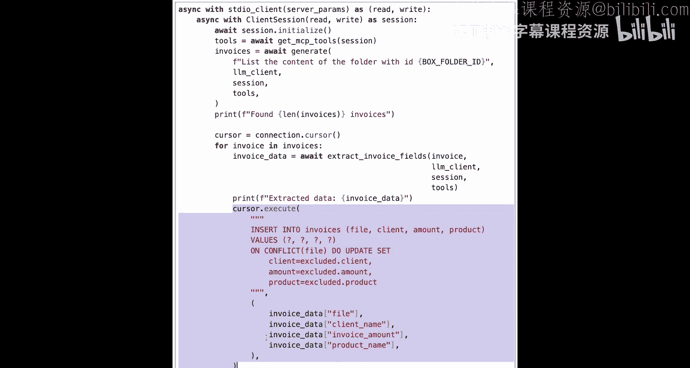
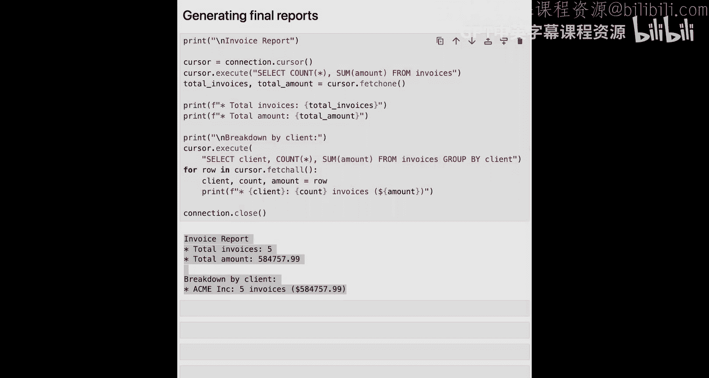

# 吴恩达《用 MCP 服务器构建 AI 应用：操作 Box 文件｜Build AI Apps with MCP Servers》中英字幕 - P4：4.processing-invoices-using-box-mcp-server.zh_en - GPT中英字幕课程资源 - BV1sApvzmEYz

In this lesson， you'll learn how to process invoices using Box's MCP server。

Al right， let's code let's start by loading the necessary libraries。 Again。

 the environment variables upload from the dot Ev file。

 Note that I imported the MCP Python SDK standard Iio client。

 which allows you to spawn and connect to the local MCP server using the standard input output transport client session。

 which allows you to initialize the session during which the MCP server in the MCP client will communicate and standard Io server parameters which allows you to define the server parameter configuration。

 Noteep previouslyously， we were using Gemini as a model to extract the Json fields。

 But in this lesson， we'll be using Gemini as a model to power our tool calling from the MCP server that's provided by box Next。

 let's define some variables。 just like before， I'm using Gemini 2。5 flash as our model。 Now。

 since we're going to run the MCP server locally， we need to install the files of MCP server for the boxP server。

 we clone the server reportpo to the lesson folder。

 And so here I define the local path where these files exist。 keep in mind。

 you could also point the remote MCP server writing the cloud。 Next。

 I define an array with the two tools that you'll be using from the MCP server1 to list the contents of the folder。

In one that does the actual extraction using AI， Finally。

 I loaded two additional settings from the environment file， the gymi API key。

And the box folder I pointer the folder containing the invoices。 Once that's done。

 you can create your Gemini client using the API and configure access to the MCP server。

 Here I define the input output server configuration。

 which includes the command and the arguments required run the server。 In this case。

 I'm pointing to a local folder where the server lives and running it using Uv。

Alice define some helper functions that we will put all together in the final solution。

 So here I defined a helper function that allows your application to discover the tools provided by the MCP server。

 You will use this helper function after the application connects to the MCP server here in this line。

 MCP sends the list tools request to the MCP server。

 which responds to the list of the available tools Since we're not going use every tool I filter the list of available tools and grab only the declarations for the ones we need including this name that expected a parameters。

 This gives you a nice clean list of tools definitions that you can use to pass in a Gemini whenever you make the request Gaway Gemini knows what tools it has access to and how to use them let's again define the parsh Json helper to help clean up the responses from Gemini。

Here I defined a new generate function， which generates response to the user's query or prompt。

This function takes care of passing the prompt and tool definitions to Gemini and handling any tool ins using the MCP server。

 If Gemini wants to use a tool， it will indicate in the response。In this case。

 you use the MCP client to send the call tool requests to the MCP server by specifying the function name and arguments the Gemini provides。

 the MCP server returns the response， which you can then parse and return at the end。

 And if Gemini does not want to use a tool you just extract the text from the response。

 Now I will define the extract invoice field function to extract data from a specific invoice。

 All I need to do is to specify the file I of the invoice stored an inbox in As Gemini to extract the client name invoice amount in product name from that invoice In the complete solution。

 you will call as function after you get the list of files that exist in the box folder。

 noticeice something important here。I'm passing the request to generate the function we just defined。

 I'm not using local OcrR anymore。 I'm not downing the P files locally and turning them into text。

 Instead， inside the generate function， Gemini will decide to use the extract tool from the MCP server and then the MCP server will process a file and then extract the fields on the box server side。

 This means you're not limited to P files anymore。 The tool can handle any documents because the extract tool from box handles this functionality for you。

 in general， when using MCP， you have the benefit of using any advanced functionality that the MCP provider offers you。

 Now， let's move on to the main loop that will contain the code of the complete solution。 First。

 let's open up the connection to the SQL light database。

 and create the table if it doesn't already exist it。And here's the main loop。In the first line。

 I created MCP client and handed the standard input output configuration of the box andP server。

 This will spawn MCP server in the background。 Next。

 I created the session with the read and write streams of the MCP server and then initialized it。

 This will establish connection between the MCP client and the MCP server next to discover the tools available to the MCP server。

 I call the get MCP tools function redefined earlier。

 This will return the definition of the two relevant tools。

 Now ready to ask Gemini to list the contents of the folder。

 I call the generate function with the prompt to list the contents of the folder specified by the box folder I variable。

 Gemini will process the prompt and realize that there's a tool that can handle it。

 the MCP client will then ask the MCP server to invoke it， which will then return the response。

 Then for each invoice， I call the extract invoice fields function。

 In Gemini will decide on the extract tool to pull out the data。 So just like that。

 you can get a list of all the invoice file from box and extract the data using the extract tool。

 Everything goes to the MCP server。 like you did before， youll insert your results in the database。😊。

You can see the result that the Gemini client did indeed decide to call the MCP tool to list the file contents。

 which they found five invoices， and then for each of them it's called the MCP tool。

 which is the AI extract Freeform tool and you can see the extracted data from the fields you requested。

And finally， you'll generate the same two reports just like last time first you'll aggregate all the invoices and sum the total them amount。

 second， you group the data by the client and show much revenue each one brought it。That's it。

 Just like last time we have the same invoice report and break down my client。 As you can see。

 the agent powered by Gemini using the MCPV server provided by box。

 was able to extract the fields in a simple and scalable approach。 In the next lesson。

 you will learn how to further extend the capabilities of this application using multi agent architecture。

😊。

