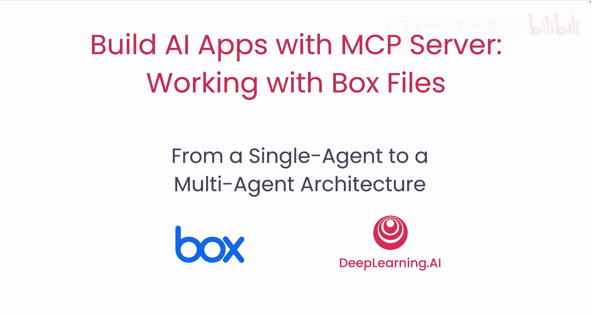
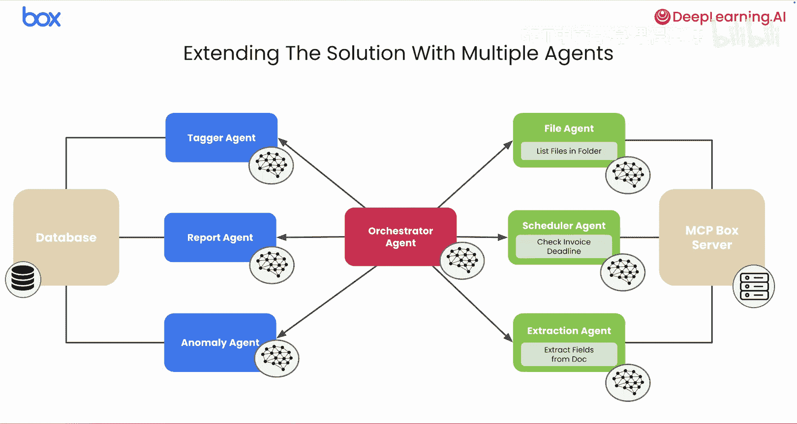
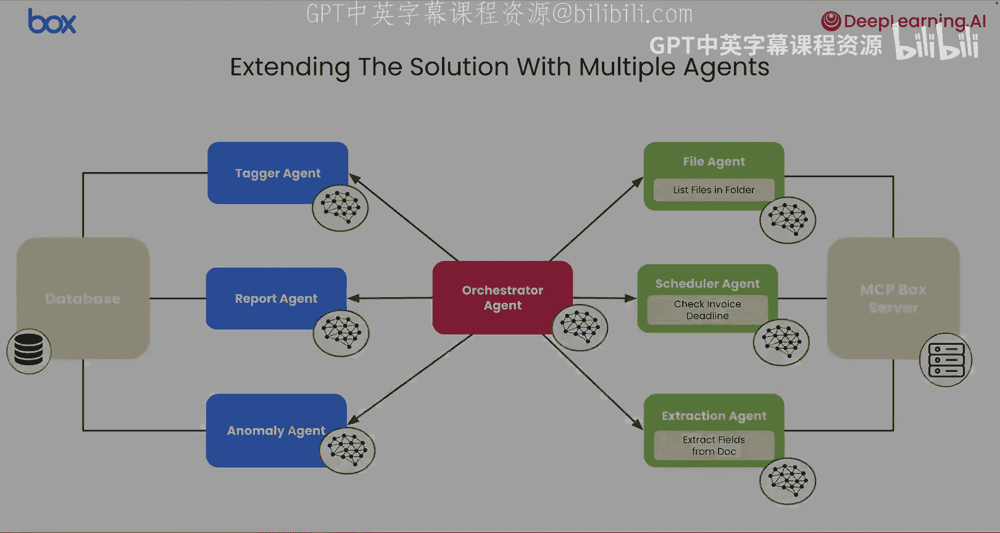

# 吴恩达《用 MCP 服务器构建 AI 应用：操作 Box 文件｜Build AI Apps with MCP Servers》中英字幕 - P5：5.from-a-single-agent-to-a-multi-agent-architecture.zh_en - GPT中英字幕课程资源 - BV1sApvzmEYz

The new MCP based solution is significantly more flexible than the original solution。

 You'll now learn how to extend the solution's capabilities by transitioning to a multi agent architecture。

 You'll also learn how independent agents can communicate through the agent to agent protocol。

Let's dive in。 The new MCP based solution is significantly more flexible and robust than the original solution。

 Now， if you want to extend the capabilities of the solution。

 you can start adding more advanced business logic on top of the data you've extracted。 For instance。

 you can automatically classify invoices based on specific conditions。

 A simple rule can be to categorize all invoices over $10000 with an important tag。

 you can also build a feature to schedule email reminders for any unpaid invoices or to get even more sophisticated。

 you can run an anomaly detection model to identify invoices that are unusually late compared to a client' typical payment history。

 As you can imagine， when you start adding new features to the current solution。

 the application's logic can get complicated very quickly to keep this complexity manageable you need to improve the architecture solution。

 a simple script just won't be good enough to handle all of the new logic in a clean and maintainable way。

 a more efficient architecture approach is to transition to a multiagent architecture。

 instead of having one large complex agent that tries to do everything。

 You could break down the work into a set of simple specialized agents。This has several advantages。

The most obvious one is that each of these smaller agents is much easier to build。

 tests and maintain。 This also makes the entire system more flexible because the agents are independent。

 It is easier to replace one of them if you find a better way to do its job。

 or even compose them in a new ways to create different solutions。

 Another benefit is that you can scale each agent independently based on this workload。

 without having to touch the rest of the system。 This separation also helps the business work more effectively since you can have different teams be responsible for building and maintaining each agent。

 Let's assume you have a group of independent specialized agents。

 Each developed and maintained by another team。 and you would like to reuse these agents within your application。

 This raises an important question。 How can these agents work together。

 This multiagent collaboration can be made possible through the a to a or agent agent protocol。

 A to a is an openstand。 A universal language that allows agents to communicate。

 collaborate and delegate tasks to each other。 no matter who built them or where they run。

 The goal of A to A is to create true interoperability。

 The protocol establishes a common language that enables different agents to collaborate effectively with one another。

 This is crucial because。😊，alows us to avoid a situation where every new agent requires custom integration with every other agent in these there's also discoverability using the protocol agents can discover each other and understand their respective capabilities。

 One agent can ask another what can you do and get a clear standardized answer。

 This allows them to delegate tasks and request actions from one another。

Ultimately A to will enable us to support complex multiagent workflows to solve problems beyond the capabilities of any single agent working alone。

s return our invoice application。 you can break the current solution in a separate agent Let's start with the orchestrator agent job we be to orchestrate the work of every agent once the orchestrator agent receives a request。

 it can generate a plan and delegate to each available agent to find a solution。 For example。

 it could use a files agent to return a list of files inside the folder。

 the extract agent to extract structured data from any given document and the report agent to generate a final report with the contents of the invoices At the same time。

 the orchestrator can use the tagger agent which would be responsible for applying a tag to the invoice of the amount of 1000 or more The orchestrator agent could also talk to the scheduler agent to send an。

reminder if the client invoice is passed to and finally you could have an anomaly agent running an anomaly detection model to identify invoices that are unusually late compared to the client's typical payment history each agent would have a clear single responsibility and work together delegating tasks using the AAA protocol to create a much more powerful and flexible application in the next lesson you'll transform your implementation into a multiagent system using three agents communicating through the  AAA protocol。

