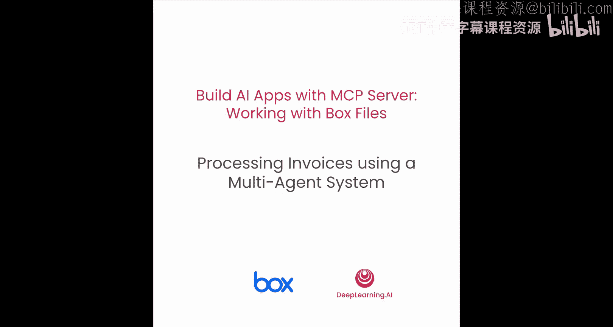
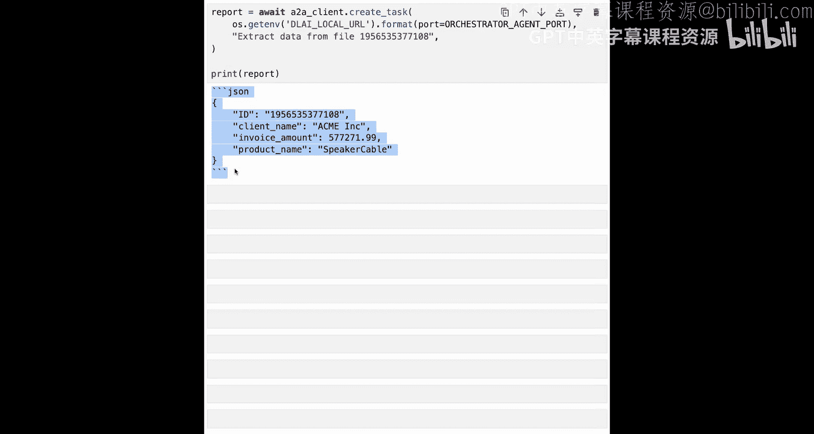

# 吴恩达《用 MCP 服务器构建 AI 应用：操作 Box 文件｜Build AI Apps with MCP Servers》中英字幕 - P6：6.processing-invoices-using-a-multi-agent-system.zh_en - GPT中英字幕课程资源 - BV1sApvzmEYz

In this lesson， you'll build three independent agents that work together to process your invoices。

 A files agent， an extraction agent and an orchestrator。

 The three agents will communicate using the AdaA protocol。 Let's go First， just like before。

 let' importpart some the necessary libraries that will be used in this notebook。

 So here I imported Google's80K or agent development kit。

 which you'll use to define each agent in the multiag system， Note that each agent is MCP compliant。

 meaning that you can connect it to any MCP server by simply defining the server's parameter configuration。

I also imported all the required libraries from A to A to let the agents communicate through A to A and loaded the environment variables from the dot E V file and some other libraries that we need。

For this example， I'm using Gemini 2。5 Pro， it's a more powerful model than Gemini Flash。

 although it's slightly heavier and slower， but for what we're doing here， it's worth it。Next。

 I define the three local ports for each agent that will use to listen to for requests to this local lab environment。

 I also define a few other variables like the folder ID pointing the box folder and the path of MCP server。

Here you'll use the same approach to configure the MCP server as before。

 a standard input output configuration that defines the commanded and arguments required to launch MCP server locally。

Let's move on to defining the agents to keep things simple， I'm going to create three agents， one。

 a files agent that will list every file in a folder。Two。

 an extraction agent that will extract data from a specific document，3。

 an orchestrator agent that will coordinate the whole thing for this particular example。

 these agents will all run locally， but in practice they could be hosted anywhere let's start with the files agent its job is to list all the IDs of the files in a given folder and give this agent access to just one tool from MC server the one that lists the contents of the box folder。

After defining the agent， you need to create its agent card。

 The agent card outlines the agent responsibilities。 This is what other agents。

 such as the orchestrator will use to determine if this agent can assist with a specific task。

 You include things like the URL where the agent will be running。 here。

 I'm using the link to the local lab environment。 But you can use local host if you wish to replicate the work on your local machine。

 The type of input and output formats supported by the agent and the agent skills。 In this case。

 just list files。 Once you have the agent card， you can set up the remote agent at the agent instance variable that you'll used to let the orchestrator communicate with this agent。

 Note that the agent card has an inpoint that ends with this variable。

 The endpoint will be used by the orchestrator to get the information about the remote files agent。

Now let's move on to the extraction agent。 This agent's job is to extract invoice data from the file inbox。

 You'll extract the agent to extract the client name and voice amount and product name and return everything as a JON object in a specific format。

 Again， this agent only has access to one tool， the AI extract tool from boxes MC server just like before you define the agent card It includes one skill extracting data from an invoice and you also provide a few examples so that the other agents will understand how to interact with it。

 We also need to create a remote instance for this one。 just like we did for the first agent。

Now let's look at the orchestra rating。This is the agent that ties everything together。

 The instruction for this agent is a bit more complex。 I asked it to interpret the user's request。

 break it down in the steps and then delegate each step to the appropriate subagent。

 This agent doesn't have access to any tools。 instead it has access to two subagent we just defined。

 Finally， you define an agent card for the orchestrator as well。

 Now that you've defined all three agent you're ready to run them。

 Let's begin by defining a few functions that will start a server for any given agent and run in the background。

 In this function， this runner instance provides the execution environment for each8K agent。

 So this instance is required any time you define an agent with ADK。

 It manages the execution of an agent within that session， handling message processing events。

 Even generation， an interaction with various services like artifact storage。

 session management and memory。 The second important instance is the8 agent executeecutor。

 The agent Excutor acts as a bridge between the8da protocol and your agent's specific logic。

 It receives context about the request and uses an event queue to communicate results or updates back。

 The default request handler instance will then process Q。😊。

To send the response to the user who requested this query， finally。

 you need to wrap the request handler and the agent card in the A to A Starlet application instance。

 which you can then use to run the ADdaA agent server。Now to launch each agent as an  AA server。

 you could have the definition of each agent in a separate Python file and then start the server of each agent in a different terminal。

 you can check the provided notebook for guidelines on how to do that。

 but in this lesson you're going to launch each agent from this notebook environment and for that you're provided with these special functions。

Using these functions let's run the file agents first。

 then proceed with the same steps for the extraction agent and the orchestrator agent。

After in this cell， you'll have all three agents running locally on ports 10024，1025 and 10026。

 You can let the script sleep for a few seconds to ensure the threads are alive and then display the message confirming the agents are running。

Here is a confirmation the agent servers are。Now that everything is up。

 it will create an AAA client that will help you connect to any AAA agent server。

 You can think of this as an interface that receives a user's request and sends your request to the agent is connected to in this case youll connect the AdaA agent to the orchestrator and the orchestrator will analyze the request and for the requests to the specialized agents the AdaA client will handle processing and caching the agent card of the agent。

 creating an AAA client with the agent card， sending tasks to the agent in the correct format。

 paring the responses， and returning clean Json or text。

 This class will make it easy to interact with any of the agents we have run you but we'll use it with the orchestrator。

And now comes a fun part running the multiagent system first I'll ask the orchestrator agent to list the files in the box folder。

 even though orchestrator doesn't have access to any tools to do this directly。

 it knows the file agent does so it'll delegate the task。

 get the response and return it and here's the list of the five files。Now。

 I'll ask the orchestrator agent to extract the data from a specific invoice。 Again。

 the orchestrator will realize the extraction agent can do this。

 It will pass the request along and return the result。And that's it。

 Here' is a response from the extract agent that shows the extracted invoice details。

 You now have a working multi agent system with clearly defined responsibilities。

 tool based capabilities and age to age of communication。

