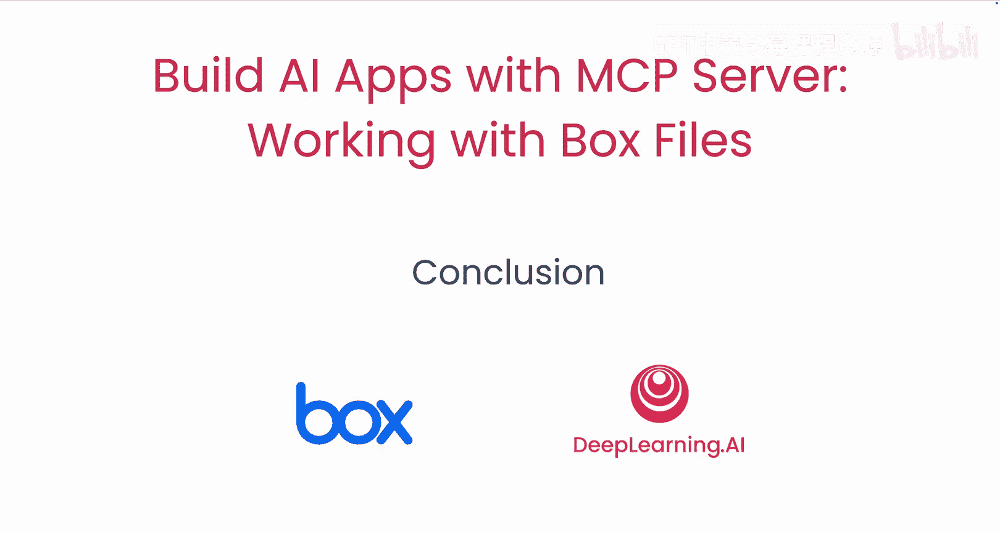
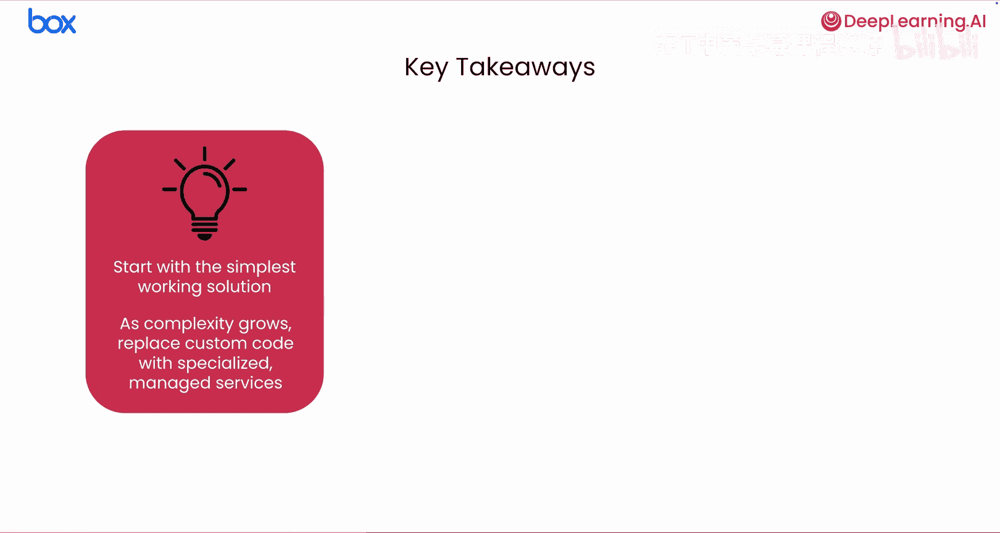
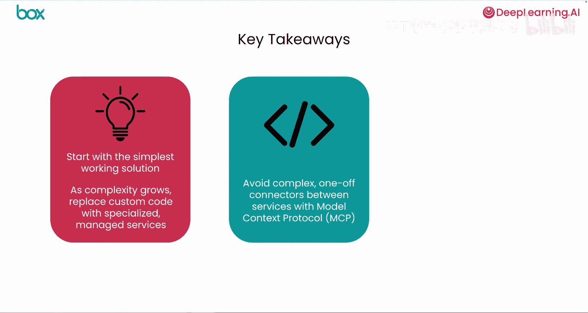
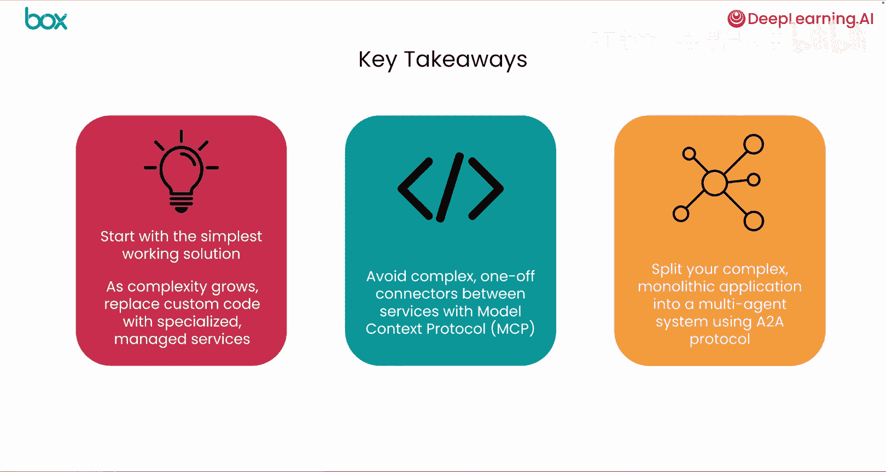

# 吴恩达《用 MCP 服务器构建 AI 应用：操作 Box 文件｜Build AI Apps with MCP Servers》中英字幕 - P7：7.conclusion.zh_en - GPT中英字幕课程资源 - BV1sApvzmEYz

Congratulations on completing the course。 Let's go over the key insights that you've uncovered。

 First， you began the project by building the simplest possible solution。

 This is always a great starting point because it allows you to quickly develop a working proof of concept without getting bogged down and complexity too early After you determine that our first script wooden' scale。

 you reimple our solution using the boxes MCP server as an example。

 to simplify the co significantlyant making it more flexible and scalable。

 The key lesson from that step was about the advantages of the model context protocol and how it can be used to save us from writing complex one off integrations with different tools and services。

 And finally， as our requirements continue to grow。

 we discuss breaking our solution into multiple agents and coordinating them using the A to a protocol。

 This would allow us to manage the new complexity by breaking down problems in a smaller。

 independent Collaborating agents。 by following this natural progression from a simple script to a more sophisticated architecture。

 you can build AI solutions that are powerful， scalable and maintainable。

 Thank you for joining me on this journey。 And I can't wait to see what you'll build next。😊。

