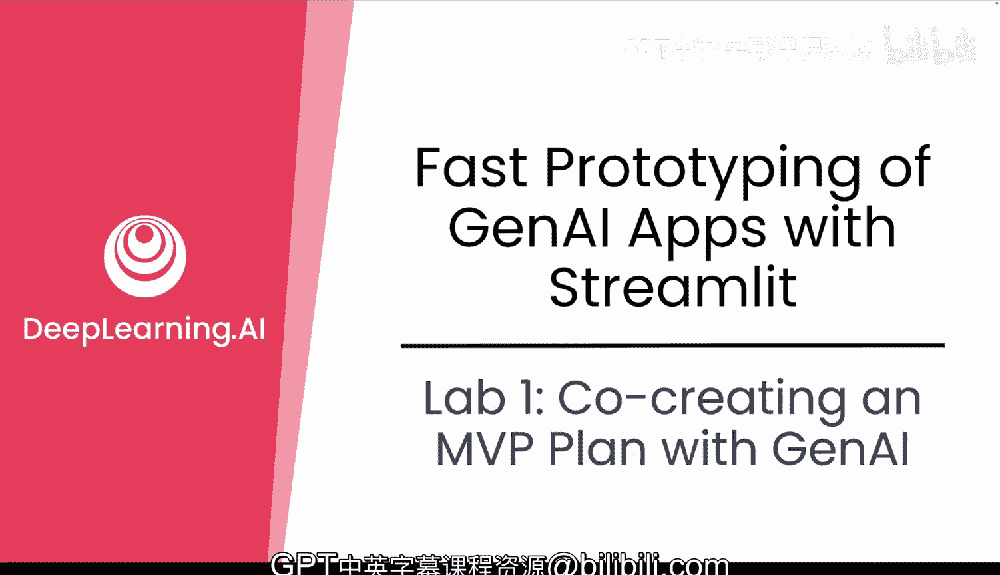
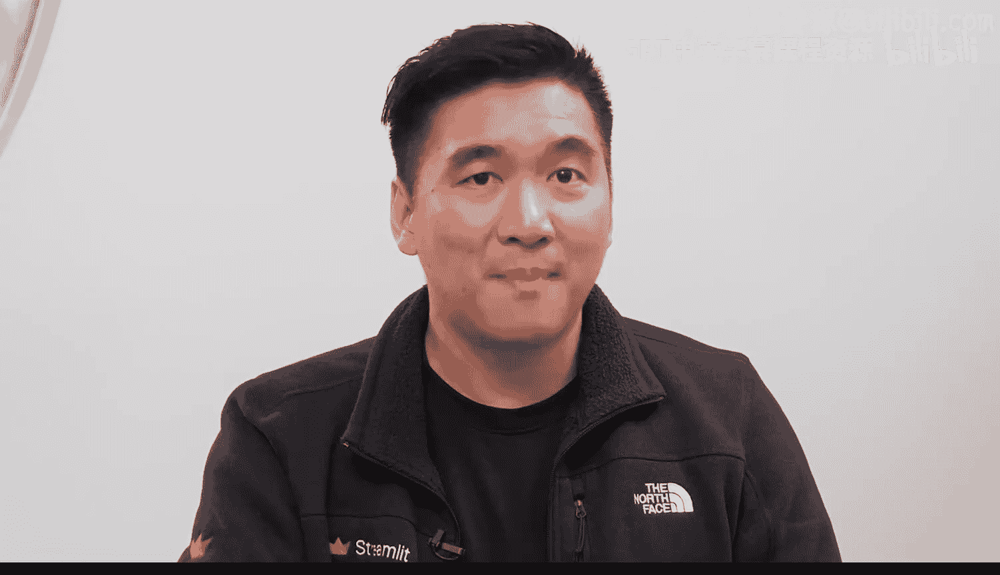
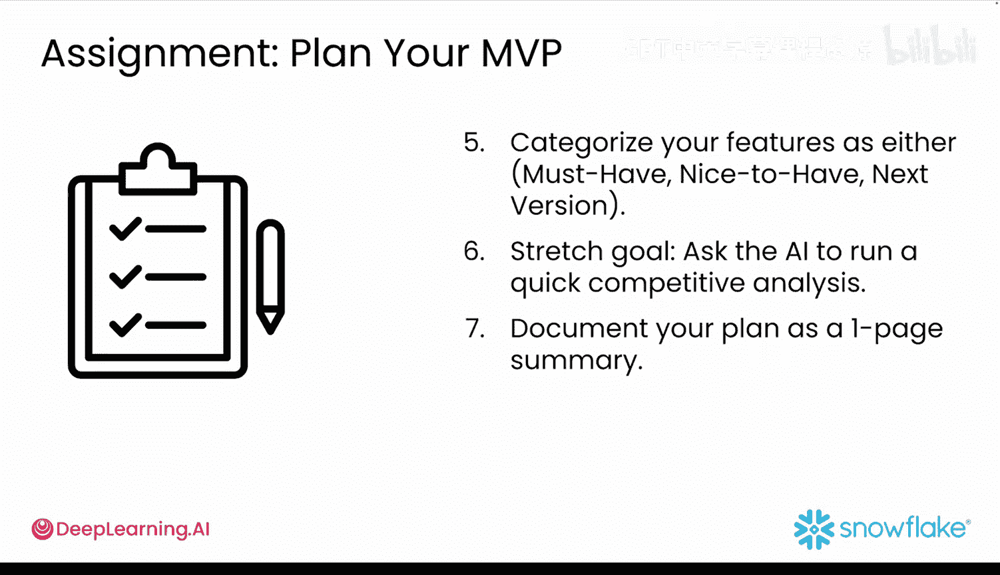
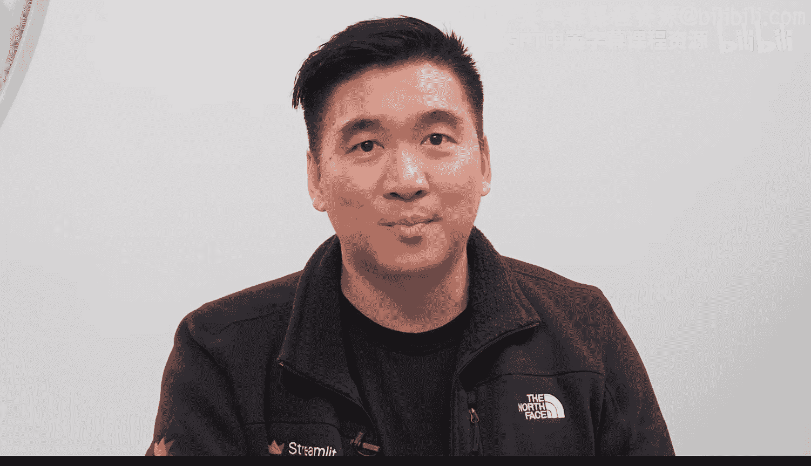

# 吴恩达《用 Streamlit 快速原型开发生成式 AI 应用｜Fast Prototyping of GenAI Apps with Streamlit》 - P10：10_01_13_实验1：与GenAI共同制定MVP计划.zh_en - GPT中英字幕课程资源 - BV1QmYrzMEu1

Allright， you fleshed out your MVP using the map process。 Now let's bring in JenI to help you build。

 You don't have to do this part alone instead of planning everything yourself。

 you could ask a JenI model to help you brainstorm features prioritized task and map out a build plan This is especially useful when you're short on time or stock trying to figure out what to build next。

 let's look at how one developer use JenI not just to code but to think through their MVP Me Priya an M engineer at a healthcare startup she recently build a proof of concept that uses JenI to extract structured insights from clinical trial Ps It kind of works but the prompts are fragile The results are inconsistent and her stakeholders one a polished demo fast so she opens the Geni app and types act as the product manager helped me define an MVP for an app that extracts data from clinical trial Ps instead of just jumping into code Priyallbo。

WithI app walk through the core planning the JenI app helps her walk through the MVP planning process and go Priya goal is clear reduce the time her team spends on manually extracting data from messy clinical trial reports users。

Her audience。Clinical Op staff。Nontechnical users who currently rely on engineers to run queries for them What does the working app look like Her simplest success metric did this save you time rough estimates are fine early on no need to overengineer your KpiIs just yet Proitized features with Jenny I's help preoscopes of basic workflow drag and draw PDF upload LM pipeline to extract and clean the data editable table of results export to CSV This isn't a full product is a lean and clean prototype focus on learning and value。

Before she dives into code， Priya gets a few more tips from GenAI to build a better prompt for her first prototype。

 be specific， instead ofHe me build an app to extract data from PDFs。

 try I'm building a GenI assistant to automate the process of extracting data from clinical trial PDFs to extract insights from the data they contain。

 what core features should the MVP include。Providing context is important because I'm an ML engineer building an internal tool gives a very different response than I'm a student building a school demo。

Ask Jeni for exactly what type of output you want。 summarizemarize this as bullety points。

 generate a step by step plan。 createate a table of MVP versus stretch goals。 instead of saying。

 help me scope my app try act as a product manager for an M team  building a GenI prototype。

 These small changes shift a Geni models tone and structure from generic suggestions to focused collaboration。

 Now it's your turn to co-create your MVP plan with GenI。 Here's a prompt to get started。

 I'm new at using Geni for prototyping。 help me plan an MVP for a streamlet app that load a CSv perform sentiment analysis using open AI shows a bar chart of the results and let users filter by product。

 tweak it to match your idea。 Then try this prompt。 Act as a product manager。

 Help me define an MVP for a ji app， use these principles。Define the end goal， identify the audience。

 choose success metrics， prioritize core features， then walk me through each step What problem are you solving who are you solving it for what would success look like whether they must have features。

 GenI can act like a coach， helping you clarify goals。

 trim features and stay focused on what actually matters you can even flip it around and have GenI ask you questions that help you brainstorm and plan once you've defined your MVP ask you to organize features into must have nice to have next version Before moving on keep in mind that there are things GenI is great at helping you with like creating TDious setup code。

 brainstorming features， writing queries， recommending architecture， planning and debugging。

 but you still need a human for picking the right problem， making UF decisions。

 applying business logic and validating AI。Outputs now is your turn for this first ungraded lab。

 Write a one to two sentence description of your Geni app idea。

 Use your favorite geni tool like chattBT cloud or Gemini copypy paste to structured prompt shown above。

 Ask for help defining your MVP categorize your features as either must have nice to have or next version stretch go ask the AI to run a quick competitive analysis。

 document your plan as a onep summary。 In this lesson。

 you saw how developers like Priya use Jeni not just to build but to plan here。

 you learn how to treat Geni like a product strategy coach by giving it a clear context structure and roles。

 Now youre ready to move from blank page to solid MVP plan in minutes coming up next。

 you will start building your prototype step by step using the avalanche data。😊。

