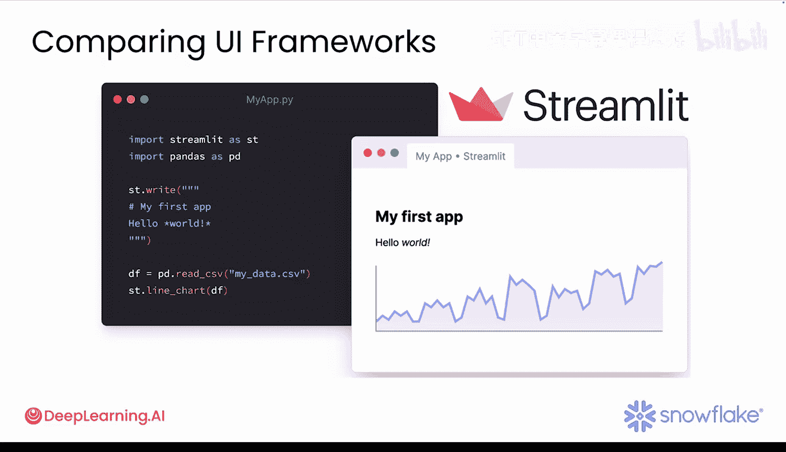
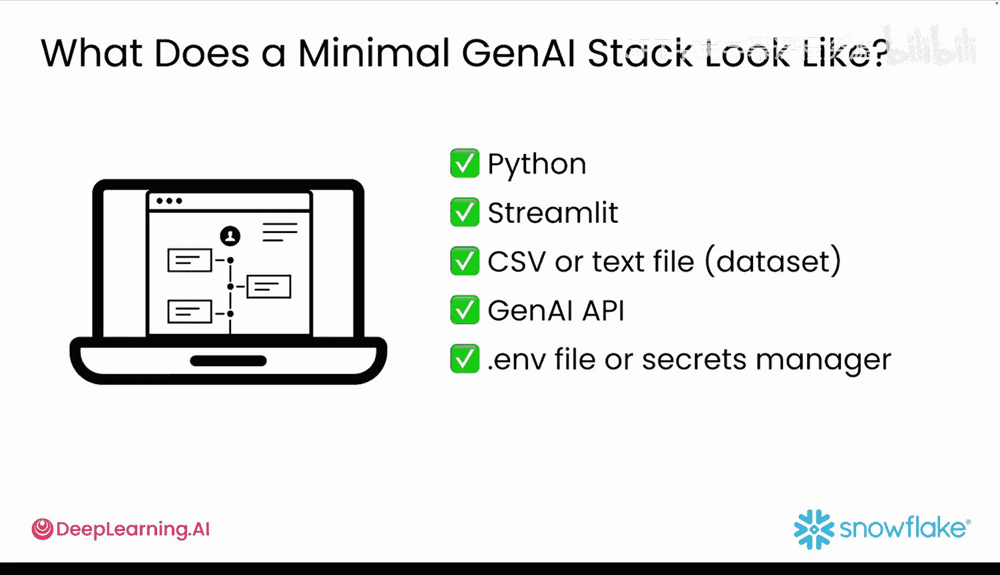

# 吴恩达《用 Streamlit 快速原型开发生成式 AI 应用｜Fast Prototyping of GenAI Apps with Streamlit》 - P11：11_01_01_选择合适的工具.zh_en - GPT中英字幕课程资源 - BV1QmYrzMEu1

When you're building a GenI prototype， speed matters， you don't need a full production staff。

 just the essentials to test your idea and get feedback quickly。

 you're probably used to working in notebooks， running models and analyzing results。

 not building front ends or setting up deployment pipelines。

 but if you want users to interact with your model， you still need some user interface。

 and it has to be fast and easy to build in this lesson will cover how to choose the right tools for building GenI prototypes quickly。

One of the biggest mindset shifts in GenI development is this you don't need to spin up a backend configurefi a database we're set up hosting just to test an idea。

 you can build a working prototype with just three ingredients Python。

 a lightweight UI library and access to a GenI model when you're in built fast mode choose tools that don't slow you down Use Stlit if you're a data scientist or M engineer who wants a simple way to turn Python scripts into interactive apps without worrying about HTML。

 CSS or JavaScriptscript， other tools like radioio and dash can work too but they take longer to set up Stamlit hits the sweet spot for speed flexibility and ease of use for GenI there's no need to train your own GenI models Use pretrain models via APIs like GT4 for general purpose code and text generation Cloud for handling long documents or summaries Google Gemin I for projects inside Google's ecosystem。

Or open source models if you want to work offline。 Just pick one that's easy for you to access and start building。

 Let's break down what a working Geni prototype stack could look like Python to handle your app logic and API calls streamlit to build the user interface CSv or a text file of a small testable data set like the avalanche reviews Geni API like open AI or anthropic API key E V file or secrets manager to keep your API key safe That's pretty much it you don't need to overengineer your prototype or your text stack start simple use Python a Geni model and a tool like Stlit to create something interactive。

 you get real feedback faster and you can always scale up later in the next video。

 you set up your environment and get ready to build。

