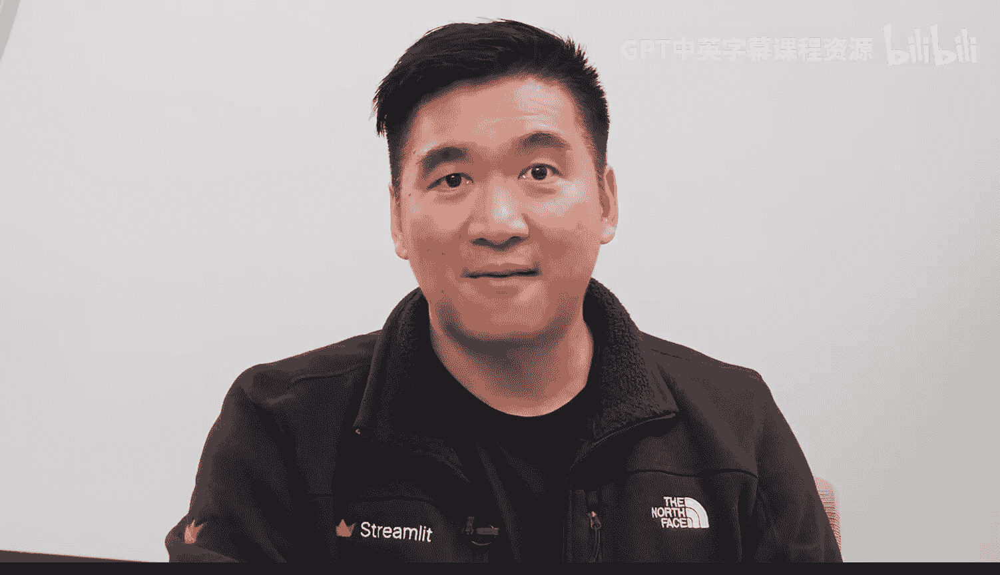
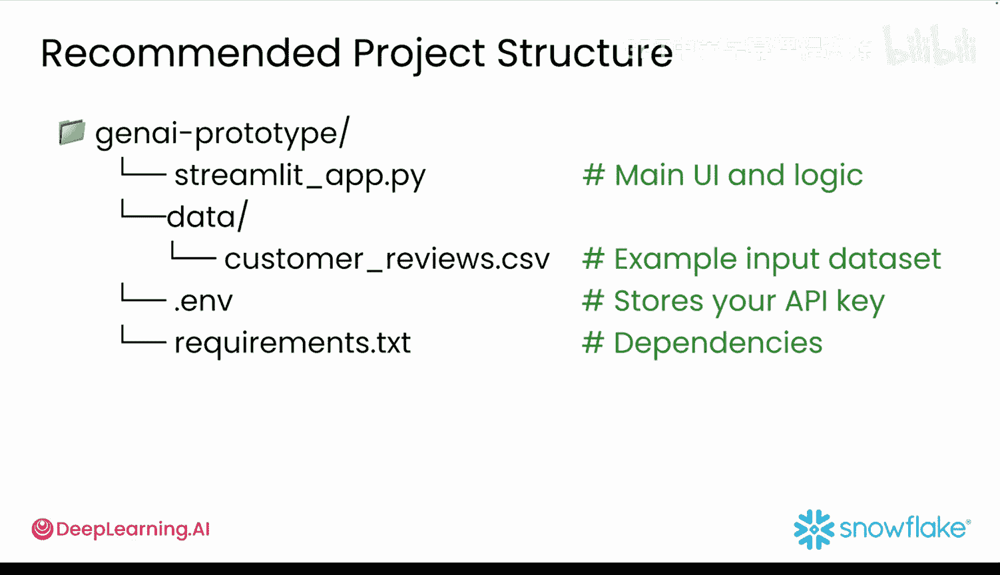
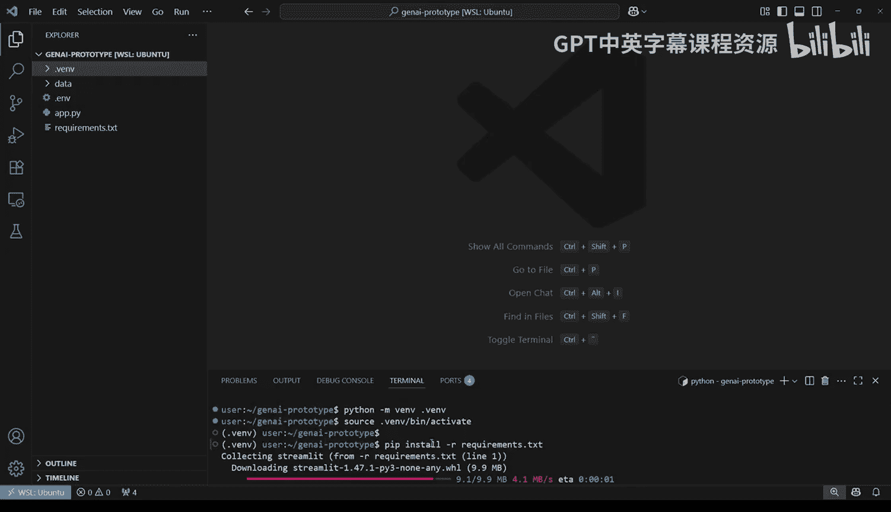
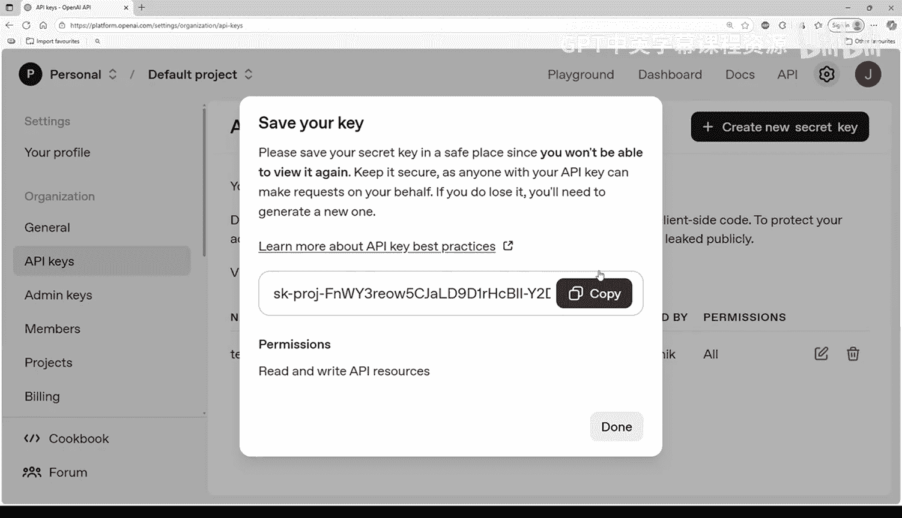
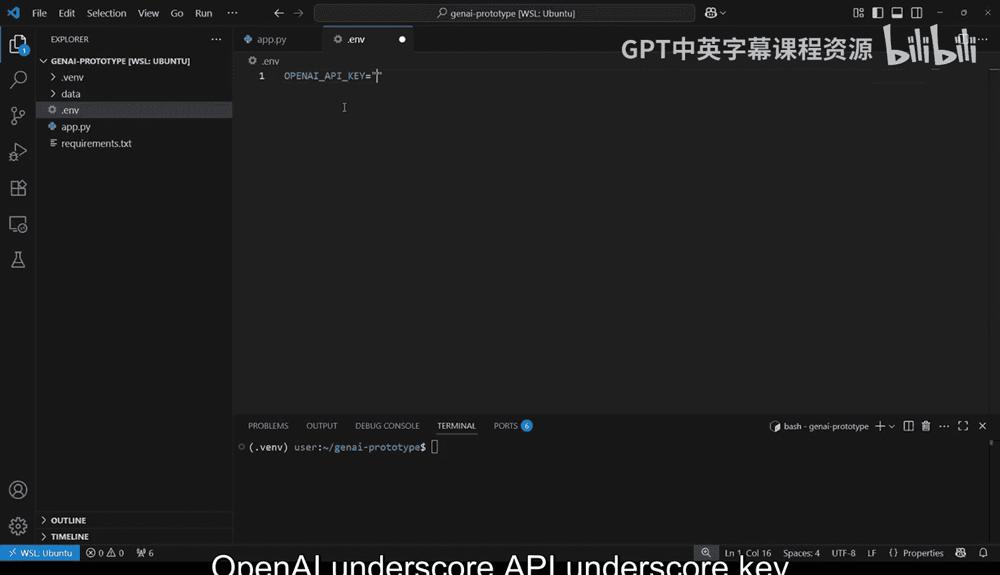
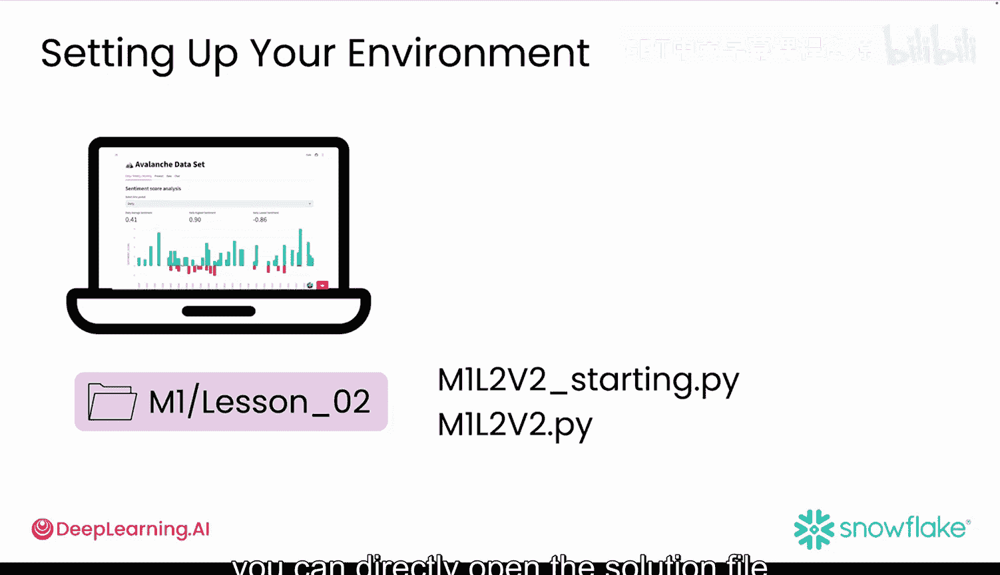
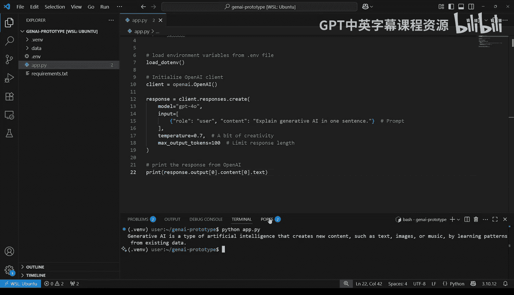
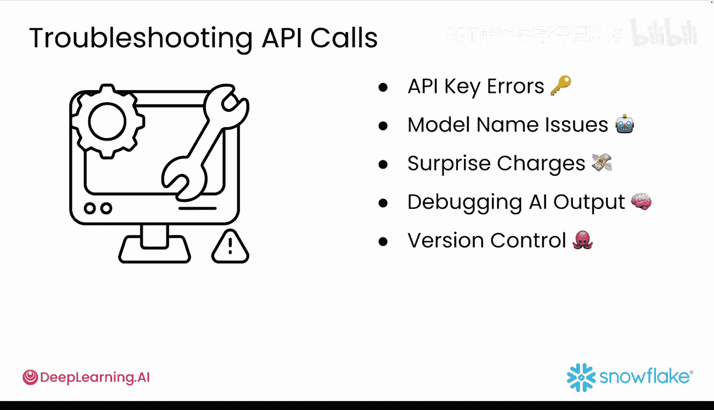

# 吴恩达《用 Streamlit 快速原型开发生成式 AI 应用｜Fast Prototyping of GenAI Apps with Streamlit》 - P12：12_01_02_环境配置.zh_en - GPT中英字幕课程资源 - BV1QmYrzMEu1

Before you can build something， you need a clean and stable environment that lets you focus on prototyping instead of fixing errors in this video。

 you will set up everything you need to start building Geni apps will keep it minimal reproducible and easy to manage。

 Let's get you building prototypes。 feel free to skip this video if you already have these tools set up。

 Here's a simple project structure you can use for your prototype who a folder for your project。

 something like Geni dash prototype， In that folder you'll need Stlet underscore app do py。

 the core app interface and logic data， a folder to store files like customerreview do csv do E V。

 a hidden file in your Os to store secrets like your API key， but never share this requirements TxT。

 a list of Python packages your app needs。 This structure keeps your app organized and easier to update later。

 a virtual environment keeps。😊。

All the tools for a specific project in one place so you can isolate the dependencies required to run your app。

 open a terminal in your project folder and run the following Pythonmvv。

vv will create a new environment。You can see that a new folder appeared here。

 It contains everything you need to activate the environment。

 You could do it by running source dot V E and V slash bin slashactate or on Windows dot V E and V back slash scripts back slash activate。

 Now this activates the environment。 And in your terminal。

 you have dot V E and V written in parenthsesis at the beginning of each row。

 This means your environment is activated。 Then you could install your dependencies with Pip installt dash R requirements dot Tx T。

Now to use AI in your app， you need to connect to OpenaiI's API service This requires an API key which is essentially a password that lets your apps talk to their geni models start by creating an openaiI account at platform。

 openaiI。 co once you've logged in find the API key section in your account dashboard click create new secret key and copy the key that you're given as a reminder it's important to save this key somewhere safe right away you won't be able to access this key again once you close that window make sure that you don't just paste this key into your app code that's not safe instead create a hidden file called do Ev in your project folder you can create a dot Ev file using a text editor and save the file with a do Ev extension place this file in the root directory of your project where your code will run from Once created open the do Ev file and add this line。

Open AI underscore API underscore key equals and then your actual API key Now it is time for you to jump into the code if you want to follow along and write your code。

 you can go to the M1 lesson underscore 02 folder in the Github repo and open the M12 V2 underscorestar do Py file which is just an empty file to write your code if you prefer you can directly open the solution file M12 V2 do Py instead and follow along if you decided to start with an empty script start by adding the following lines。

 this code uses load underscore do E and V function to grab everything from your do Ev file and store it as environment variables in your script OpenaiI openaiI is used to retrieve the openaiI API key that you loaded with load。

or do E and V function Then it creates a connection to the open AI client API Now that you can connect to open AI。

 you need a way to send a prompt and get a response The open AI SDK is always being worked on and update。

 So if these specific instructions don't work for you make sure to check the openaiI docs for the most up to dateate methods to prompt the model add these lines to the end of your script here。

 the function client do responses dot create。It's used to send your message to an open AI model and return its response here's what each argument does model allows you to select the model you want to use。

 you can use GBBT40 in most situations unless you have a specific reason to change it。

Input is a list that keeps track of your conversation history as a list It stores the row that the model took when generating a response and the actual response itself For now。

 you would just ask the model to do a simple task。 Ex generative AI in one sentence temperature controls how creative the AI is。

0。0 means very predictable 1。0 means very creative。

 which sounds great but can be more prone to incorrect responses。

 Max tokens limits the length of the response， which can help control costs and make the answers more or less detailed。

 Note that since this field is changing at a very fast pace。

 it is always a good idea to check the documentation for the latest changes as to function you are using might quickly get outdated。

 Finally， add this code to the last line in your script。

 This line of code takes the response returned from client dot responses dot create and pull。😊。

The actual response taps from the chat history list Since the model can store multiple responses and chat history。

 you want to take the first item in the list with the most recent response at index0 then to get just the text part without the role you can use the attribute content after adding all the code save your file to test your Gen API connection from your command line type the following or change the name of app Py to the name of your file note that you need to be running these commands from the same folder as the file to use this command。

 otherwise you need to give it the full file path if you're running this from the root folder if all goes well you'll see a message like this in your terminal if you don't get a message from the GenI model you'll likely get an error message that explains what went wrong Geni is great for helping you debug and you might also want to have it help you check for and resolve API key errors check for typos or extra spaces。

model name issues make sure you're using the latest model ID OpenaiI updates these often surprise charges start with small tests。

 monitor usage and set spending alerts in open AI debugging AI output AI can make mistakes try edge cases long inputs and empty ones version control use Github to track changes especially when experimenting with different prompts or As if you get an error message and you're not quite sure what it means you can also ask a chatbot model like chatTBT about the error message and how to fix it this can help speed up your development process by saving you a lot of time when debugging in this video you build a solid foundation by setting up a clean organized development environment using Python with a simple UI tool and a genI model creating a secure setup using virtual environments and EV files for your secrets。

And testing everything early to make sure it works。 Next up。

 you will start using this environment to build your first room like prototype。 Let's go。

