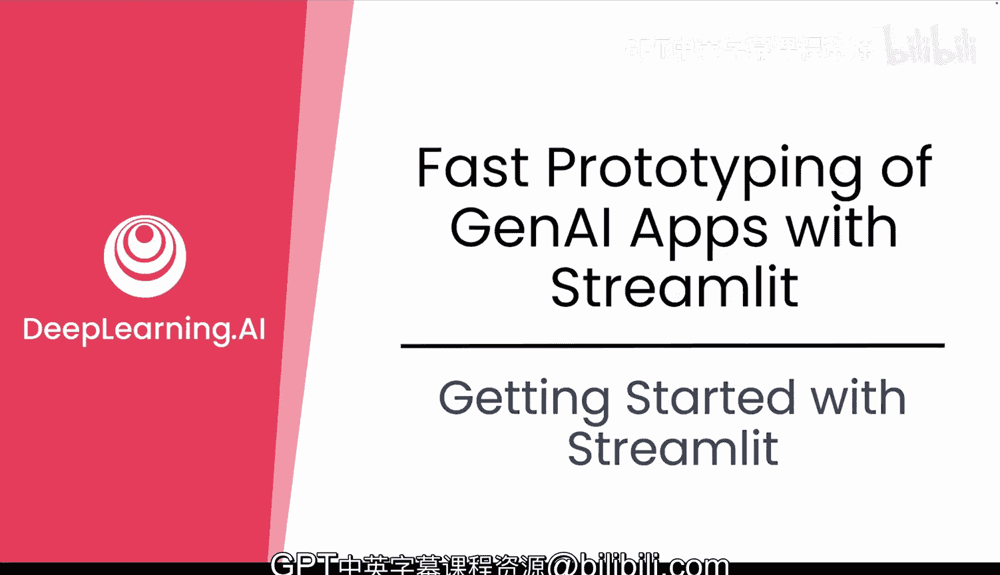
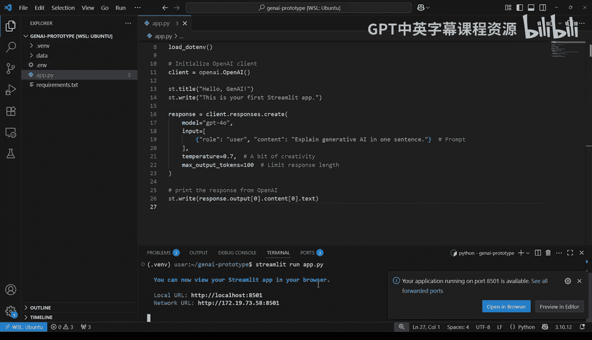
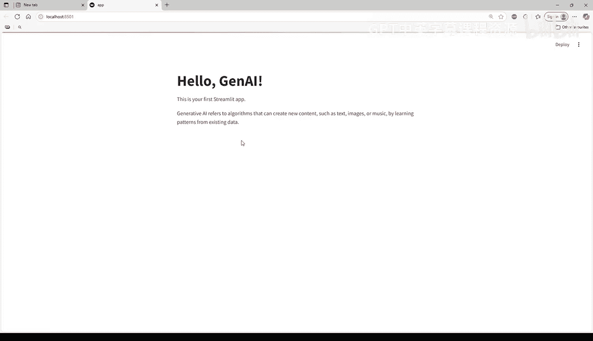
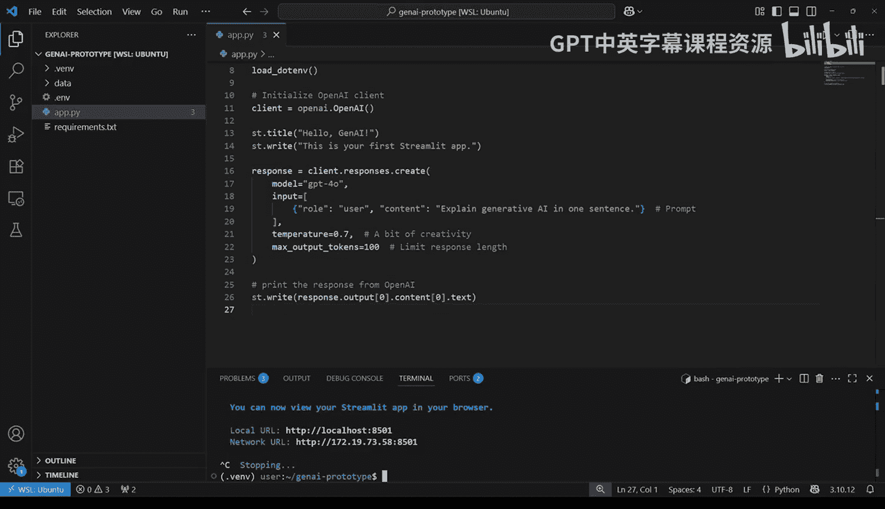

# 吴恩达《用 Streamlit 快速原型开发生成式 AI 应用｜Fast Prototyping of GenAI Apps with Streamlit》 - P13：13_01_03_Streamlit入门.zh_en - GPT中英字幕课程资源 - BV1QmYrzMEu1

It's time to turn your GenI script into an interactive web app that runs in your browser。

 you'll be using streamlit， which acts like a glue between your Python code and a full web interface。

 no front end required by the end of this video you will have a working prototype that takes user input。

 sends it to a GenI model and display the response in your browser let's build in the previous video you have already installed streamlit when installing the requirements Txt file to verify that the install worked type streamlet version you should see a version number If not check that your virtual environment is active and try again in this video you can continue working on the file you have from the previous video or if you want to directly see the solution。

 open this file。

Your script already connects to OpenaiI。 It's time to turn it into a full app to turn your Python script from the last video into a simple web app。

 You only need to add a few lines of code， Ims streamlet as ST this line imports the streamlet package and gives it the shortcut ST so you can easily use its function throughout your app at the top of the script you'll see ST dot title hello Geni This creates a large heading for your app below it you can write some text about what the app does ST。

right， this is your first glet app ST。 right is a flexible function that can display text numbers。

 data frames and more then instead of using the print function for a printing your model's responses to the terminal or use ST dot right again to display the output of the model in your app That's it just four lines of code and your command line script is now a web app。

 Save the file。And get ready to launch Now， for the exciting part。

 you get to see your app in action again， you will run your app from the terminal。

 but this time you will use Stlit to run the script in your terminal type this command Stlit run app P This starts a local web server and opens your app in the browser。

 you'll see a message like this， you can now view your streamlet app in your browser。

 if it doesn't open automatically go to Http colon local host colon 8501 congrat your live time to check out your app in the browser。

 you'll see your app title and below that the one sentence response from the Jeni model that you previously printed out on the command line the call to the geni model is not always instant So don't worry if there is a delay before you get a response。

 as long as your terminal is open， your app is live。 Anyone on your machine who visits that。

OrL can interact with it When you're ready to stop the app。

 just go back to your terminal and press C C to shut it down。 Your app might look simple right now。

 but this is the foundation for everything that follows。

 Stlet automatically refreshes your app whenever you save your script。 Just hit save。

 No need to restart or reload This instant feedback loop makes it easy to iterate。 Make a change。

 Sa the file。 Then watch the update appear instantly。😊。

You did it， congratulations， you now have a working JenAI powered web app， no flask， no jascript。

 no pan。 Strly spins up a miniwe server， handles layout and watches over everything。

 That means you stay in Python， you prototype fast and your users get realtime results in the next video you'll take your app further。

 adding interactivity， Po and more advanced features Let's keep building。

