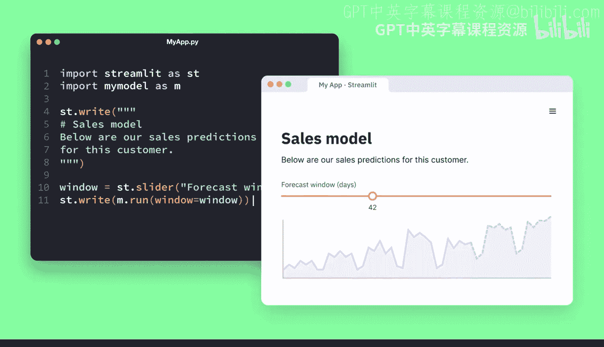
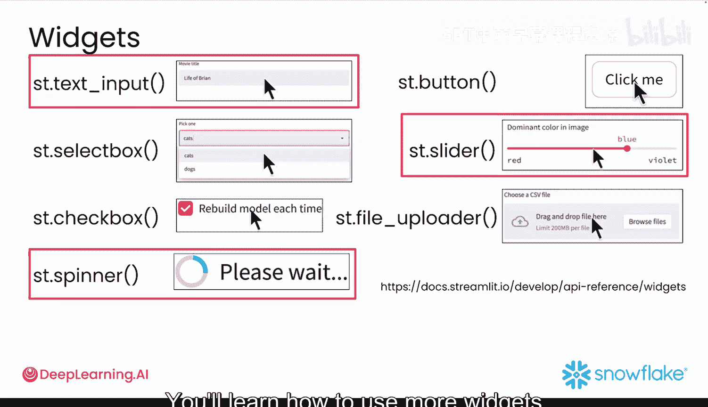
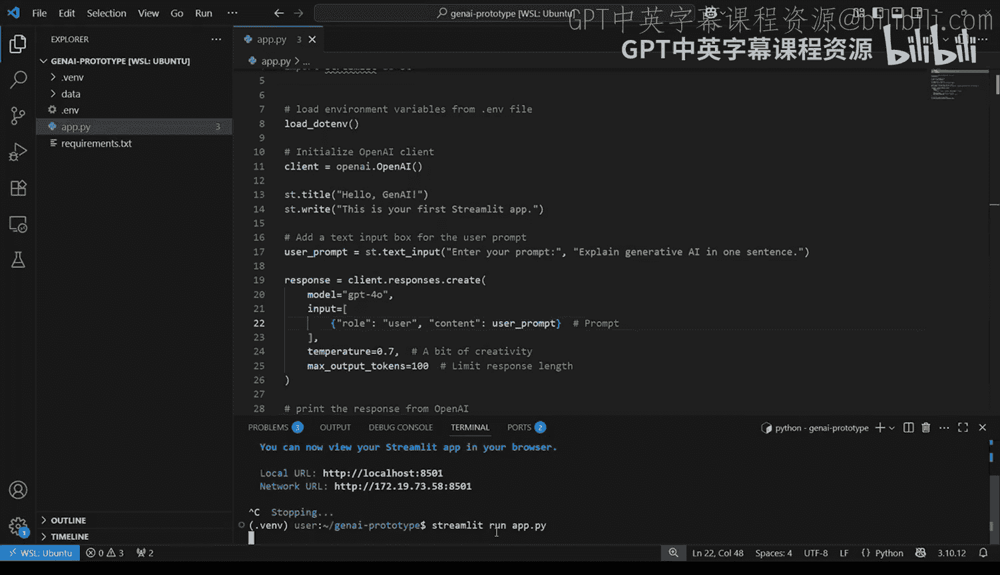
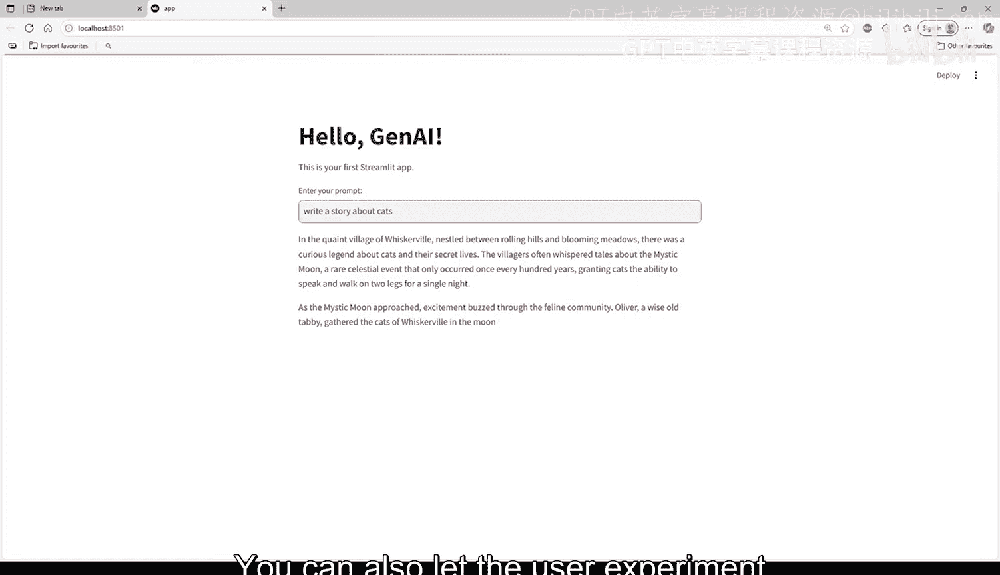
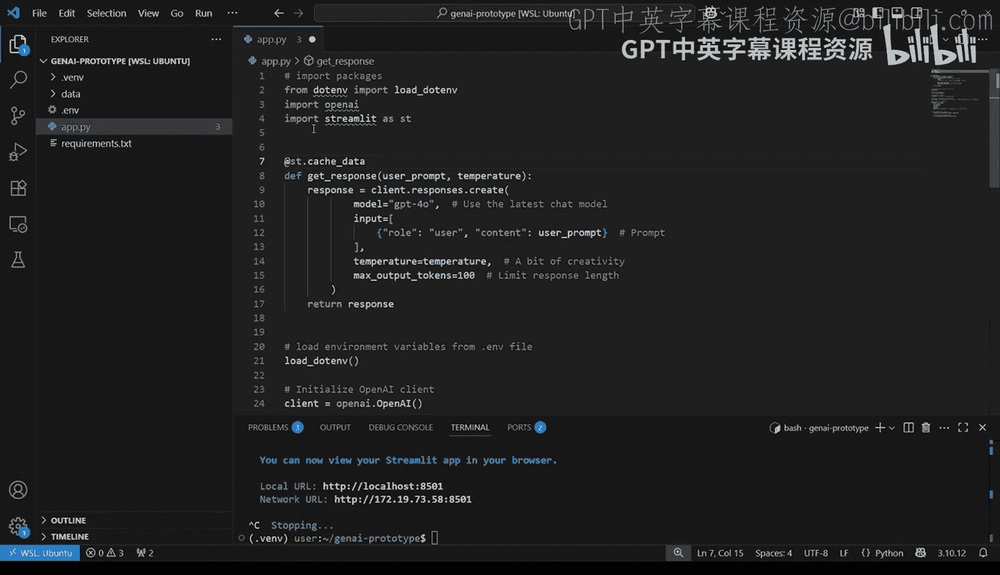

# 吴恩达《用 Streamlit 快速原型开发生成式 AI 应用｜Fast Prototyping of GenAI Apps with Streamlit》 - P14：14_01_04_创建首个交互式Streamlit应用.zh_en - GPT中英字幕课程资源 - BV1QmYrzMEu1

In the last video， you built your very first geni powered streamlit app。

 It shows some text called a geni model and printed the output。 But let's be honest。

 it wasn't exactly interactive。 You could open the app and that's about it。

 Let's go make it interactive Stlet gives you a set of interactive Python elements called widgets。

 These let you add user controls to your app without needing to touch Html or javascript Here are a few handy ones that you can use for a geni app dot text input is a text box for prompts。

 S do button triggers actions。 S dot Selectbox add dropdowns for model selection。

 St dot slider adjusts values like temperature St do checkbox creates onoff toggles St dot file uploader。

 uploads CSsvs or text files。 St do spinner shows a loading animation when waiting for something。

 for example， for a reply from。😊。

And LM in this video， we use three of them to upgrade your app， a text box for typing in prompts。

 a slider to control model creativity called temperature and a spinner to show when the model is generating text。

 you'll learn how to use more widges throughout the rest of the course you can continue editing the file you have from the previous video or find a solution file in the repo to follow along。

 If you want to add a box to type your own prompt。 You only need one additional line of code user prompt equal st do text input to create a box for user input。

 The first argument to this function is a message letting the user know how to interact with the box enter your prompt。

 you can also add a default prompt to populate the box on startup。 For example。

 explain generative AI in one sentence。 Now， just replace the hardcoded prompt in your model call with user_ prompt when you run the app。

You'll see the input box and it'll run the model as soon as you hit enter。

 let's test it with something simple just to make sure it's working， try typing。

 write a story about CAS， then hit enter Stla takes care of the rest。

Nice， a story about Cas。 You can also let the user experiment with how creative or deterministic the model is by adding a slider widget to add one to your script。

 put this code near the top of your app where you define user inputs。

 This creates a slider from0 to one。 with0 being the most deterministic。

 and one being the most creative。 The value argument says a default value and the step argument controls how much the value increases or decreases when a user moves the slider。

 Now， just update your model call to include the specific temperature value。

 You've just made your app dynamic。 Use can now tune the vibe of the AI。

 Llms can take a few seconds to respond。 and your app might feel frozen in during that time。

 Let's fix that by adding a spinner that gives your users a visualization letting them know the model is running the API call。

 You can do this by wrapping the API call code in。😊。

With ST do spinner block Now， instead of wonderinging if somethings broken。

 users see a helpful little animation while the model is working。

 if you're calling the model multiple times with the same input especially during development you can cache the results using the ST cache data decorator。

 If you haven't worked with decorators before don't worry。

 it's basically a wrapper much like a width statement that you can put around a function to change or enhance what it does without modifying the original function。

 So the first thing you need to do is move the model call to its own function named get response。

 the app should work exactly the same， you just move some of the logic into its own function and put the decorator on top of the get response function like this ST cache data is a streamma decorator that improves app speed by caching the results of a previous function or calculation it tells stream。

I've seen this input before just return the cached result instead of rerunning the code it's especially useful with GenI apps because GenI calls take time and cost money so if you ask the model to analyze the same data set again and again you can use SC data to get the result instantly from cache instead of hitting the API again and again in the avalanche project。

 this is something you might want to consider using for any data transforms you need to do or perhaps for the sedi analysis in just a few lines of code you've leveled up from a static demo to a fully interactive app now it's time to bring in data in the next video you'll learn how to upload data into your app and perform GenI powered operations on it all while leveling up your streamline skills See you there。

