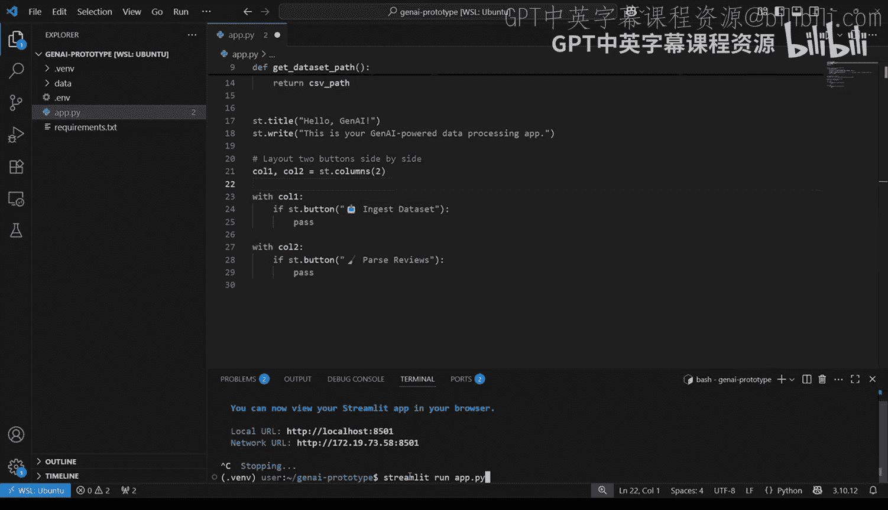
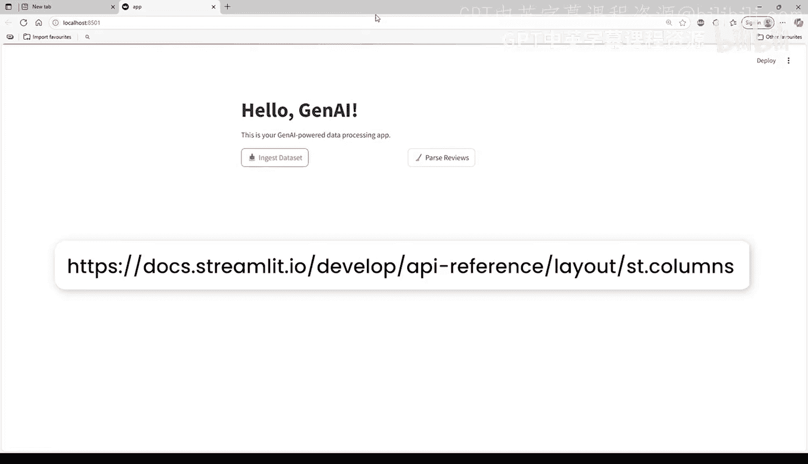
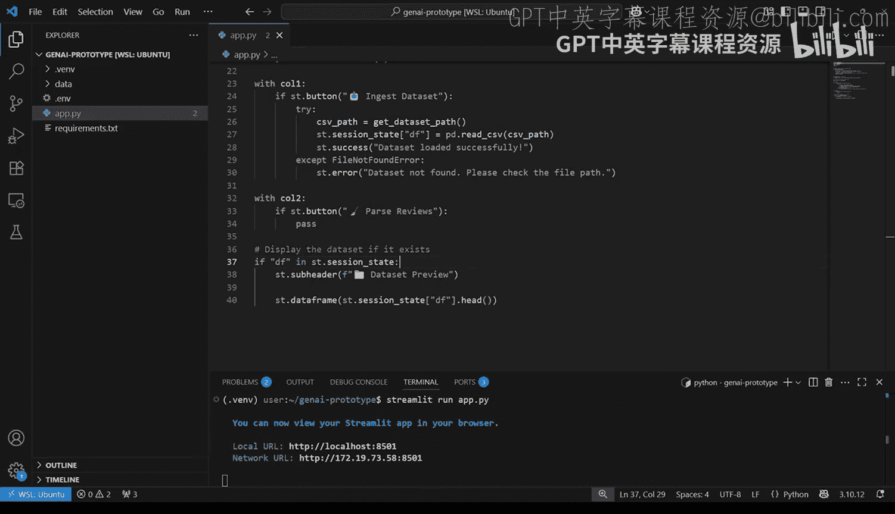
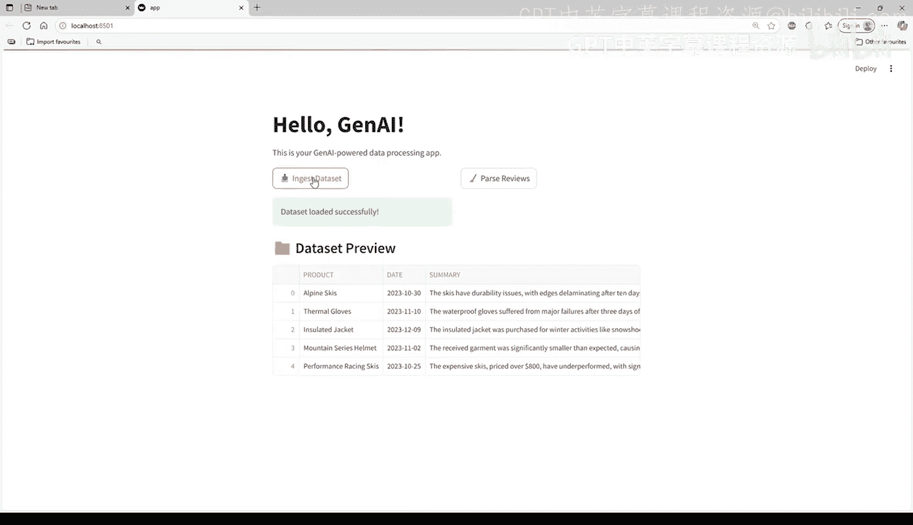
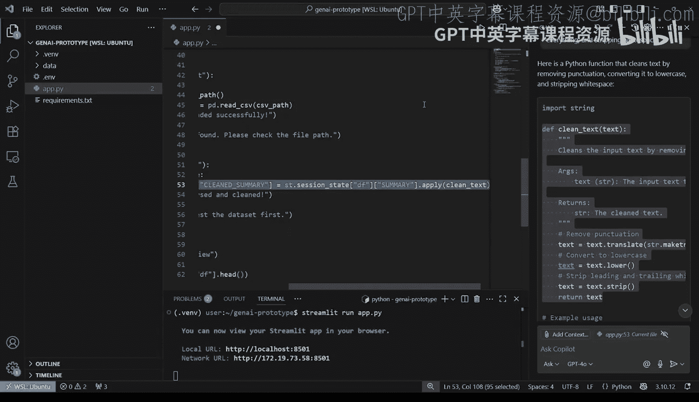
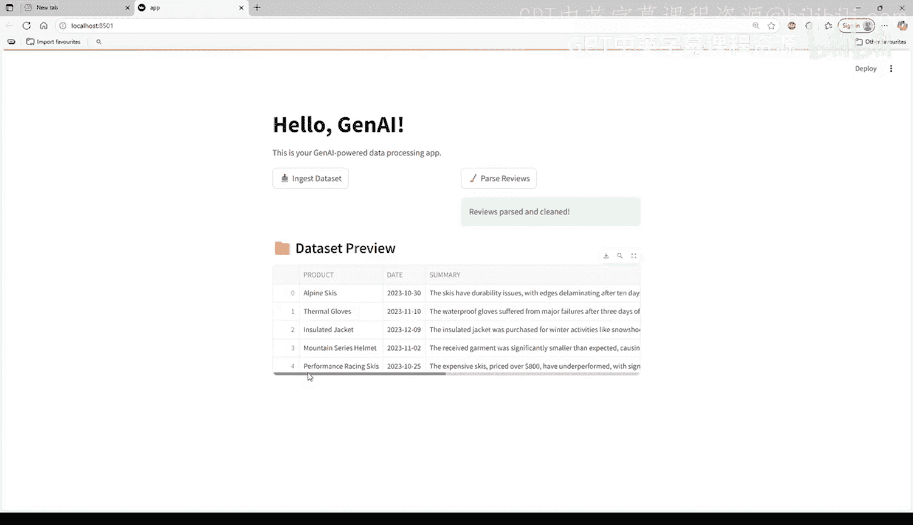
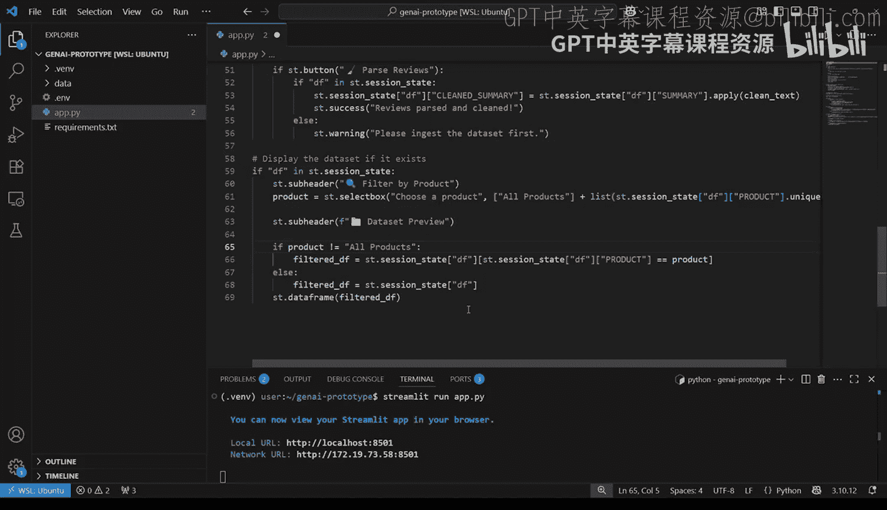
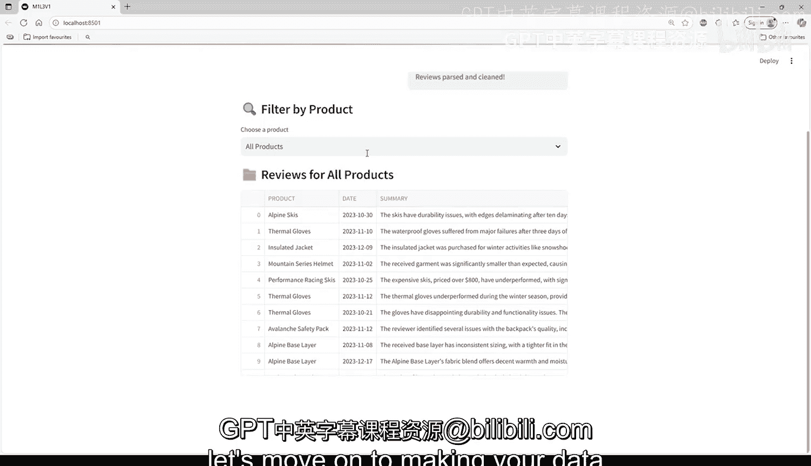

# 吴恩达《用 Streamlit 快速原型开发生成式 AI 应用｜Fast Prototyping of GenAI Apps with Streamlit》 - P15：15_01_01_集成GenAI进行数据处理.zh_en - GPT中英字幕课程资源 - BV1QmYrzMEu1

In the last lesson， you built your first Geni powered streamla app。

 which is a simple interface that lets users enter a prompt and see a response。 Now。

 you're going to level up your app by organizing the workflow for this demo。

 you can follow along by opening up M1 L 3 V1 starting dot Py or open M1 L 3 V1 dot Py for the solution file。

 This time， you will build an app with more than one function So it's good to get organized。

 You can use S2 dot columns to display the buttons side by side。😊。

Like this， then place a button in each of the columns。 try running the app。

 using Stid run with the path to your file， and you should see something like this。

 you now have two buttons side by side but if you click them nothing happens yet。

 you can use S columns to find two in the column with adjust a gap between the columns and a lot more。

 check out the link at the bottom of your screens for more information Now。

 let's implement the functionality of the first button。

 you can copy this code to replace the pass in the first button。

 An important thing you should notice here is that the data frame was not simply saved to a Df variable as usually done。

 but to something called a session state。 The reason you need to do this is that Stid reruns the entire script from top to bottom every time the user interacts with the app。

 This means that if you click a button all the variables are lost unless you store them somewhere that's persistent between。

Runs to achieve this， you can use something called session state by storing the data frame in S do session state D F。

 your app remembers it， even if the script runs again。

 this allows the user to ingest the dataset that later perform operations on it without the need to ingest it again。

 Now， it would be nice to display this dataset， use this code in the bottom of the script to do it。

 but pay attention to how this code is written。 it is within an if block。

 you need this if statement to check whether or not a data has been ingested and saved to the session state。

 remember， every time the app is reloaded， it runs the whole script。 if there is no data ingested。

 it cannot be displayed。 Now， open the app again and check if it works。

 Now if you press the first button the dataset will load and display below Next。

 you'll need to add the functionality to the other button you've got a lot to build。 why。

Deelegate the boring stuff let's say your app needs to clean incoming text you could write it all by hand or prompt Jenny I for a draft Here's an example prompt。

rite a python function to clean text by removing punctuation。

 lower casing everything and stripping whitespace。 The model might return something like this。

 It's not fancy， but it's clean， testable and easy to integrate into your app。

 copy the code and paste it at the top of your app。

 Then you need to add that functionality to your button。 you want to clean the ingested dataset。

 So you first need to check if the dataset exists in the session state。

 All you need to do now is apply this operation to a column in your dataset and save it to the session state。

 go ahead and check the app。 Now you have one button to ingest a dataset and another to clean it you might have noticed that nothing seems to happen when you click this button。

 but don't worry this is just because this dataset has more columns than what fits on the screen If you use the slider you can see that your cleaned column。

Is here now you can add a bit more interactivity to your app your users might be interested in just the reviews about specific products so you can add a dropdown menu to filter the display data set to show only the relevant columns to do this you can add the Stda select box to your code and pass it as a parameter to the list of products then you need to add the logic for filtering the data you can also add an all products option in case users want to analyze all the products you can do this by updating the filtering logic if a product is selected you want to filter the data frame but if all products are selected you want to use the original data frame for displaying save and refresh your app to see if it works in this lesson you leveled up your genI prototype by giving it to essential powers loading data and cleaning it up This is the backbone of most GenI data apps get the data prep。

And tee it up for analysis since you have a template to build on。

 let's move on to making your data come to life with sound visualizations。

