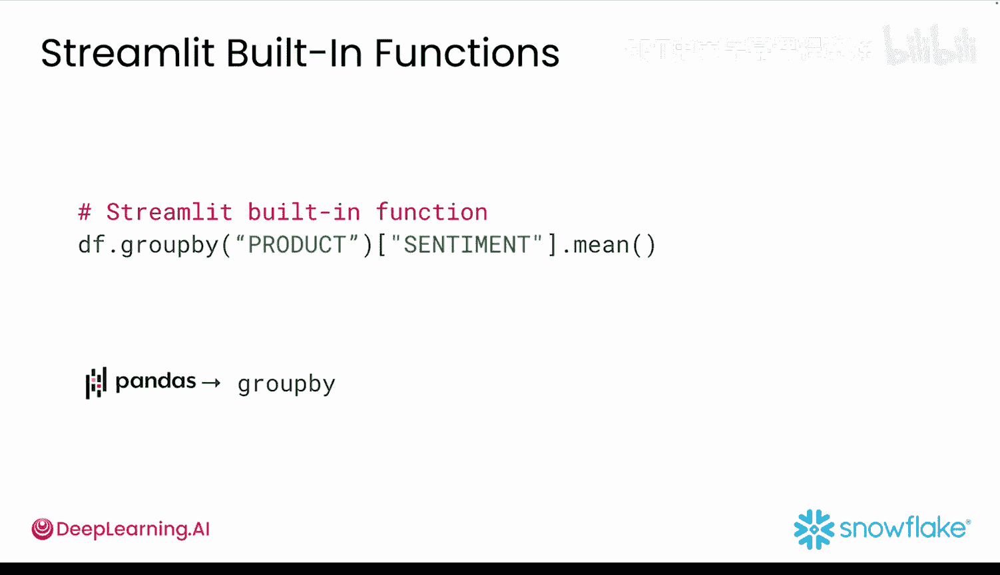
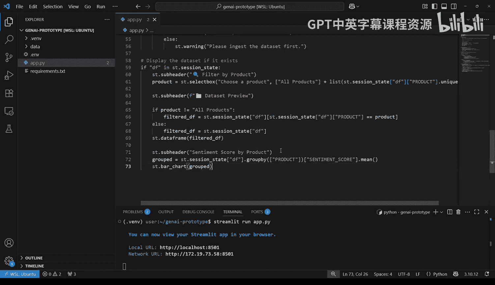
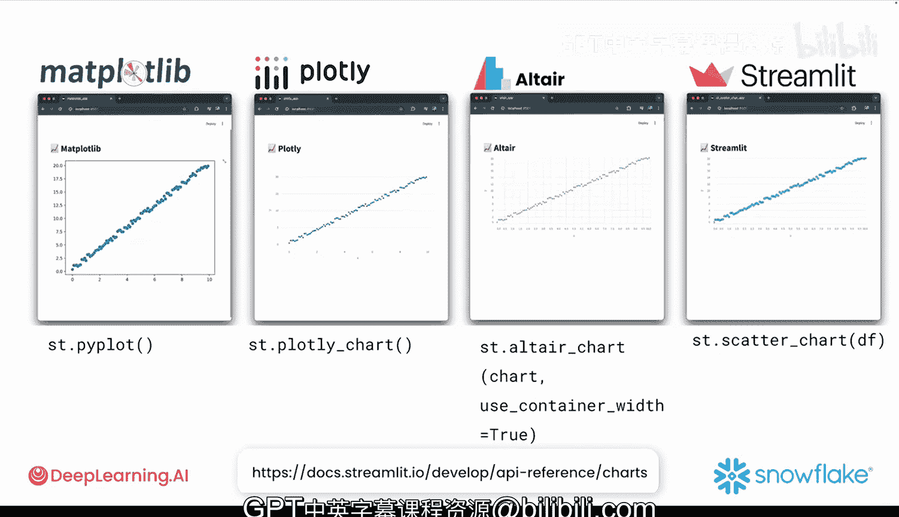

# 吴恩达《用 Streamlit 快速原型开发生成式 AI 应用｜Fast Prototyping of GenAI Apps with Streamlit》 - P16：16_01_03_数据可视化.zh_en - GPT中英字幕课程资源 - BV1QmYrzMEu1

Al right， once your data is cleaned up， the next step is helping people understand it。

 Just printing out a list of numbers or rows might be fine for quick testing。

 but it's not your best option for helping stakeholders envision vision， your end。

 That's where visualizations come in In this lesson， you'll learn how to add charts to your app。

 using four different visualization libraries。 Stlets built in chart functions。

 mapplotlib plotly and alt。 Each one has its own strengths。

 And depending on what kind of chart you want to build。 you'll learn when to use switch。

 Let's start simple。 The easiest way to show a chart in Stlet is to use one of its built in functions。

 For example， you can use。That one line of code would turn a column of sentiment scores into a tidy bar chart。

 And yes， it works directly with a pandas data frame or series。

 Strimlit also has these ready to go chart options。 Sett line chart。 S do area chart。

 Stdo scatter chart。 These are great for exploring your data quickly。

 just pass in the data frame and it handles the layout and rendering for you。 Now。

 if you want to compare things like sentiment across different products， try this。

 this line uses pandas scoop by to break down the data by category so you can build charts that show the sentiment for each product rather than as individual reviews。

 Now， let's see this in action。 All you need to do is add these three lines of code to the app that you built in the previous video to visualize the mean sentiment per product。

 when you run the app and ingest the data set by clicking on the button。

 you can immediately see your chart。😊。

Alright， what if you're already used to mapplotlib， you can totally use it here。

 This is perfect for histograms， scatter plots or anything where you don't need a lot of interactivity。

 Note that you've used a filter Df variable here。 So the plot will change when you select something else in the dropdown menu。

 If you want interaction like two tips or zoom。 plototly is a solid choice。

 plototly charts few modern and smooth Use can hover over points， zoom in or click for more details。

 and you don't have to write any extra Ui code to write a plotly chart Use that last part。

 Use container with equals to true。 Just make sure that the chart stretches to fit the full width of the app。

 Another great option is Alt。 Alt works really well with pandas。

 and it' amazing for layered plots or anything with selections。 two tips or filters。

 You can render it with。😊，Now， here's a quick rundown of what each tool is good for。

 Stamless built in charts are superfa and perfect for quick feedback。

 Maplotlibb is simple and classic， great for static plot。 plotly is interactive。

 which is great for exploring data。 And out there is good for more advanced visualizations。

 Start with whatever's easiest for you and only switch tools when you actually need to。

 Let's go through some quick examples So you can see the difference。

 Say we want to build a scatter plot。 Here's how we implement it using Matpllootlib。😊。

Plootly Altaiair。And finally， with streamless native function。

 each of these tools lets you create clean， useful visuals with just a few lines of code。

 These are just a few examples， but you can learn more visualization techniques by checking out the chart elements section in the streamlet dos。

 The link is at the bottom of your screen。 Look how far you have come from generating Python functions with Gennyi to processing real data with pandas to creating multiple visualizations。

 You're seeing firsthand how Gennyi adapts to whatever tools you need and how everything just works with streamlit。

 You've been building individual pieces。 Now it's time to put them all together into a complete dashboard app that you'll built from scratch using Gennyi as your coding partner。

😊。

