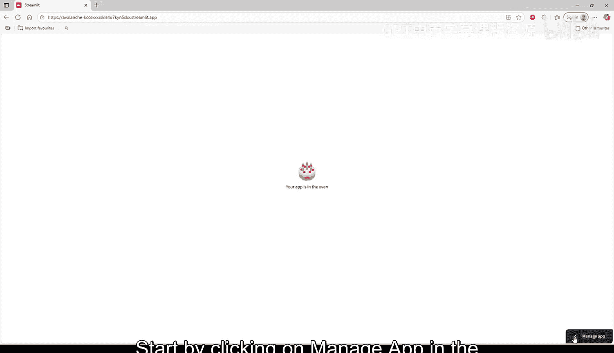
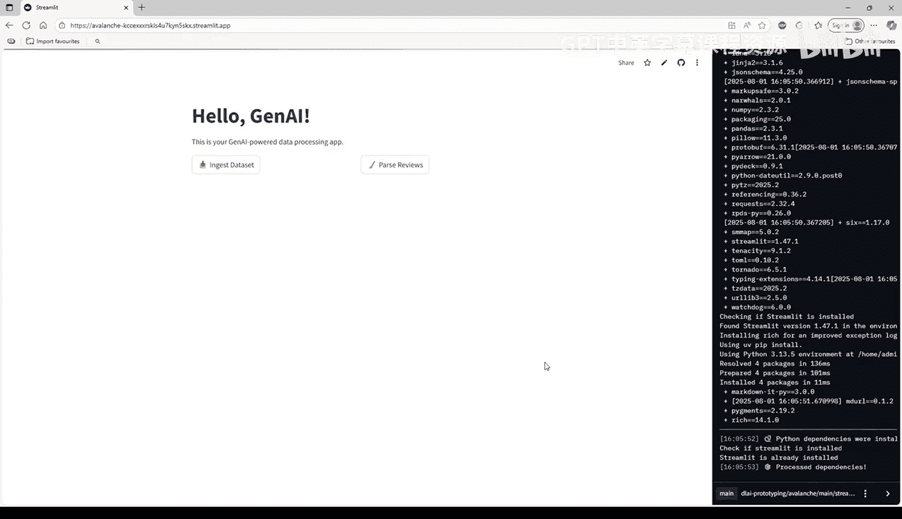
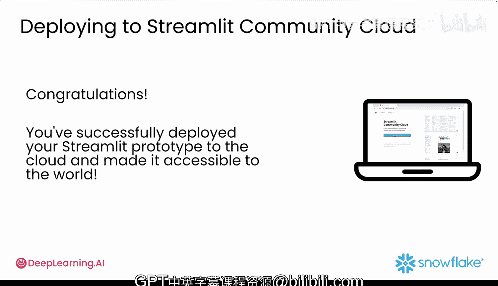

# 吴恩达《用 Streamlit 快速原型开发生成式 AI 应用｜Fast Prototyping of GenAI Apps with Streamlit》 - P17：17_01_04_在线发布应用.zh_en - GPT中英字幕课程资源 - BV1QmYrzMEu1

You've now learned how to build an interactive streamlit app， use Geni to create code。

 load data sets， process data and create visualizations all within the same web app only one thing remains to share it with the world In this video。

 you will learn how to deploy your app on Stlit community cloud Stamlet Community cloud is a free platform that makes it easy to deploy and share your apps online on Stamlet community cloud。

 you get a limited public apps and the code will be public too One private app per account Github repository integration for easy deployment Auto updates when you push changes to Github built in analytics to track app usage is a quick。

 no cost way to get your prototype in front of users Starb opening your browser and hitting to Stamled io cloud click on join community cloud。

 then click continue to sign in Cho the Github。

To log in next， you'll be redirected to GiHub When asked to let Strumler connect to your Github account。

 click Authorize if this is your first time， Github will send a verification code to your email。

 check your inbox for this email copy the code that was sent and paste it in to finish the login process。

 Strumley will ask for basic details like your name and email address。

 fill these out and then you're ready to go you can continue with your app from the previous video or choose any other app to work with in this video。

 If you haven't already clone the course repo to your local machine。

 If you want to start with a tested version。 you can use the files located in the courses Github repo folder at M1 lesson3 Next。

 make a new Github repo specifically for your deployed app。 log into your Github account。

 click the plus button in the top right corner of the screen。 select new repository。

nameame your repository， avalanche or something similar along those lines。

 Make the repository public for easier sharing。 Then click on create repository。

 This should open up a new Github repo for you in your new Github repo。

 click on upload an existing file。 Then upload the entire M1 lesson 3 deploy folder your new repo should now contain the Stlet app do Py requirements do Txt and customer reviews dot csv。

 When the upload is done， click on commit changes。And that's it。

 your files are now ready for deployment to deploy your prototype from Snowflake onto Stromli community cloud。

 Start by logging into Strli。ioclo。 click on create app or new app in the top right corner。

 select deploy a public app from Github and select your Github username and avalanche repo title as repository。

 leave the branch as mean and make sure it's pointing to your streamlet app file called Strli app p。

 Cho a unique custom name or use an auto generatedrated web address for your prototype and click on deploying Strly will start building your app which can take a couple of minutes while your app is deploying let's take a look at some of your options for monitoring app performance。

 Start by clicking on manage app in the bottom right corner of the loading screen and you'll see two main sections。

 View build logs is where you can find your app's log files for。

hooting and the app management features allow you to reboot your app if it has issues。

 download log files， delete the app entirely or update access settings and also manage your secrets files When your app is up and running。

 youll get a success message that provides you with a website address that you could use to view it the web address is usually something like https colon your app name dostromlet do app and also with some extra random letters and numbers to test it out。

 browse to the URL and test all the interactive witches navigate between all the tabs to make sure they work then verify that the data table and visualizations are displaying correctlygratulations your app is now live and accessible to anyone with the link Want to see how many people are viewing your app Here's how go to your Stomlet community cloud dashboard next to your app you'll see three dots click on them and。

Select analytics。 This shows you how many people have visited your app and when they visited。

 If something goes wrong with your app， you can check the logs。

 click manage app on your deployed app page。 Then look at the logs panel。

 This helps you figure out what's causing any problems with your app。 Congratulations。

 you've successfully deployed your extremely prototype to the cloud and made it accessible to the world。

 This is a real accomplishment。 You've taken a step more than most people ever will by turning an idea into a live shareable web app。

 Now that your prototype is deployed。 You can share the link with your colleagues。

 Add it to your portfolio or posted on social media。

 you will finish the lesson with a lab where you will put all your knowledge to work。

