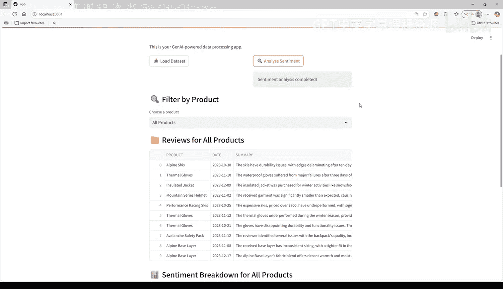
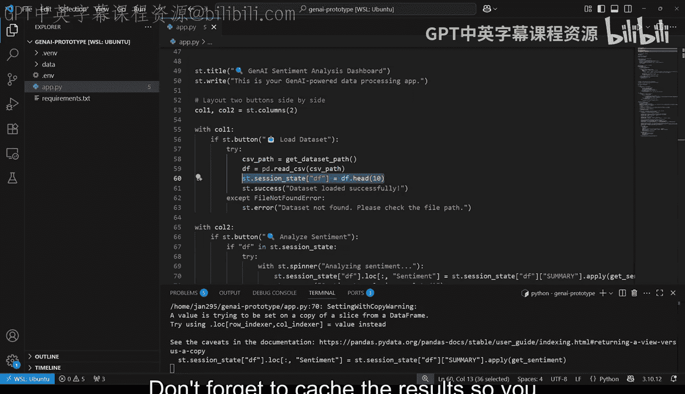
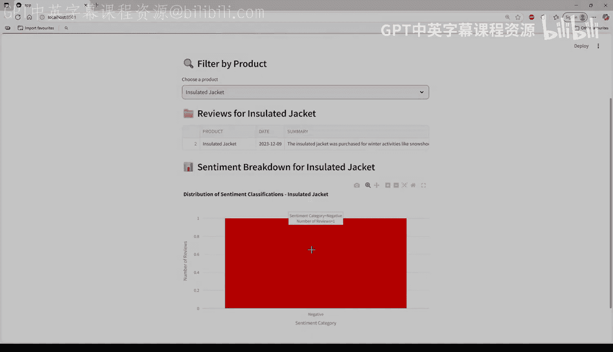

# 吴恩达《用 Streamlit 快速原型开发生成式 AI 应用｜Fast Prototyping of GenAI Apps with Streamlit》 - P18：18_01_06_实验2：基于GenAI的雪崩舆情分析仪表板.zh_en - GPT中英字幕课程资源 - BV1QmYrzMEu1

To wrap up this lesson， you'll put all your new skills to the test by building your own version of the Avalanche dashboard app using everything you've learned for this lab。

 you'll be building a Stlet dashboard app for the avalanche dataset set yourself。

 Your app should load the data with pandas analyze the sentiment of the avalanche customer reviews using Geni。

 display the data in a data frame。 Then visualize the sentiment analysis results with a bar chart。

 you'll find everything you need in the M1 lesson 3 lab to folder of the course Github repo。

 there you will find an empty file which you can use for building out this lab。

 Theres also a solution file which has to complete code solution to help you with this lab。

 Let's take a look at an example of what you'll be building In this video I'm using Stomlet and the features you've learned in this module。

 but feel free to add your own ideas and modify the app to your liking your。😊。

Should have at least two buttons。 one to load the avalanche customer reviews dataset set and want to analyze the sentiment。

 The load data button should load and display a data。

 The analyze sentiment button should use a geni model to determine whether reviews are positive neutral or negative。

 Keep in mind that you might not get the same answer every time。 some Geni models。

 especially order ones can give unexpected or inconsistent results because sentiment analysis can take a while to process I recommend loading only a few roles of your data for testing to help you speed up the process to subset your data you can use the pandas do head function to save the first 10 or 20 roles to session state like you saw in previous videos don't forget to cache the results so you don't recalculate them unnecess。

 Next， create a dropdown filter that allows。

To select products and display the filter data。 just like we created previously。

 then plot the distribution of positive， neutral and negative reviews。

 You can use any plotting library and feel free to get creative with colors and design。

 The plot shown here uses plotly with custom colors， but use your imagination for this part。

 Once you complete this lab， you'll be finished with module 1 and have a fully functional Geni powered sentiment dashboard that ingest a real worldor data set Classifies sentiment using open AI visualizes the results。

 supports interactive filtering Now that you've laid the groundwork。

 you're ready to take your skills further by integrating a geni data assistant into your app on snowflake。

 See you there。😊。

