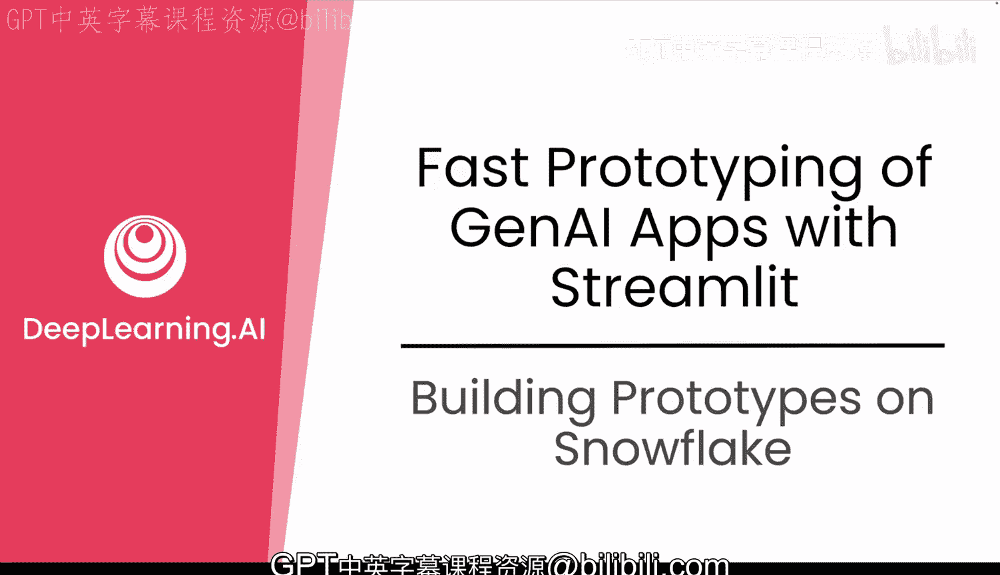
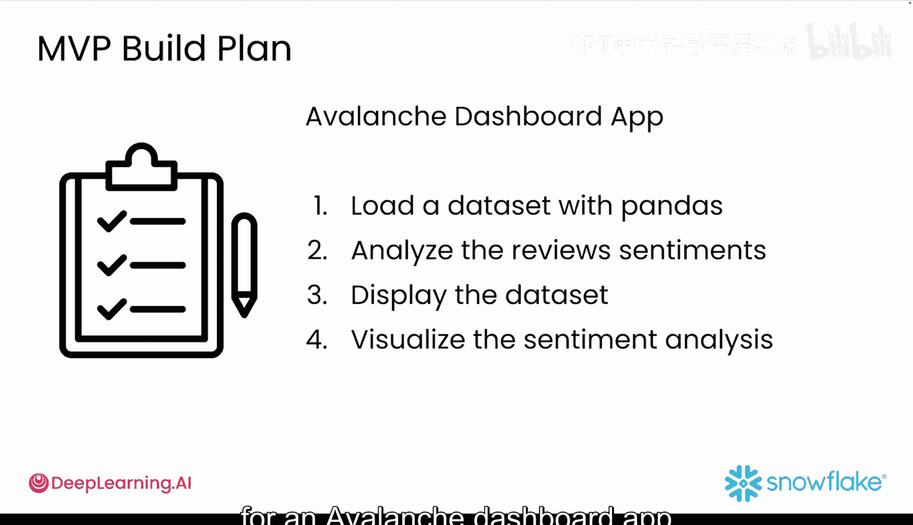
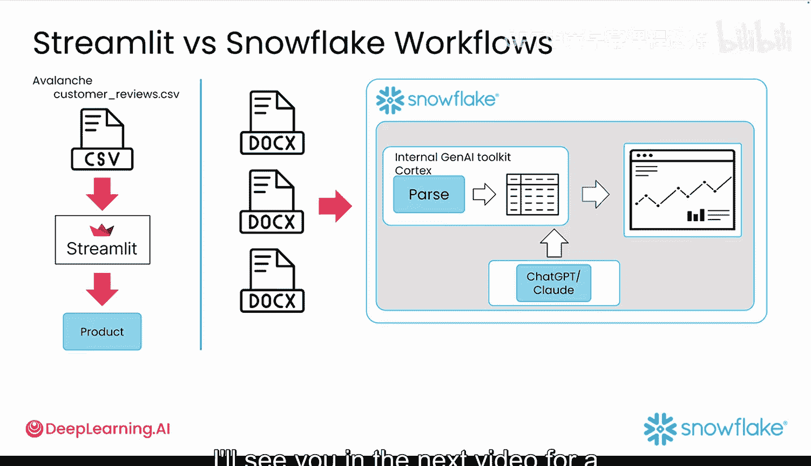

# 吴恩达《用 Streamlit 快速原型开发生成式 AI 应用｜Fast Prototyping of GenAI Apps with Streamlit》 - P19：19_02_01_Snowflake平台原型构建.zh_en - GPT中英字幕课程资源 - BV1QmYrzMEu1

In this module， you'll take the Jdii prototype that you built in module1 and move it into Snowflake。

 you use snowflake as your main development platform so you can prototype quickly without having to worry about moving around large amounts of data or setting up infrastructure giving you more time to focus just on prototyping in the last module you created an MVP built plan for an avalanche dashboard app prototype in your local environment that app ingested a CSv file of customer reviews performed。

 cleanup and sediment analysis on the data visualize the results and you streamlet to create a quick user interface accessible in your web browser in the real world you will rarely get a small and tidy data set like the avalanche customer reviews CSsv。

 So this module will move things to snowflake where you will be ingesting a larger batch of files and working with databases for a more realistic handson experience in this module you will load a batch of。

Unstructured word Doc X files into Snowflake use Snowflake's internal JennyI toolkit called Cortex to parse the batch of files and turn them into a table and throughout the rest of the course you will use a GenI app like ChaCBT or a cloud to help you quickly write code and debu problems By the end of this module youll have a complete working GenI Strma app running on Snowflake I'll see you in the next video for a guided tour of the Snowflake platform that you'll be using in this course。

