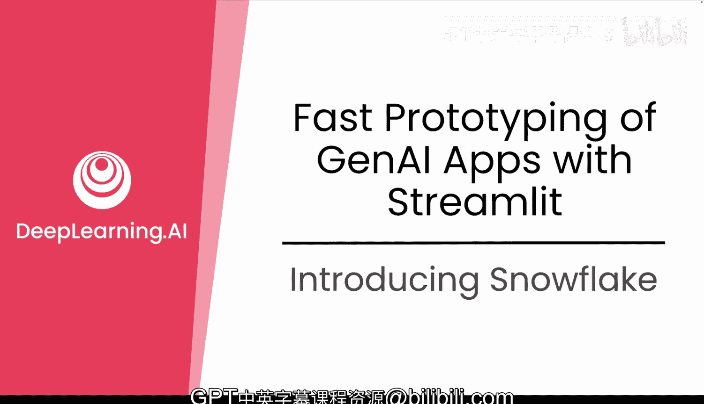
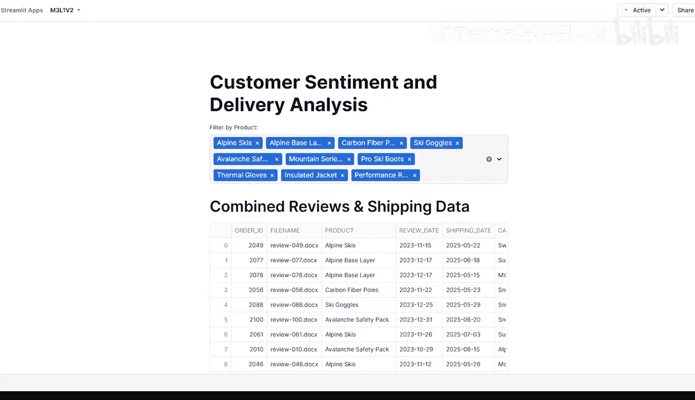
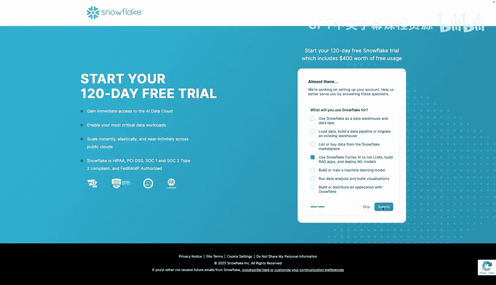
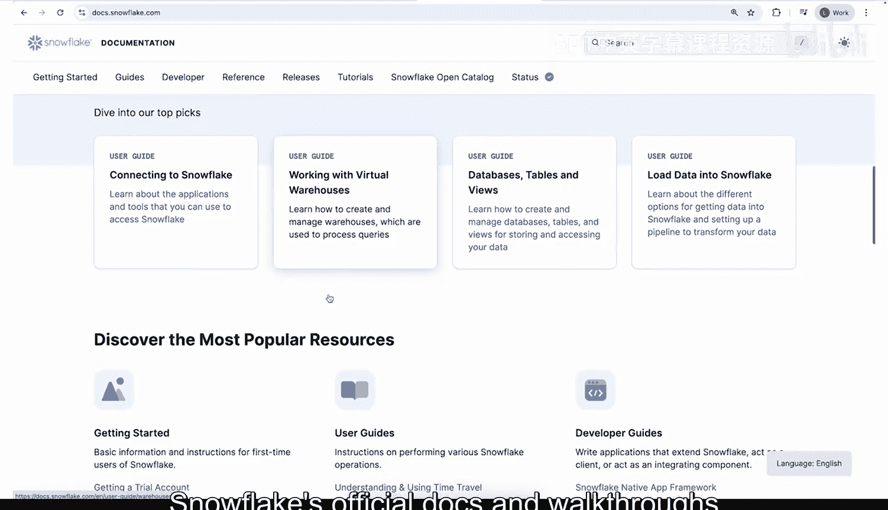
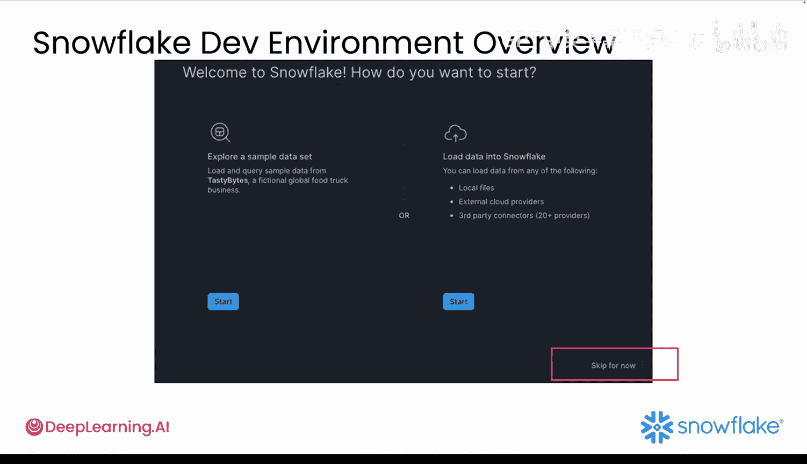
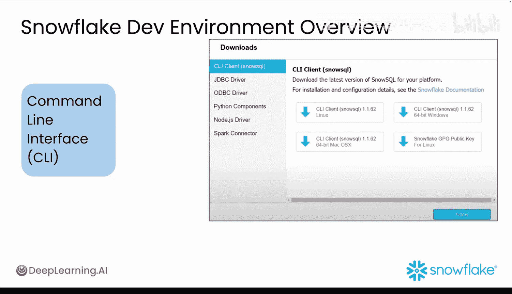
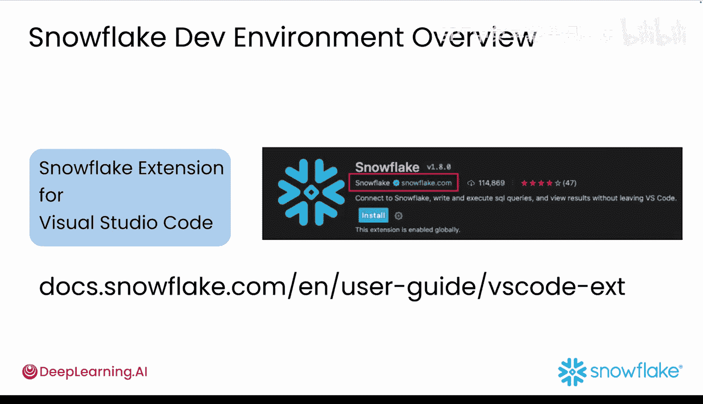
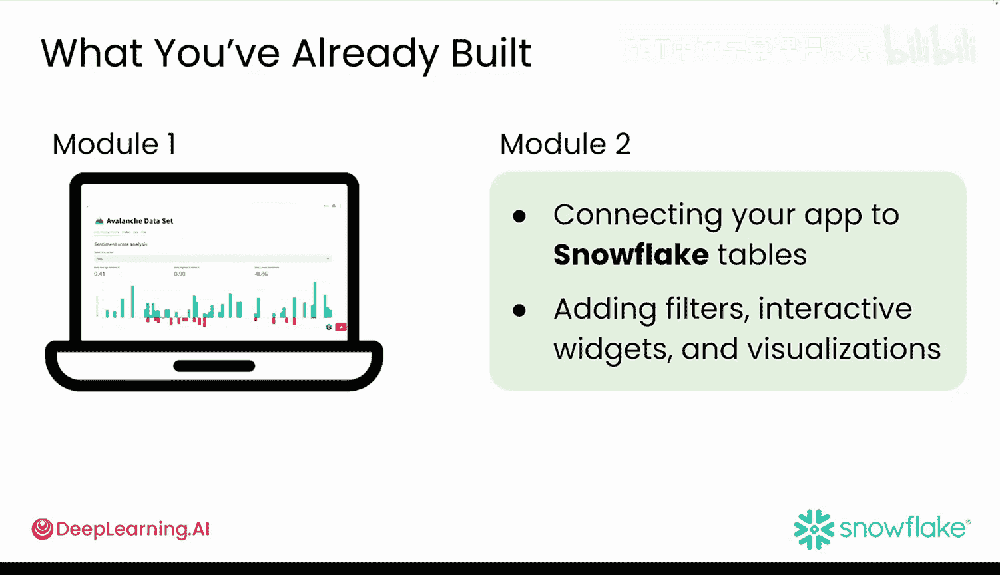

# 吴恩达《用 Streamlit 快速原型开发生成式 AI 应用｜Fast Prototyping of GenAI Apps with Streamlit》 - P20：20_02_02_Snowflake简介.zh_en - GPT中英字幕课程资源 - BV1QmYrzMEu1

In this video， you'll see a demo of how streambl apps run directly in S Snowflake。

 letting you prototype faster without having to worry about setting anything up。

 But what's the biggest reason that you streamlet in Snowflake。

 Your apps can be directly connected to the data and Snowflake supports pandas and other familiar Python tools So it fits right into your workflow。

 It means that there's no need to move files around or jump between external tools。

 and your apps will have better speed。 lower latency and built in security。

 It also makes deployment really easy。 Just a few clicks and your app is live on the Snowflake platform。

 Let's start by taking a look at how your streamud app or work in Snflake。

 and then you'll get familiar with your new snowflake working environment As a student in this course you get 120 days of free access to the full snowflake platform to follow along with the rest of the video sign up here。

Here's a slightly fancier version of the avalanche dashboard that you've built in module1。

 The prototype you're looking at now was deployed internally on Snowflake so that it can be shared securely with any of your colleagues that have access to the underlying tables and a link to the app。

 once you're at the snowflake sign up page fill out the sign up form。

 then select the sign up reason from the dropdown menu It doesn't matter what you select here Just choose an option and then click continue on the second page of the sign up form。

 enter a company name and job title you can make this up if you want。

 it's up to you find the dropdown menu labeled， choose your own snowflake edition leaving it at En will give you all the options you'll need for this course Next。

 select the region that is closest to you。 For example。

 I'm on the West Coast So I'll select US West read through the terms then click on the checkmark at the bottom。

Of the screen， if you agree to them Now click on get started and the away we go while your account is being set up behind the scenes。

 you'll see a few more optional checkboxes that will refine some of your account preferences at a minimum。

 select Python as your language of choice， then either fill out or skip the rest。

Next， check your email inbox for a verification email。 Once you get the email from Snowflake。

 click on the verification link in the email and you'll be able to log in and access the platform。

 Now that your account is set up。 welcomecome to your new playground。 All right。

 once you're logged in to snowflake。 you should see the word home somewhere near the top of the screen。

 This is your main workspace called snow site， which is kind of like a mission control for your data。

 a quick heads up。 Snowflake is constantly evolving。

 So things on your screen might look slightly different from what you see here。 don't worry。

 the overall flow will make sense and you'll be able to follow along just fine。

 if you ever get stuck。 Snowflake's official docks and walkthroughs are super detailed and very helpful。

Right now， you might get a pop up offering a quick tour of a sample data set totally up to you。

 take the tour if you're curious。 if you want to dive straight in。

 go ahead and hit skipip for now down on the bottom right。

 there are a few different ways to interact with snowflake depending on your work style。

 Snowight is the main one It's the web interface that you'll be living in is fast clean and supervisual。

If you're a terminal fan， there's a command line interface too， and if you're deep in depth mode。

 Snowflake even has a VS code extension so you can stay right in your cloning zone since this course runs in your browser。

 Snowsight will be your home bees。 Now for the fun part。

 you already know Stlet is great for making web apps。

 and now Snowflake lest you run Stlet apps directly inside your data warehouse。 no extra setup。

 no juggling APIs or moving files around just build。

With Stlit on snowflake， you can create dashboards directly from snowflake tables instead of having to do prep work every time。

 explore and visualize your data in real time to ensure your users will always have the most accurate and uptod results keep your entire workflow code data logic and Ui all in one plates。

 there are two main ways to do this。 Snowflake notebooks。

 which are great for rapid prototyping and working with teammates， Stlit and snowflake apps。

 which is perfect for when youre ready to share your app more broadly。

 Most people start in notebooks and then move to Stlit and snowflake apps Once their pro is solid。

 you'll use both snowflake notebooks and Stlit and snowflake apps in this course。

 So let's connect this to what you've already built back in module 1。

 you've created a working Stlet prototype for analyzing product reviews in the avalanche data。

 Now in module 2。😊，Going to supercharge your prototype with Snowflake by connecting your app to Snowflake tables inside the platform and adding filters。

 interactive witches and visualizations。 Next up， it's time to walk through the snowflake development environment so you can learn your way around。

😊。

