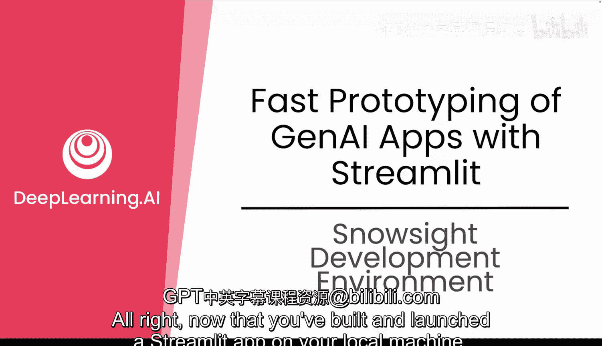
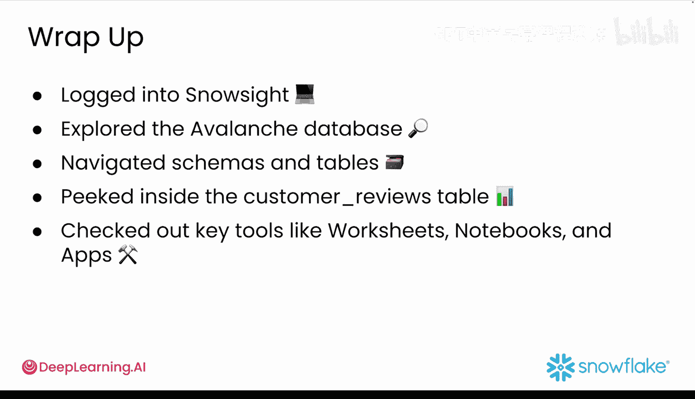
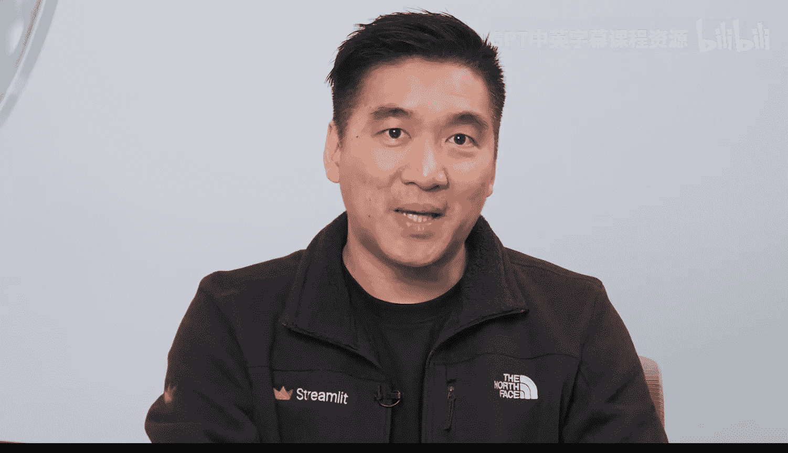

# 吴恩达《用 Streamlit 快速原型开发生成式 AI 应用｜Fast Prototyping of GenAI Apps with Streamlit》 - P21：21_02_04_Snowsight开发环境.zh_en - GPT中英字幕课程资源 - BV1QmYrzMEu1

Alright， now that you built and launched a streamla app on your local machine。

 you're going to bring that experience into Snowflake and take things to the next level。

 In this video， you'll get your first in-depth tour of Snows。

 which is Snowflake's webbased interface。 This is where you'll access your data right Python code。

 build Stlit apps and basically live for the rest of the course。 before we dive in。

 let's talk about what snowflake is and how you use it。

 Snowflake is your all in one data command center in the cloud。 It stores your data。

 runs your queries and handles the heavy lifting。 scaling up or down automatically。

 depending on what you need。 No hardware， no setup headaches。 behind the scenes。

 Snowflake uses virtual warehouses。 These are independent compute engines that process your work in parallel。

 which means multiple tasks can run at once without slowing each other down。

 Your data itself lives in cloud storage like AWS S3。😊。

Or Google Cloud storage。 But on snowflake， your data is stored in an optimized。

 compressed format thus's fast search and easy to scale The part of snowflake that you'll mainly interact with in this course is called Snows It's a webbased workspace and will be your main hub for exploring data running code and building Gennyi powered apps in Snows。

 you'll spend most of your time working in databases where your data is stored notebooks where you'll analyze data using code。

 whether that be SQL or Python Stlit where you'll build and preview your apps interface within Snows。

 you've got powerful tools to choose from SQL is the standard language for querying data。

 you use it to explore and summarize your data。 Snowpar is a developer framework for using Python Java or Scala directly inside snowflake。

 It works like pandas and runs code where your data lives securely。

And at scale Cortex is a suite of fully managed GenAI tools built into Snowflake。

 you can call large language models， run sentiment analysis。

 generate text and build rack systems using built in SQL or Python functions and Snowflake Copilot is the AI coding assistant for SQL queries。

You start by exploring your data in Snows， then use SQL or Python with Snowpark to analyze it in notebooks when you're ready to share your insights like with an interactive dashboard。

 you'll use Stomlet to build and deploy your prototype in size Snowflake or on the Stamlit community Cloud。

 Cortex powers your app with GenI features like sentiment analysis and T generationration。

 since Copilot's support for Python is still in development。

 we recommend using tools like Cloudud or ChaTBT to help you when you're working in Python。

To sign into Snowight， open your browser and go to the link shown in step one。

Enter your account identifier， which looks like this and can be found in the confirmation email that you got during your initial sign up。

Then sign in using your snowflake credentials。 Welcome to Snowsight。

 This is your all in one command center for exploring data， building notebooks and creating apps。

 Look at the lefthand sidebar to find your main navigation tools Let's start by clicking on data to see where all of your databases tables and schemas will live When you open the data tab you'll see a list of any databases that have already been created such as these examples snowflake databases you can use for practice。

 Once you create the avalanche database you find a listed here for now we explore the one that I've already set up Each database is like a main project folder just click on a database to see all the schemas that it contains inside the avalanche database you'll see the same data that you use in module 1 but now store in a way that's optimized for performance that data came from over 100 separate word docx files and was cleaned merged。

And load it into snowflake。 You'll learn how to do that soon。 Here's how Snowflake organizes data。

 A database is the topleve container。 schemas are like soft folders that group different types of data and tables are where the data actually lives Next click on the avalanche schema to open its detail page here you can see info about who has access to that schemas and related admin settings from here click on the tables tab。

 This will show you all the tables under that schema like customer reviews and shipping data。

 you can click on any table to open it Then you'll be shown these tabs the table details tab which includes admin settings and permissions for the table the columns tab listing each column name data type and description and the data preview tab that shows a sample of your data and info about the compute warehouse it uses to run queries。

Vi gives you everything you need to understand your data structure， No code required。

 Now let's take a quick look at a few other parts of Snows that you'll be using on the lefthand navigation sidebar click on the projects menu。

 This menu is the one that you'll want to use when creating any new kind of workflow in snowflake such as writing queries and code will be working lot with snowflake worksheets where you can write and run SQL and Python code directly inside your snowflake environment It's a great place to test queries or do quick analysis to open a snowflake SQL worksheet。

 click worksheets in the navigation sidebar。 then click plus worksheet on the top right to create a new one next。

 from the lefthand navigation menu head to notebooks。

 This is where you'll do most of your multistep analysis。

 unlike worksheets notebooks let you combine text SQL and Python all in one place like a snowflake nativeative Jupyter notebook。

To open a new snowflake notebook， click notebooks in the navigation sidebar。

 then click plus notebook on the top right。 Finally， click on apps in the navigation sidebar。

 This is where you're deployed streamud apps will live inside snowflake。

 when you publish a streamud app from a notebook This is where you can find it。

 you'll be using most of these tools over the next few videos。

 So feel free to take a minute to explore them now。 Before moving on。

 let's take a moment to celebrate how far you've come。 you've already locked into snows。

 explore the avalanche database。 navigated through schemas and tables peeked inside customer review table and check out key tools like worksheets。

 notebooks and apps。 There are a lot of features in snows that we won't be using in this course。

 but you can check out the demo video linked in the next reading item if you want to learn how to take full advantage of all of the functionality Now that you know your way around the snowflake workspace that foundation will make the rest of。

😊。

This course is much easier to follow up next， you'll start loading your avalanche data and exploring it with Python Let's keep the momentum going。

