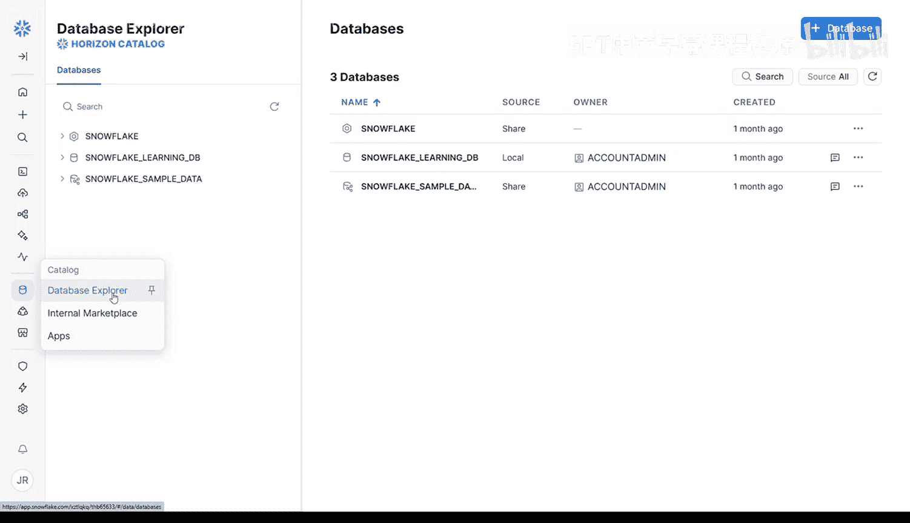
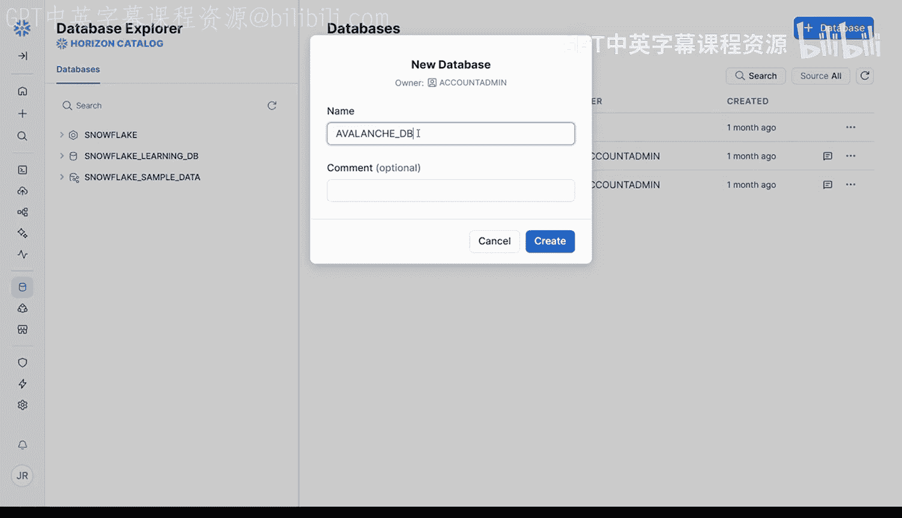
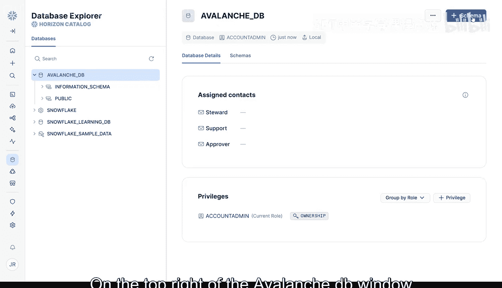
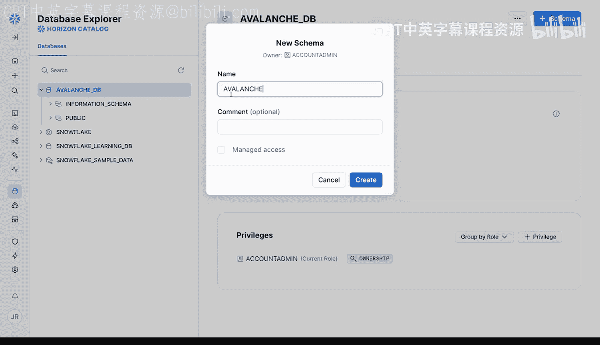
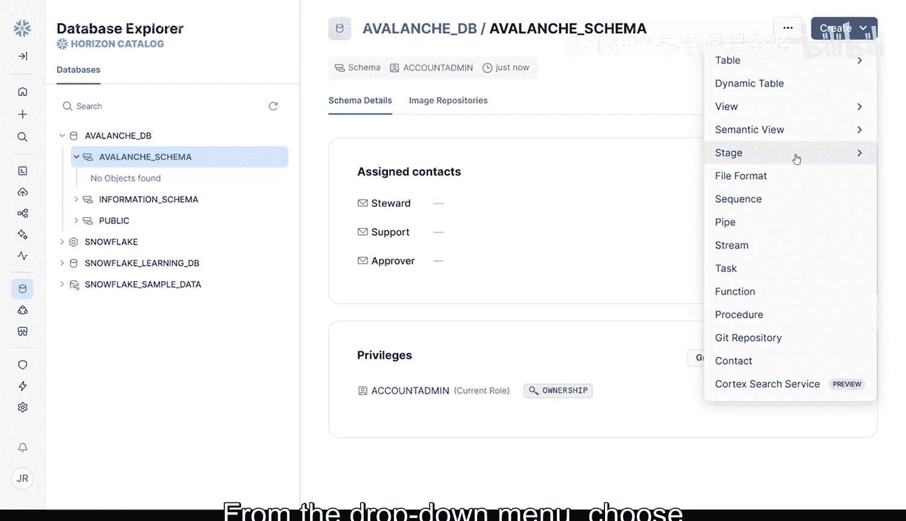
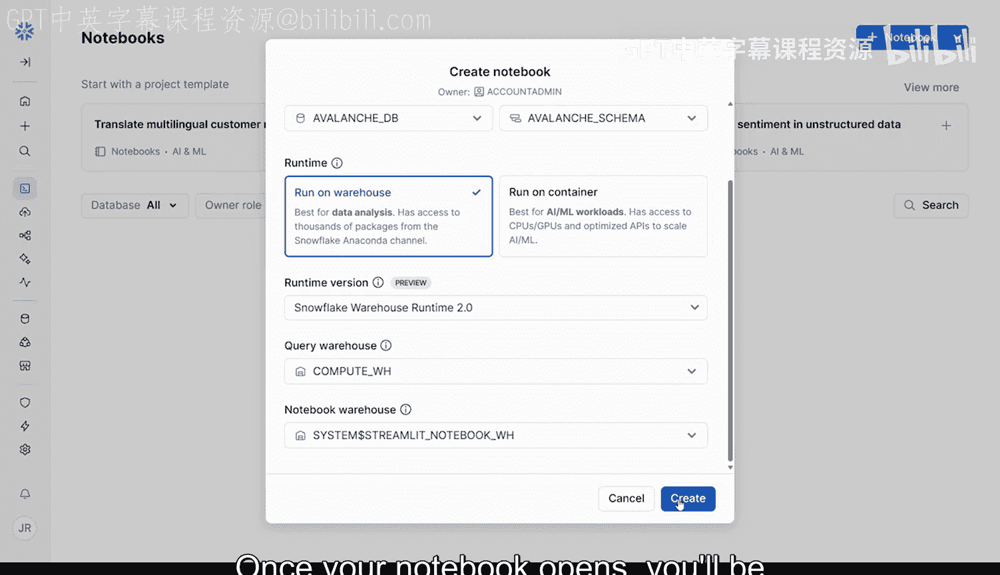
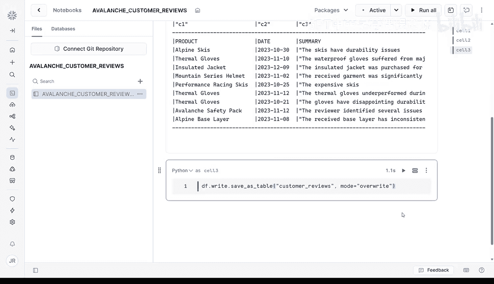

# 吴恩达《用 Streamlit 快速原型开发生成式 AI 应用｜Fast Prototyping of GenAI Apps with Streamlit》 - P22：22_02_07_通过Notebook将CSV数据导入云端雪崩数据集.zh_en - GPT中英字幕课程资源 - BV1QmYrzMEu1

So far in the course， you've been working with a cleaned CSv file calledCustom Reviews In this video。

 you're going to upload that same file into Snowflake and turn it into a proper table。

 In the next video， you'll recreate that same data set by combining a messy pile of word dos。

 But for now， let's start simple and get the clean version loaded so you can get familiar with the process from start to finish。

 First， let's check in with your MVP bill plan for module 1。

 Now you have already worked through this pipeline in module 1。

 But this time we're starting fresh in snowflake so you can see how the full upload and table creation process works in this environment。

 It's time to tackle step1， getting data into snowflake。

 If you've worked in data science or analytics。 chances are you've handled a lot of tabular data。

 usually in the form of CSvs， Excel files or other spreadsheet style formats。

 Snowflake supports all of the most common formats and many more such as structured files like CSV and TsV。

😊。

Your classic spreadsheet formats， These are great for cleaning organized data semistructured data like JSson。

 Avro， parquet and Xml。 These are more flexible formats often used for logs。

 events or nested information and text documents Pds and word files if you're coming from a traditional data science background。

 This might be less familiar。 but thanks to GenI is now much easier to analyze and extract insights from this kind of data Before we upload anything。

 let's quickly review how snowflake organizes your data。

 Think of it like an office file and cabinet Datas are like the cabinet itself a top levelve container for a project schemas are folders inside that cabinet to keep things organized Ts。

 View and stages。 your actual data and tools for managing it Ts are the roles and columns of structured data View are saved queries that look like tables stages are upload zones for files before loading them into tables this structure。

Keeps your data clean， modular and easy to navigate。 And now you're going to set it up for yourself。

 Now， according to this organization， you're going to create three things。

 a database to store your project， a schema to organize your files and a stage where you'll upload the avalanche customer reviews cv file。

 This setup mirrors the most typical project setup up in snowflake。 First up， the database。

 This is your toplevel container for everything related to the avalanche app to create a new database in snows。

 click on the data tab in the left sidebar。 This will open the databases window。

 click the plus database icon in the top right corner in the database window give your database a name like avalanche underscore Db。

 then click on create database。 step1， check over here on the left。

 you now have a new avalanche database that you'll use as a topleve container to store all the avalanche tables and schemas。

 Now let's add a schema to keep things organized。 This is。

You will store your raw files and tables click on your new Avalanche Db in the lefthand sidebar on the top right of the Avalanche Db window that opens up。

 click on plus schema， name your schema， something like Avalanche_ schema。

Then click Create。Now you've got a place to organize raw files separately from clean ones or anything else you add later。

 Finally， let's create a stage。 This is especially useful if you plan to reuse files across Do bookss or across users in the same workspace。

 This is your upload zone。 It's the place to hold raw files before they're loaded into tables。

 Click on the avalanche schema that is now listed under your avalanche Db on the top right of the screen。

 click on the blue createreate button from the dropdown menu to stage。

And then snowflake managed unless you have a reason to select externally managed storage。

 this will be the easiest option to configure from the create stage window。

 Na your stage something like avalanche underscoreco stage。

 If the schema isn't already pointing to avalanche Db do avalanche schema updated now。

 Select server side encryption。 and you can leave everything else at default。

 Then click on the bright blue create button on the bottom right。 When your stage is ready。

 it's time to upload customer reviews cv to the stage you just created Once the avalche stage is ready。

 you'll be taking to the settings window。 on the top right of the screen。

 click on the plus files button， drag and drop or browse to the location where you cloned the course repo and select customer reviews cv。

 click on the upload button。 your file is now stored securely in avalanche stage and ready to be referenced in queries and scripts。

 Now that your data is on snowflake。 the rest of the。😊，can be done in a snowflake notebook。

 Noteflake notebooks or like Jupiter notebooks， but hosted in snowflake。

 you can write and run both Python and SQL， visualize data and work directly with your snowflake environment to open a new notebook in the lefthand No sidebar。

 click projects then click on notebooks on the top right of your screen。

 click the plus notebook button name your notebook， something like avalanche customer reviews。

 select your avalanche database and schema leave your runtime option at runon warehouse。

 This is your best option for data analysis with Python because it comes with most of your data science packages free installed。

 leave everything else at default， then click on create once your notebook opens。

 you'll be taken to the main editor window， which is where you write your code。

 your notebook will open with a few cells of example code in both Python and SQL shown here on the top left of each Excel to run a cell hit shift enter on your keyboard。

Reress the run button on the top right of the screen。 You can try that now to see how it works。

 The first Col cell is how you connect to any data that is stored on snowflake。

 So leave that in place for grabbing the customer reviews。

 But now you can go ahead and delete the last two example code block by clicking on the three dot menu on the top right of each block and selecting delete。

Now that you've set up your database， schema and stage。

 you're ready to load your customer reviews save fee file into a data frame。

 In your snowflake notebook in snowflake， you'll mostly be working with two types of data frames。

 Panda's data frames and snowpar data frames。 they look similar and support many of the same operations。

 but under the hood they behave very differently。 Let's break it down。

 panda's data frames run everything immediately on your local machine。

 That's great for quick analysis on small data sets。

 but they can slow down or crash when the data gets large。 Snowpar data frames。

 Don't execute right away。 Instead， they build a query plan。

 a kind of blueprint that describes what should happen like filtering， Jo or transforming data。

 but doesn't naturally run anything until you ask for a result。 Then when you're ready。

 the entire plan is sent to snowflake's cloud infrastructure and execute all at once。

 right where the data lives That means no downloading note memorym overload and way more speed at。😊。

GSo which one should you use The following table gives you a good overview of the differences Use pandas for fast local testing and small files。

 use stillpar data frames when you're working with larger data sets or when you want to tap into the full power of stillflce compute engine。

Now that you understand how snowflake handles data frames。

 let's put that into practice by loading your customer reviewsview csv file into a snowpar data frame。

 The first step is to connect your snowflake notebook to your project environment Snowflake handles this for you automatically using something called an active session Each snowflake notebook will start out automatically populated with this code block Let's run this code block by clicking on the plate button on the top right This code begins by importing your core libraries Stlet and pandas just like you've done before。

 then you can call get active session from the snowpar library This creates a direct connection to your snowflake project Once that session is active。

 you are fully plugged into snowflakes backend That means you can now query existing tables load files from on stage write data into new tables and run everything inside snowflakes cloud instead of on your local machine Now that you're connected to snowflake。

And have a session ready to go。 It's time to load your data。

 Let's put a customer reviews csv file into a snowpar data frame so you can start working with it directly inside your notebook using this line of code This line loads your csv file directly from a snowflake stage into a snowpar data frame so you can preview and work with it inside your Python code session do read tells snowpar。

 you're about to read data into a new data frame options parenthses in first schema true is a helpful shortcut to have snowflake automatically detect the column names and their data types based on the contents of your cv without using this option everything would be loaded in as plain text CSsv parenthses at avalanche stageCustom reviews csv points directly to the file you uploaded earlier。

 The avalanche stage is your named stage the secure upload zone you createdCustom reviews。

CSV is the file sitting inside it。 Finally， D F dot show lets you preview the top few rows of your data set。

 just like you would with DF dot head in pandas。 At this point。

 you're reading snowflake hosted data into your notebook。

 analyzing it with Python and previewing the results all without ever leaving the cloud。

Let's click on Play。Before you move on， it's worth understanding how file paths work in snowflake。

 especially when you're working with stages， when you see a file path like this。

 here's what each part means the app symbol tells Snowflake you're referring to a stage。

Your storage area for files， Avalanche stage is the name of the stage that you've created earlier is where you uploaded your customer reviews csv file。

 customer reviewsview csv is the name of the file you placed inside that stage。

 If you had uploaded your file to a subfolder in the stage， the path might look like this。

 Snowflaketreat stages cut of like cloud directories。

 you can organize files inside them using folder like paths。

 even though the underlying storage is flat。 As you work with multiple files in later lessons。

 understanding how these paths work will help you stay organized and avoid errors。

 Now that you preview your csv files and confirmed everything looks right。

 it's time to make your data permanent。 Right now， your data only lives in memory inside your notebook。

 which is like a temporary scratch pad。 to make it truly useful。

 you want to turn it into a table inside your snowflake database。 Here's the code to。😊。

Do that This line tells snowpar customer reviews is the name of the table you're creating in your snowflake database mode equals overrite。

 Tell a snowflake if a table with this name already exists， replace it with this one。

 Once you run this command。 your data frame is no longer temporary。

 It becomes a real permanent table， store it in your project database and schema。

 This means you can write SQL queries against it。 You can connect it to Stlet apps。

 You can join it with other datas。 and you can share it with your team or other tools inside your snowflake environment。

 This is the key step that turns raw data into a structured snowflake native resource。

 ready to bequeried， Viize and build upon。 Don't forget to run this cell。😊。

Nice work In this lesson you created a new database， schema and stage to organize your data。

 uploaded your customer reviews CSV file using Snowflake notebooks。

 loaded the customer Review CSV file into a snowpar data frame directly from the stage。

Preview the data to verify and looked good。And save it as a permanent queryable table inside Snowflake you've officially completed step1 of your MEVP bill plan getting data into Snowflake in the next video you'll level up by taking a pile of raw DocX customer reviews and transforming them into clean structured data using GenI power tools from Snowflake cortex。

