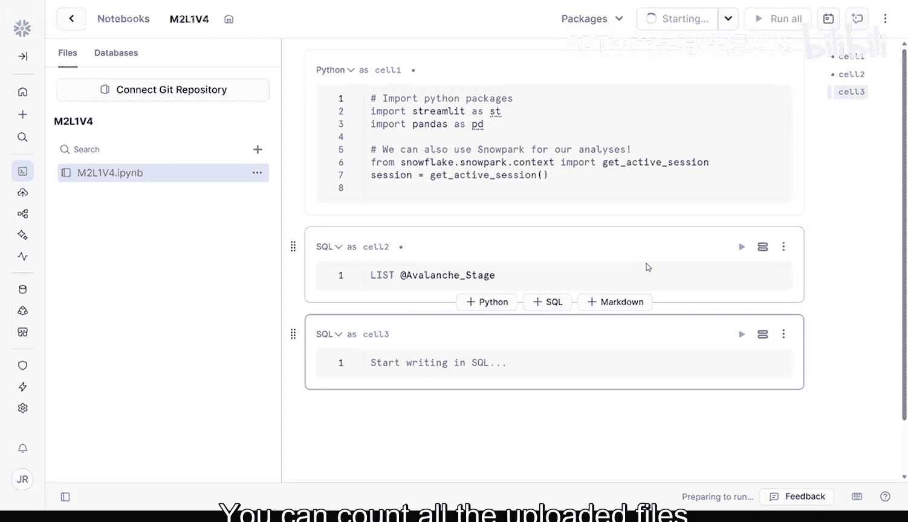
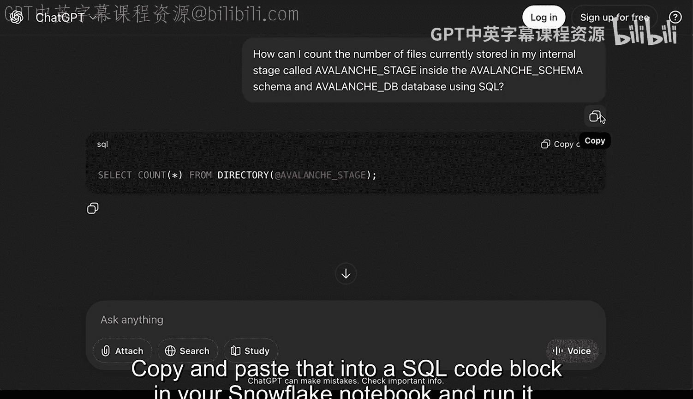
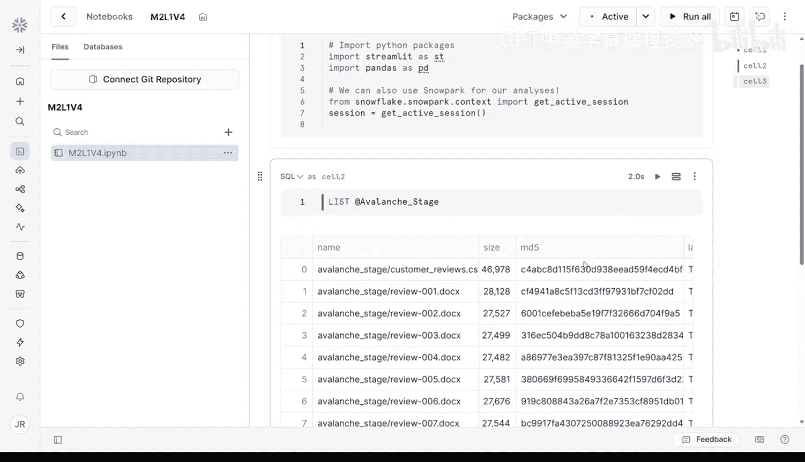

# 吴恩达《用 Streamlit 快速原型开发生成式 AI 应用｜Fast Prototyping of GenAI Apps with Streamlit》 - P23：23_02_09_批量文件上传.zh_en - GPT中英字幕课程资源 - BV1QmYrzMEu1

Sometimes you need to upload a massive pile of files all at once。 And trust me。

 dragging them in one by one is not going to cut it。 In this video。

 you're going to recreate the customer reviews table from scratch。

 but this time you'll do it by combining over 100 word documents into a single table。

 You uploaded a clean Cv version of this data in the last video。

 But now you'll build it the hard way。 before we start loading files。

 let's review why staging is so important。 Snowflake doesn't load files directly into tables。

 Instead， you first upload them to something called a stage。 Remember。

 stages are like a secure holdinging zone for your files。

 They help you preview and validate files before ingestion。

 keep your uploads organized and let you reuse the same files across multiple workflows。

 Loing files to a stage instead of directly。 is' also safer。 If something goes wrong during upload。

 your files aren't lost。 But the good news is that you already created a database schema and。😊。

In the last video well use those again Now。 your database is avalanche Db。

 Your schema is avalanche schema and your stage is avalanche stage。

 Time to upload those 100 word documents Data customer reviews docs do zip from the course Github repo。

 download the zip file， then unzip it locally after you unzip it locally。

 you should see 100 docx files in a folder to get them into snowflake from the snow site homepage on the lefthand sidebar。

 click data， navigate to databases and click on your avalanche Db。 Then select your avalanche schema。

 select stages from the sidebar， then click on stages and select your avalanche stage。

 hit the plus files button on the top right of your screen。

 drag and drop or browse to wherever you store those 100 unzipped words select all 100 works。

 then click on open you'll be presented with a window。Uload your files underneath the window title。

 you should see a small description st that 100 files will be uploaded to your avalanche stage。

 Make sure your avalanche Db and avalanche stage are selected。 then click on upload。

 Even though there are 100 files。 this should move pretty quickly on snowflake。

 Let's use a new snowflake notebook to check that everything made it in as expected from Snow site in the lefthand navigation bar open a new notebook by clicking on projects。

 then notebooks from the notebooks window， click on the bright blue plus notebook button on the top right of the screen。

 Give your notebook a name。 select your avalanche database and schema leave all the other options at default and click on create Once inside of a new notebook。

 delete the bottom to code cells at the bottom of the first code block that contains getactive session。

 which is your connection to your data hover over the cell。

 you see a few options pop up for creating a new cell。Use plus SQL from the list。

Then paste this SQL statement on your keyboard press Shi enterter to run。

 this will return a list of all files in the stage。

You can count all the uploaded files by hand to confirm there are 100。

 but let's do this the easy way。 Ask a gennyi app to help you write a SQL command using a prompt like this。

 How can I count the number of files currently stored in my internal stage called Avalanche stage inside the avalanche schema and avalanche Db database using SQL。

 It should give you back something like this， copypy and paste that into a SQL code block in your snowflake notebook and run it If you're like me。

 and then delete the customer reviews CSv file that we uploaded in the last video。

 you should get count of 101。 Once you've verified the files are uploaded。

 you're ready to move on to the next step， parsing and combining them into a single structure table。

 Let's do that Now。 Great work。 in this video， you reuse the database schema and stage you created earlier。

 downloaded a batch of 100 word docs， uploaded them into your named snowflake stage。😊。

And verified to upload using SQL， you've now mastered batch file uploads in Snowflake。

 and you can fully check off step 2 of your MVP built plan。

 You know how to upload both a single file and a larger batch of files into Snowflake。

