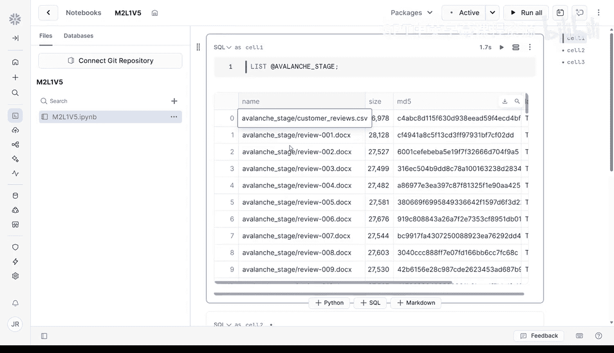
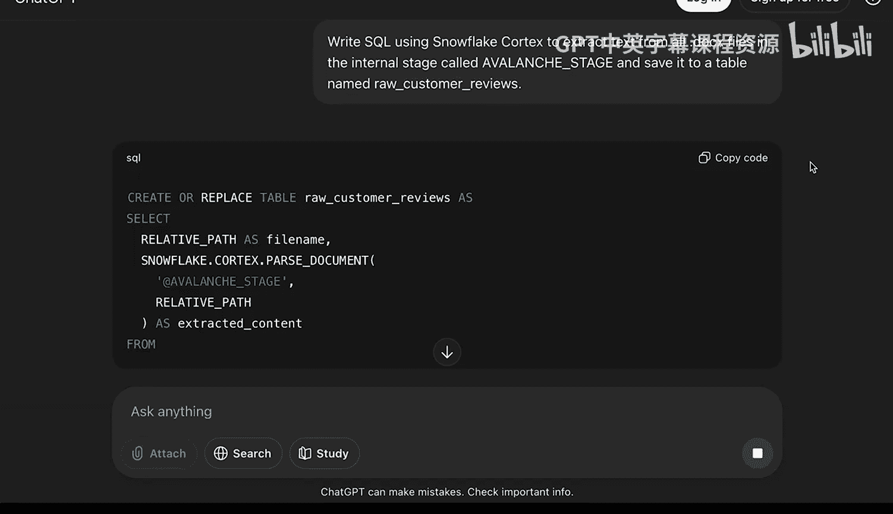
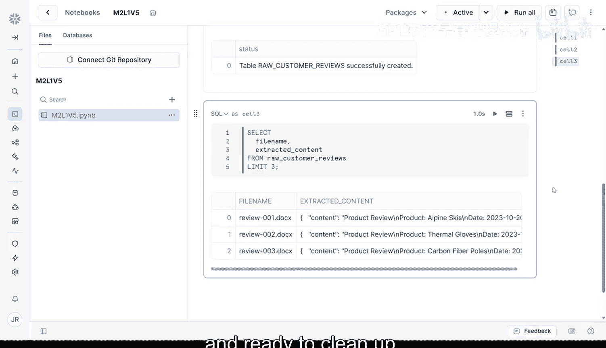
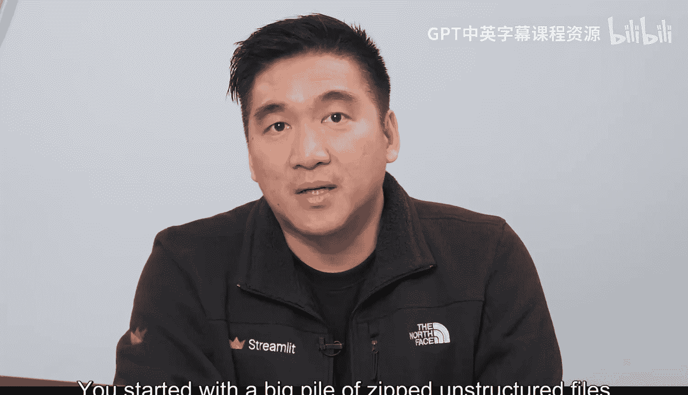

# 吴恩达《用 Streamlit 快速原型开发生成式 AI 应用｜Fast Prototyping of GenAI Apps with Streamlit》 - P24：24_02_10_利用Cortex从暂存区到数据表转换.zh_en - GPT中英字幕课程资源 - BV1QmYrzMEu1

Hello and welcome back。 In the last video， you uploaded over 100 customer review Word docs into your snowflake stage。

 Now you're going to turn that big pile of docs into a single structured table。

 using nothing but Python right here in your snowflake notebook。 Let's get started right now。

 you're moving from step1 of your MVP built plan ingesting data into step 2。

 parsing and structuring So in this video， you're going to use parse document to extract content from each of your staged Word docs。

 automatically create a table with the file name and the extracted text。

 then preview the results in your snowflake notebook to make sure everything worked。😊。

All of this will happen inside a snowflake notebook using the avalanche Db avalanche schema and avalanche stage that you've created earlier。

 Before we jump in， let's quickly revisit why we using cortex Snowflake cortex is a built in set of JdiI tools that lest you process and analyze data using simplesQL No setup required。

 It includes functions like parse document， which you will use in this video that can extract content from docs Pf and text files。

 This means that you don't need to use Python or external libraries to extract text Cortex handles it all for you。

 is fast secure and writein sizeized snowflake。 Let's start by verifying that your files are in the stage in a new SQL cell in your notebook run this line list avalanche stage you should see a list of dotx files one for each customer review。

 If you're seeing 101 files instead of 100 is's probably because customer reviews。

V is still sitting in there from earlier。 To fine。 will filter it out。 As always。

 you can ask your favorite GenI app to help you generate the SQL。

 try something like write SQL using snowflake cortex to extract text from odd dot X files in the avalancheic stage and save it to a table named raw customer reviews。

 It'll probably give you something close to this。😊。

Here's what this is doing。 Directory avalanche stage gives you metadata about every file in your stage。

 Re path is just a file name like review 43 do dots parse document function takes the stage name and file name then extracts the text from the document。

 The result is stored in a table as two columns file name and extracted content as a semistructured JSO object Run this code inside isflake notebook SQL cell Once that finishes。

 make sure everything is working by running the following。

This will show the first few lines of each document。

 so you can sanity check that parsing worked as expected。 If you're seeing results here， Asome。

 that means your 100 word docs are now neatly organized and ready to clean up。 Nice work。

 You just pulled off something pretty advanced。 That's processing over 100 word documents directly inside theflake。

 You see nothing but SQL and cortex。 You started with a big pile of zipped unstructured files。

 And now you've got a clean， queryable table called raw customer reviews。 ready for analysis。😊。

