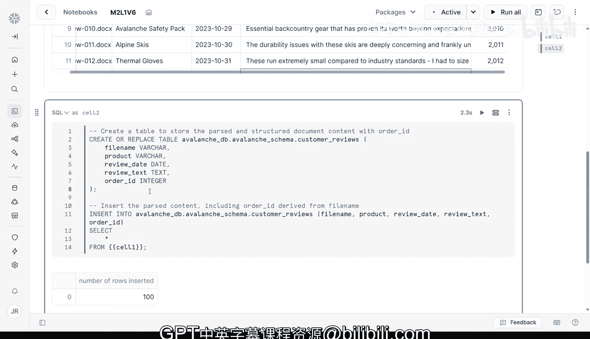

# 吴恩达《用 Streamlit 快速原型开发生成式 AI 应用｜Fast Prototyping of GenAI Apps with Streamlit》 - P25：25_02_11_从内容中提取信息.zh_en - GPT中英字幕课程资源 - BV1QmYrzMEu1

In the last video， you created a table with raw content from your uploaded docx files Now it's time to clean it up In this video。

 you'll extract specific pieces of information from that raw text。

 things like the product name the review date and the review itself and save them to a new table called customer reviews you're use a bit of SQL and regular expressions to get it done if you don't know SQL。

 don't worry， you can ask Jeni for help or copy and paste the code from the course Github repo。

 Let's walk through it in this video you'll quickly go from the raw input customer Cv files into parsed content that is ready for analysis。

 you can parse this data using snowflake notebook and either Python or SQL will walk you through the SQL code here Since it moves a little faster than Python because you're working with a consistent text format across all of the doc X files that makes regular expressions especially useful here you can define a pattern once。

Apply it to every row。 First up the product name。 you'll use the Regx substr function to search for the word product and then grab everything after it up to the next line break that gives you just the product name clean and simple the date of the review same idea you'll use Reggx substr function again but this time you're looking for a specific pattern a date in the yy format。

 for example，20231013 then the review content itself here you'll use a case statement to check whether customer review exists in the content If it does you extract the text that comes after it If not you leave it blank easy Now for a little creativity。

 the order I each file has a three digit number in its name since these files are from batch2。

 you'll create a unique I by putting the number two in front of each files。

umberThis ID will help you connect reviews to shipping records later。 For example。

 if a file number is 045。 your unique ID becomes 2045 Once you've written your full SQL query you' run it on the raw customer reviews table to organize your data into clear columns ready for analysis and now for the most important part it's time to save the results as a table on snowflake so that you could use it later on to do this。

 you can simply add a create table statement like this When you run this cell you will have a cleaned up version of the customer reviews table that you could use downstream Great job in the previous video you started with a big pile of zipped unstructured files and now you've already got a clean queryable table called customer reviews ready for analysis in the next video youll switch datas and start exploring the aval shipping logs to add more depth to your sentiment analysis。

。