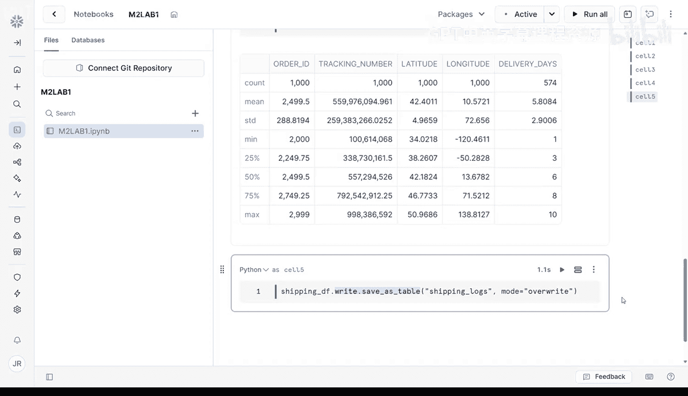

# 吴恩达《用 Streamlit 快速原型开发生成式 AI 应用｜Fast Prototyping of GenAI Apps with Streamlit》 - P26：26_02_13_实验1：雪崩运输分析系统.zh_en - GPT中英字幕课程资源 - BV1QmYrzMEu1

Welcome to the Avalanche shipping lab In the last few videos。

 you uploaded individual files and stage batch data in Snowflake。

 Now it's time to put all those skills together in one real world scenario。 This time。

 you'll be working with avalanche shipping logs because while customer reviews help you understand what people are saying about the items that you sell。

 Shi data helps you understand how delivery affects their sentiment。

 When you combine both you get powerful crossfunctional insight that helps your team makes smarter decisions。

 In this lab， you'll be working with a structured CSv file that contains a log of avalanche's shipping operations。

 Each row represents a shipment and some may have delivery issues that correlate with poor customer reviews。

 let's dive in。😊。

So you've been handed a CSsv file called shippinglogs。

 csv containing avalanche's shipping operations log。

 your job is to upload the file to the avalanche stage Cl and validate the content load it into the snowflake table and prep to clean data for combining with the customer reviews in the next lab you can find everything that you need for this lab in the course Github repo This lab assumes you've already created Avalanche Db avalanche schema avalanche stage If you haven't created these yet go back to the previous videos and walked with those steps before continuing Back in the Snows homepage Start by uploading the shipping logs CSsv file from your local machine into your snowflake account the same way you did with the customer reviews CSv file This time it will be a bit easier since you've already created the database schema and stage from the snows home screen click the plus button on the lefthand navigation menu。

And select the last option。 add data in the window that pops up。

 you will see an option to load files into a stage because you will need to clean up the dataset before turning it into a table Next。

 drag and drop or browse to the location on your computer where you downloaded shipping logs csv select the avalanche database schema and stage。

 then click upload Once the file has been uploaded。

 Con it there by running a QuicksQL statement click on projects。

 then notebooks on the top right corner， click plus notebook to open a new snowflake notebook name the notebook。

 select the avalanche database as schema， leave the other options at default as you've done before。

 Give it a name like testing then click on plussQL to add a new SQL cell copy and run the following command This will list all the files currently stored in your stage If you see shipping logs csv you're good to go next。

In your snowflake notebook， add a Python cell and paste in the following code。

 this code block reads your shipping log file from the avalanche stage into a snowpar data frame。

 Get active session， connects your notebook to a snowflake compute session。

 S do read do options in first schema true tells snowpar to automatically detect column names and data types。

 Heather true tells snowpark that the first row of the file contains the column names。

 not data do Csv Re in your CSsv from the snowflake stage do show gives you a preview of the data just like Df do head function in pandas。

 Click on run。Well done Now you have shipping data in the snowpar data frame。

 you can use Python and snowpar to clean and explore the data in the data frame preview。

 you can see that the column names have quotes around them you can fix that pretty easily by updating them with an alias to redeem the columns like this Snowpar loads column names exactly as they appear in the file including quotes capital letters and spaces by using Co and alias。

 you're using snowflakesQL dialect to directly edit the column names Once your column names are cleaned up。

 you can do things like count how many shipments each carrier made and switch to pandas for quick prototyping in general is a good idea to use pandas when working locally with smaller datas and snowpar when you want scalable and platform analysis on your own take this time to clean up the data by checking for nulls making sure measured units make sense and whatever else you normally do to prep a data。

If you need help， work with your favorite jI app when your data frame looks good。

 save it to a new table using the df dotright do saveas table function。

 This will permanently register your cleaned shipping lock data frame as a table inside your avalanche database so it can be queried using SQL join with other tables streamed into apps or sent to Cortex for JenI analysis。

 Congratulations you are now able to read andwrite data to snowflake。

 This lab will get you ready for the next step in the MVP built plan doing the final data prep and sentiment analysis。

 If you get stuck the solution is in the course Github repo at M2 lab 1 Good luck and see you in the next video。

