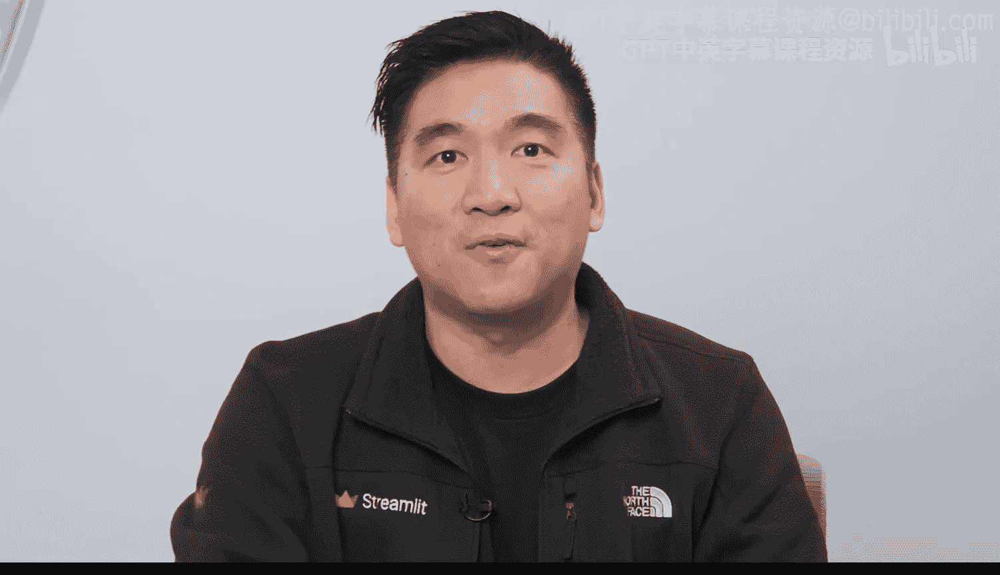
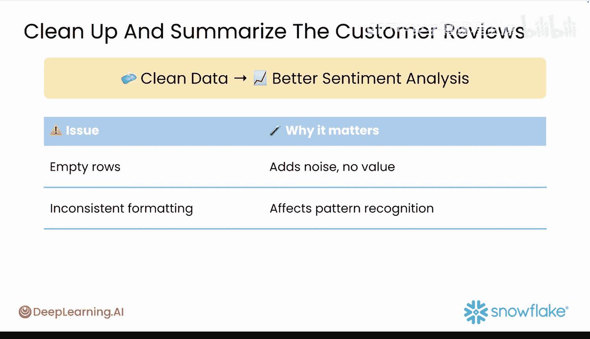
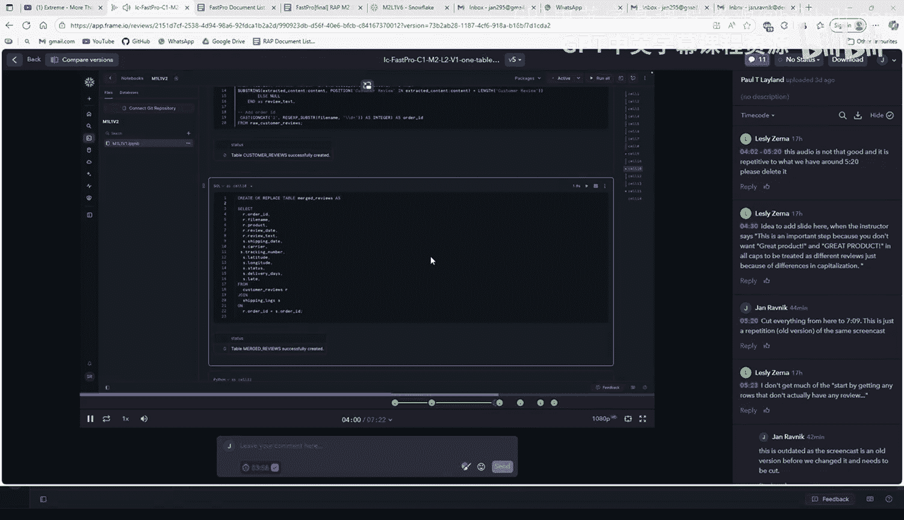
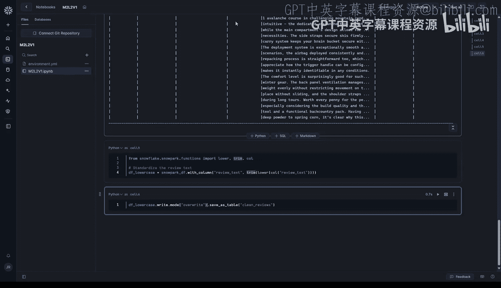

# 吴恩达《用 Streamlit 快速原型开发生成式 AI 应用｜Fast Prototyping of GenAI Apps with Streamlit》 - P27：27_02_01_统一数据表架构.zh_en - GPT中英字幕课程资源 - BV1QmYrzMEu1

Alright， now that you've uploaded， cleaned and structured your customer reviews and shipping logs。

 it's time to bring them together into a unified data set and finish prepping for sentiment analysis In this video。

 you'll be finishing up step 3 of your MVP bill plan。

 cleaning up data by bringing together the avalanche customer reviews and the shipping logs and doing a final bit of parsing to do this。

 you'll be delving into SQL。 So if your SQL is rusty。

 this is the perfect time to ask your favorite Jeni assistant for some help。

 If you've been following along with the previous video and complete lab1。

 you should already have the setup and data that you're going to need in this video If not。

 make sure to go back and complete videos  one to3 of module 2 you will be working inside the avalanche DB Avalanche schema and avalanche stage from there。

 you'll be joining together two of the tables that you've created customer reviews and shipping。

To help you do the heavy lifting， you'll be using snowflake cortex。

 Remember Cortex Cortex is snowflakes built in GenI engine。

 Think of Cortex AI as a collection of AI tools that are already built into snowflake Cortex。

 lest you do things like easily generate and run SQL queries quickly parse documents and extract text。

 summarize and classify content and analyze data using large language models all without leaving snowflake。

 you've seen cortex in action already。 Now you'll be using it to join。

 clean and prepare your tables for se analysis。You'll be writing SQL directly inside a snowflake notebook。

 but don't feel like you need to come up with queries from scratch Since those tables were created way back in the last couple of videos。

 it might be helpful to ask your Geni app to refresh your memory on what those tables contain Open a snowflake notebook and write snowflake SQL to preview the customer reviews and shipping logs tables。

 You can do this quickly by asking your Geni app to help with a prompt like write snowflake SQL to show me a preview of two tables named customer reviews and shipping logs。

 it'll probably give you something like this。 Run the SQL code one by one to get a refresher on what the column names are in each table and other useful details similar to what is shown when you use the pandas describe method Next。

 Ask your Geni assistant something like write snowflake SQL to join two tables customer reviews。

And shipping logs on order Id include review tax， shipping， date， carrier and status。

 It'll probably give you something like this。 If things don't work on the first try。

 copy and paste any error messages you get into your Geni app and it'll help you troubleshoot Once your tables are merged check the results by taking a look at the first 10 lines of the merged data frame with a quick SQL select statement。

 select off from merged review limit to 10。 Congratulations。

 now your tables are joined and every customer review has its shipping information in the same role before sentiment analysis is a good idea to clean up and summarize the customer reviews。

 you might be wondering why you need to spend time cleaning up the customer reviews when you're just going to feed it to an AI model。

 first sentiment analysis anyway， it's true that Jeni models do a good job processing whatever data you give them but the quality of your result。

Still depend on the quality of your input data For example。

 empty roles don't provide use for information for analysis Inconsistent formatting can make it harder to get consistent results when you're doing text analysis or searching for patterns So when you clean your data first。

 you're setting yourself up for better results and a more efficient process back in your snowflake notebook It's time to clean up your review text by converting it to lowercase This will make it easier to search and match text later in your analysis start by converting your merged reviews table into a snowpar data frame then apply snowpar's lower function to standardize the review text column so that all text appears in lowercase format Next use trim to get rid of any extra spaces that might be hanging around at the beginning or end of the reviews This is an important step because you don't want great product and great product in capital letter in all caps to be treated。

As different reviews just because of differences in capitalization getting the review text standardized now means your analysis will be more accurate and consistent Now is time to save your work。

 This line of code creates a new table in snowflake called cleaned reviews to store your cleaned up customer reviews the mode overrite argument means that if there's any other table with the same name Python will write over it to avoid duplicating table names。

 be careful with this so you don't accidentally write over a table you mean to keep okay run this block and now you've got a solid clean data set that's ready for whatever analysis you want to throw at it。

Nice work Now that your data is clean and organized， you're ready for the fun stuff。

 the next step is to bring in JenI to provide you with coding assistance that you'll use in the Snowflake platform。

