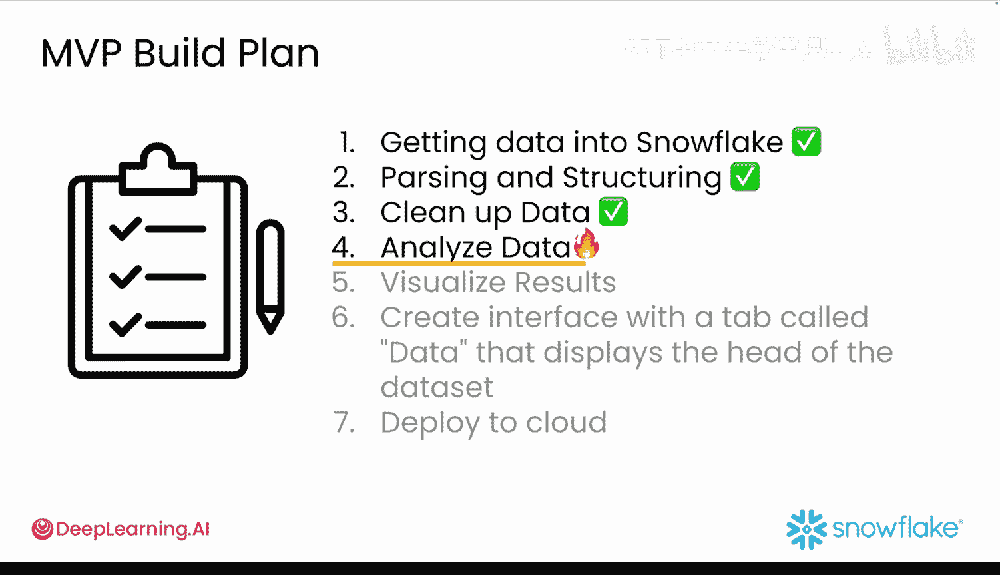
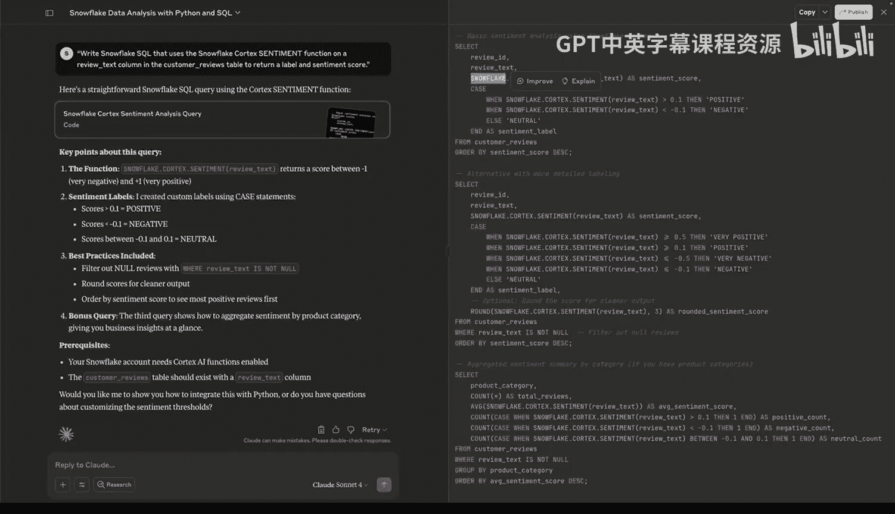
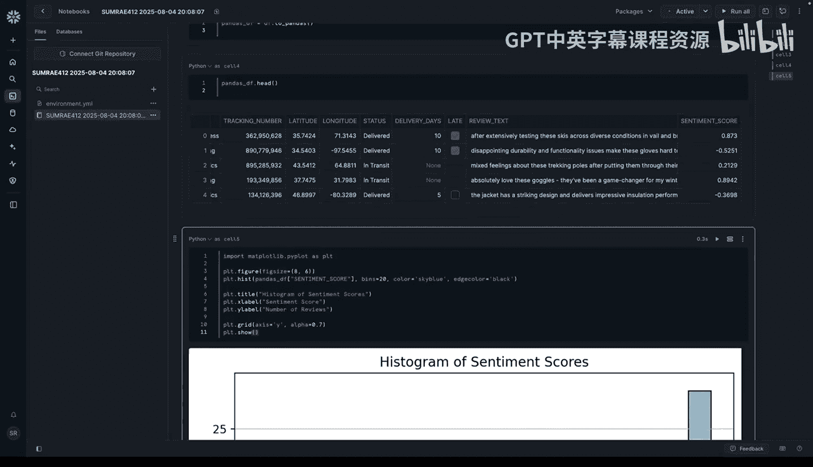
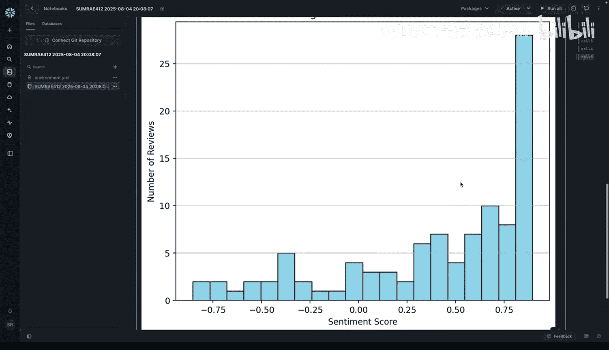

# 吴恩达《用 Streamlit 快速原型开发生成式 AI 应用｜Fast Prototyping of GenAI Apps with Streamlit》 - P28：28_02_02_基于Cortex的舆情分析.zh_en - GPT中英字幕课程资源 - BV1QmYrzMEu1

In this lesson， you'll use cortex functions to perform sentiment analysis on the avalanche customer reviews instead of writing code manually。

 you'll leverage Geni tools to speed up your workflow time to bring back the MVP bill plan and check on where we are in the process This video will take you through step 4 analyzing the data Since the data has already been cleaned and prepped this project should go pretty quickly open a new snowflake notebook in Snows and make sure you've selected Avalanche DB and avalanche schema and leave everything else at default go ahead and run the first code block to instantiate your snowflake session Then delete the two default code blocks and you're ready to go Now it's time to ask your gennyi app to help you choose cortex for sentiment scoring First set a role with a statement like this You are a snowflake data platform expert specializing in Python and SQL integration your role is to teach snowflake for data。

Alysis by providing the most straightforward beginner friendly solutions and then use a prompt like this to get sentiment scores write snowflake SQL that uses the snowflake cortex sentiment function on a review text column in the customer review table to return a label and sentiment score you should get a query something like this one that uses a snowflake SQL Since it's the most straightforward way to get a sentiment score for your data frame here Cortex uses sentiment on the review text column to return a sentiment score for every review you can run the query in your notebook using a one liner that loads results into a panda data frame then you can view the results with pandas the F dot head function the resulting data frame has the original review text and a sentiment score for every review This operation was quick because Cortex processed the scoring at scale inside snowflake。

That we have sentiment scores it's easy to visualize the score distribution using a histogram in Matplotlib Oh look we're getting a module not found error let's install the Maplotlib package to install packages head to the top right of your notebook and click on packages in the dropdown menu that pops up leave the selection at Ananaconda packages only use stage packages if you need to manually install something rather than use Pip or Conda in the search bar search for the package you want to install Matpllootlib once it finds the package it will show up in the list of things to be installed just click on save and you are good to go Now go back and run that code block。

Okay， it's time to save your work， this line of code creates a new table in Snowflake。😡。

Throughout this process JenI can help you ask what functions are available in Cortex。

 write and debug Python， parse and extract data from complex fields。

 visualize the output in MapplotL or Stlib and suggest error handling or model alternatives in this lesson you use JenI to generate code。

 scored reviews with Cortex sentiment function than visualize the results with MaPPloLib Next up you'll keep working with JennyI to add more visuals and interactivity to your Avalanche app。

