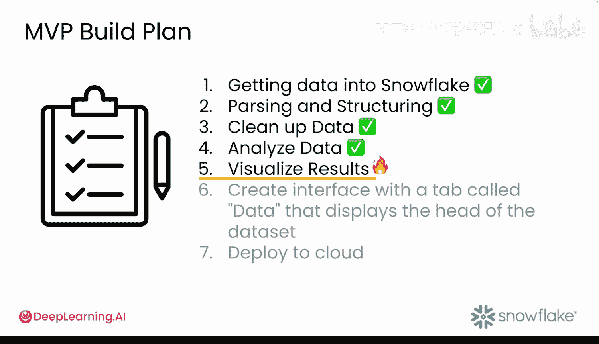
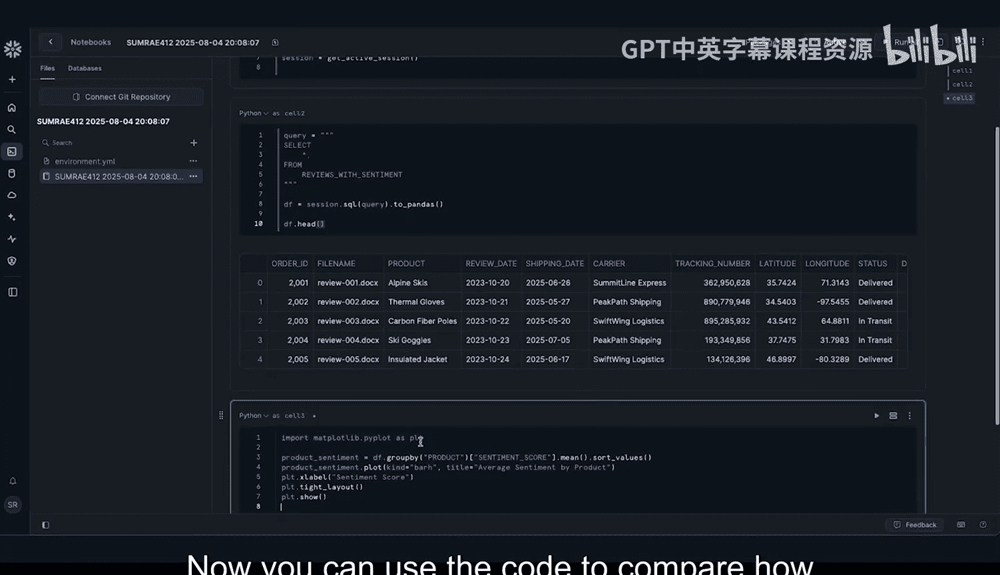
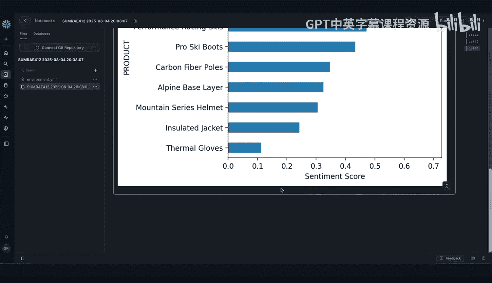
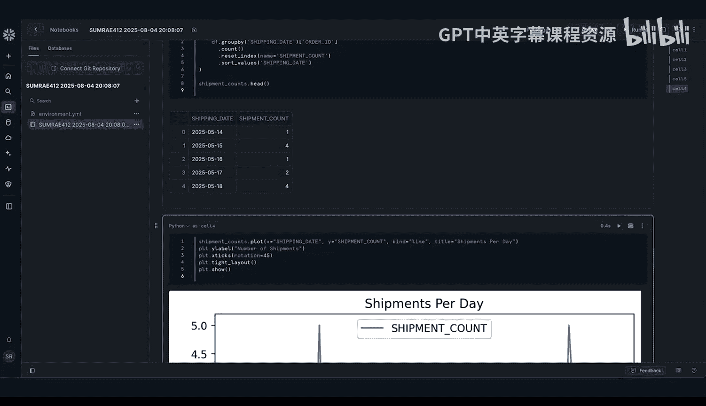
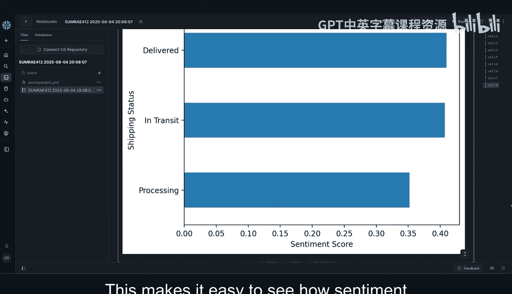
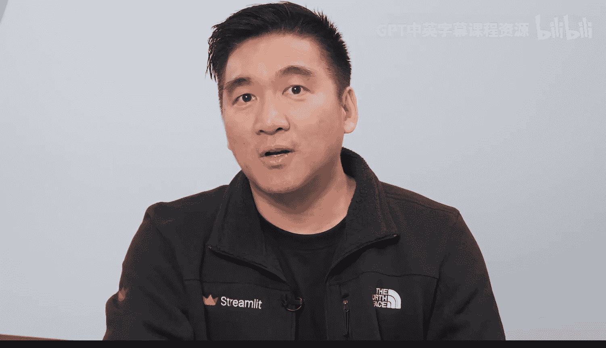

# 吴恩达《用 Streamlit 快速原型开发生成式 AI 应用｜Fast Prototyping of GenAI Apps with Streamlit》 - P29：29_02_03_Snowflake数据可视化.zh_en - GPT中英字幕课程资源 - BV1QmYrzMEu1

Instead of just looking at individual reviews or shipping records。

 you'll use AI to analyze sentiment at scale to spot trends that would be impossible to catch manually Visizing this joint table becomes the foundation for your final streamlet prototype turning raw sentiment data into visual insights that teams can actually act on You've just completed a major milestone data analysis is officially complete Time to check off step4 from your MP bill plan and move into step 5 Vi data exploration This is where your insights transform from numbers into stories that teams can easily understand and act on Start things off by asking Geni to help you brainstorm a prompt like what kind of graphs can I create from the avalanche customer reviews and shipping logs This could get you some suggestions like at a bar chart of sentiment label counts create a line chart of average sentiment over time。

 make a scatter。

Of shipping time versus sentiment or perhaps makega group bar chart by carrier or region to keep things prototype simple。

 Pick just one or two to start with open a new notebook and instantiate your snowflake session then use this query to pull in the reviews with sentiment scores Since you visualize sentiment scores with a histogram in the previous video This time let's break out sentiment scores by product to get the code quickly ask Geni how can I group sentiment scores by products。

 Now， you can use the code to compare how customers feel about different products。 Next。

 ask Jeni to help you visualize shipping patterns and anomalies using a time series you should get back something like the following Now instead of searching for anomalies the old fashioned way ask Jeni to help you dig deeper by using a prompt like how can I identify dates with lowship volume。

Sps then you could use that insight to add more charts。 for example。

 this one that groups by carrier Now you can take advantage of the merged reviews and shipping data to see if delivery affects customer sentiment。

 Let's prompt GenI to create a bar chart showing average sentiment by shipping status GenI must suggest this code that groups the data set by shipping status using the late column then calculates the mean sentiment score for each group to sort the data frame。

 The results are plotted using a horizontal bar chart from that plotlib that shows the average sentiment by shipping status。

 This makes it easy to see how sentiment score was affected by late deliveries。 In this lesson。

 you use JenI to quickly brainstorm and create visualizations Next up。

 you'll combine all that you've learned in this module into a term app that you can run and deploy inside of snowflake。

