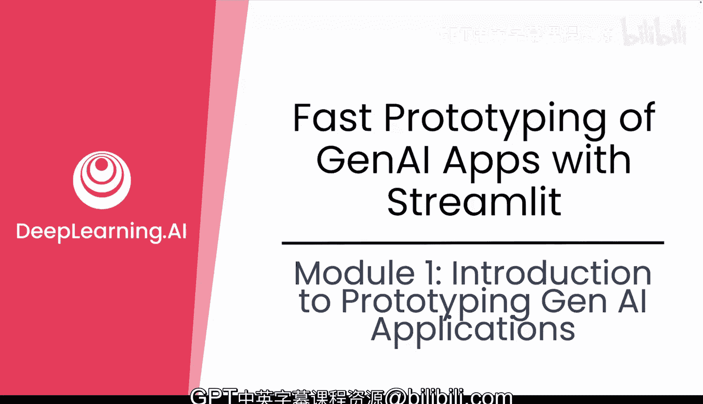
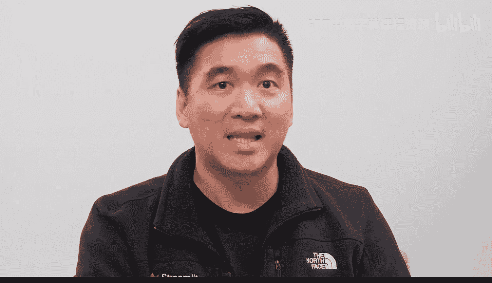
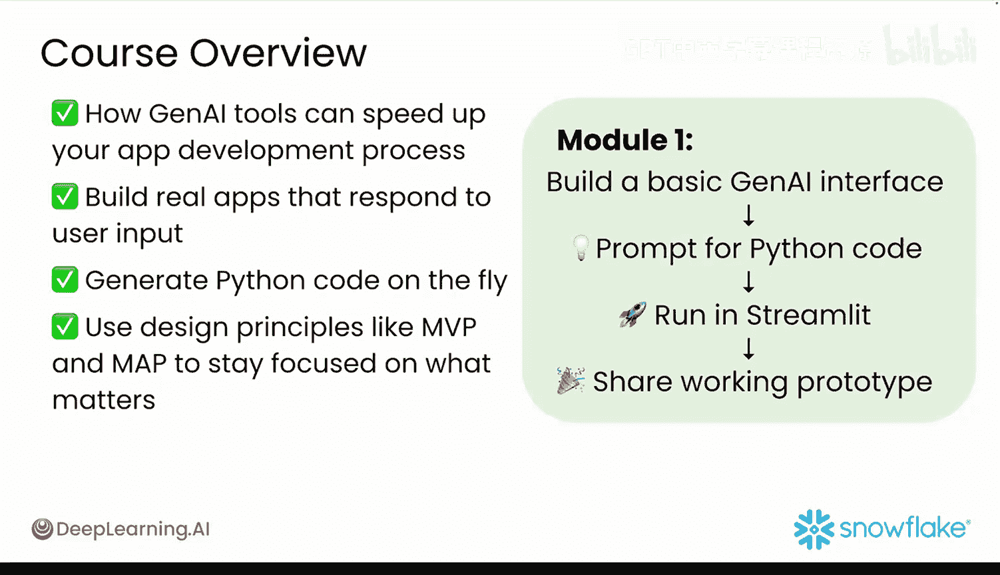
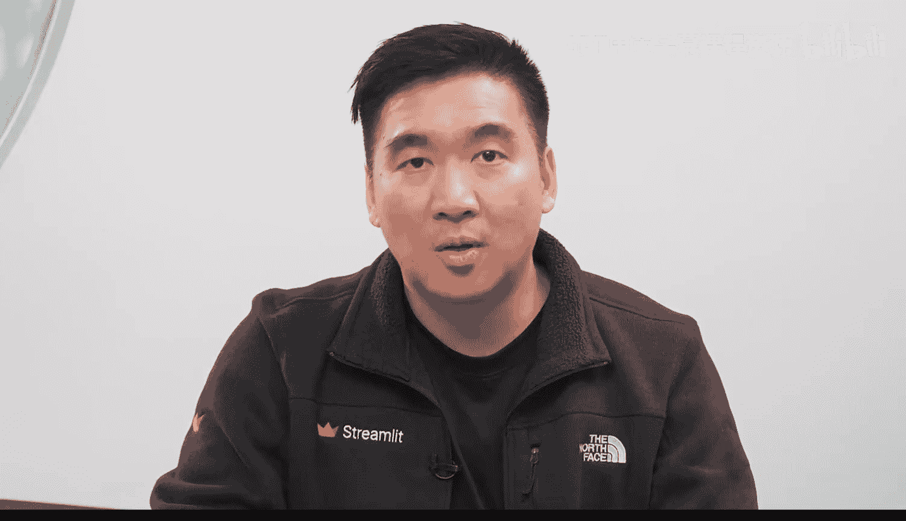
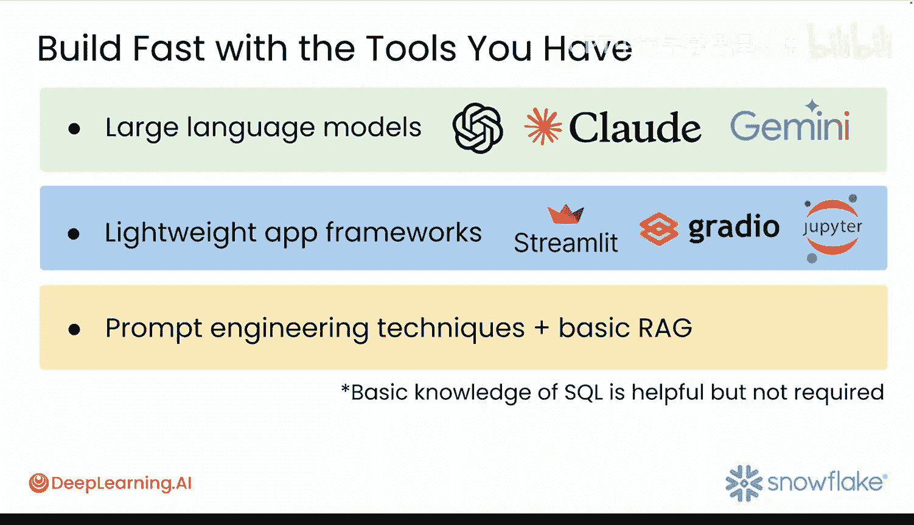
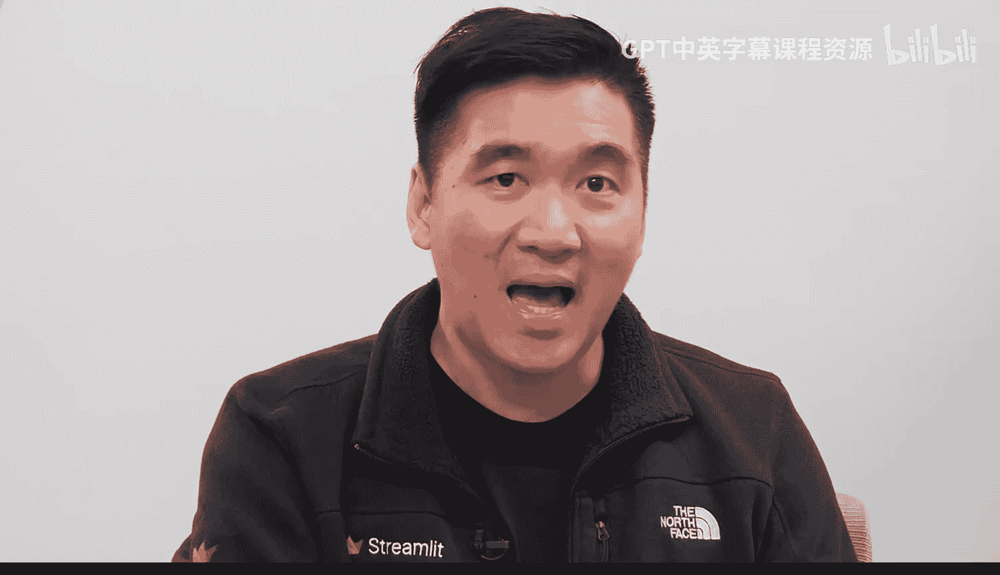

# 吴恩达《用 Streamlit 快速原型开发生成式 AI 应用｜Fast Prototyping of GenAI Apps with Streamlit》 - P2：02_01_02_生成式AI应用原型设计入门.zh_en - GPT中英字幕课程资源 - BV1QmYrzMEu1

Welcome， you're about to learn how to rapidly prototype Geni apps using Python and streamlit software development has changed instead of writing every function yourself。

 Geni can now act with your coding partner。 you give an idea it returns working code The goal of this course isn't to show off tools is to help you build things that actually work fast you move from simple command line scripts to web apps that are fully equipped with charts。

 data analysis and interactive chat bos。 This course is structured to move quickly with handson projects that will help you learn by building by the end of the first module you'll have a fully working prototype that takes user input generates code runs it live in the web interface and visualizes the data In this course you're going to learn how Geni tools can speed up your app development process build real world apps that respond to user input and generate Python code on the fly and apply design principles like minimum。

😊。

Viable product or MVP and mission audience priorities or map to stay focused on what matters。

 The first module focuses on helping you build a basic geni interface to showcase your idea prompt a geni model to generate Python code and help you run code inside a shareable streamlet app as a final result。

 you have a working prototype powered by Geni deployed to the cloud that's ready to test or share。

 You have the option to use tools like large language models such as chattBT cloud Gemini lightweight app frameworks like streamlet Gio or juvennal books and use prompt engineering techniques and basic W setups If you're comfortable coding and Python and familiar with Geni and the basics of prompting。

 this course is perfect for you。 basic knowledge of SQL is helpful but not required。

 While my examples in this course will use streamlet feel free to experiment with。

We app framework you prefer and whichever JenI model you are comfortable with the goal here is not to master every tool but to learn how to get something working fast in an environment you are comfortable with I hope you will enjoy the course and I'm excited to see you in the next video。

