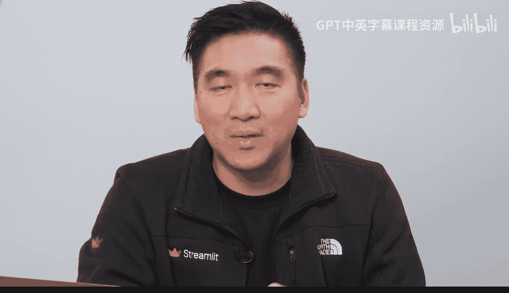
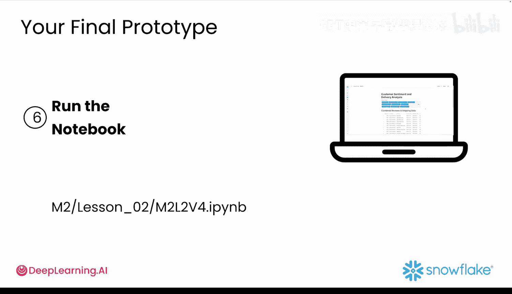
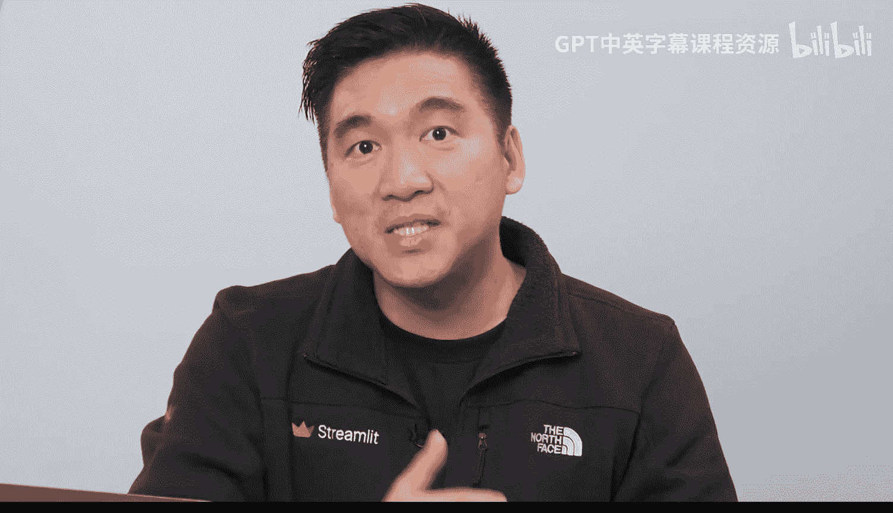

# 吴恩达《用 Streamlit 快速原型开发生成式 AI 应用｜Fast Prototyping of GenAI Apps with Streamlit》 - P30：30_02_04_Snowflake内构建AI驱动的Streamlit应用.zh_en - GPT中英字幕课程资源 - BV1QmYrzMEu1

In the last video， you took a deep dive into your dataset by visualizing it with the help of GenI In this lesson。

 you'll put together everything you've learned in module 2 by building a fully functional streamlet app。

 Your app will include interactive filtering of shipping and review data。

 Viizations using Maplotlibb and streamlet sentiment analysis using cortex。

 and last but not least a built an Lm assistant for dynamic Q and A on your data。 Here we go。

 you are flying through this MVP build plan and already on step 6， creating the dashboard。

 This step is where you finally put together your prototype and get ready to send it out for feedback。

 The hardest parts are done。 data ingestion， cleaning analysis visualization。 You're almost there。

 It's time to bring your prototype to life。 you'll build the avalanche streamlet app right inside the snowflake notebook。

 The same environment you've been working in all along。😊。

E a new notebook and call it something like Avalanche underscore app。

 Make sure to connect it to your existing avalanche database and schema and point it at the table that combines both the customer reviews and shipping data。

 Here's where it gets exciting。 You'll write your entire streamlet app as code in a notebook cell。

 hit run and watch a fully interactive web app appear as the cell output。

 Its like magic except this magic trick becomes a real tool people can use to start。

 make it easy by creating just a basic streamlet shell。

 instead of writing it from scratch either copy and paste code from a previous video or just ask Gennyi to help you with a prompt like write a streamlet app that loads a table on snowflake for sentiment analysis show some basic stats and add a title and cibar。

 your geni app will generate Python code for a basic streamlet app。

 copy and paste the code into your notebook and run the cell。 If something does。😊。

work use JenI to debug or revise the code。 You can ask something like help me fix this error。

 or can you rewrite this function to avoid this error。

 keep testing and iterating until your app runs smoothly Next。

 you can use the charts that you've created in earlier lessons。

 these should include a line chart of shipments per day a bar chart of sentiment distribution and some product level stats or topend product breakdowns。

 you can ask JenI to make a streamlet line chart to show shipment add the code to your app and it will look something like the following。

 you can also ask NAI to help with access labels legends and making the chart interactive。

 Now you can use streamlet widgets to add filters and make your app more interactive and useful prompt GenI for the following add a date and sentiment filter to my streamlet app。

 It should return something like this。Now it's time to get fancy by using Cortex to add a chatbot that can answer questions about the data。

 you can ask JenI to who eat a chatbot in StL that uses its snowflake Cortex to answer questions about the Clean reviews table。

 your JenI app will likely return something like the following and a call like this one。

In order to use cortex in Python， you need to install a snowflake M Python package from the dropdown menu in your notebook。

 So don't forget to do that。 This gives your users a friendly interface to ask questions like what's the average sentiment for product A or why were there fewer shipments on this particular date。

 run the notebook and now you've got a live chatbot inside your gen prototype。

 If you got stuck anywhere。 Don't worry， you can find the code in the course module at this link。

 Well done。 You've turn your sentiment analysis into a working strongly prototype in the next module。

 you get to deploy， share and improve your app based on feedback from your users。

 you also learn how to improve your results using advanced gen prompting techniques。

 See you in the lab。😊。

